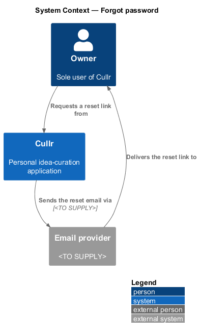
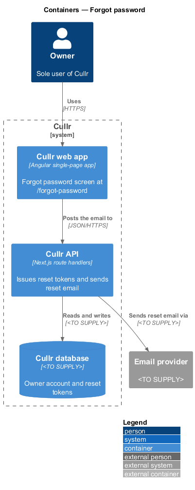
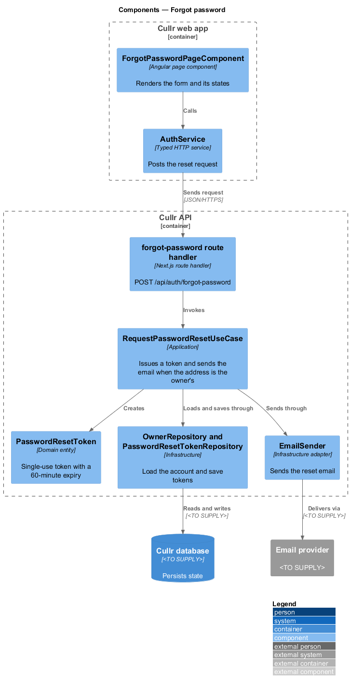
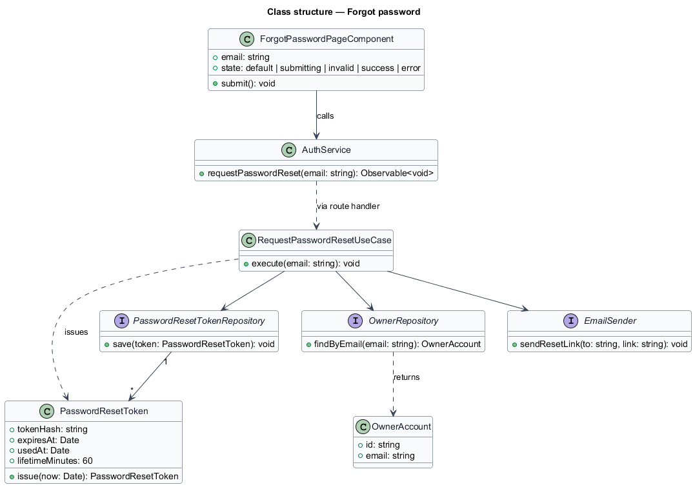
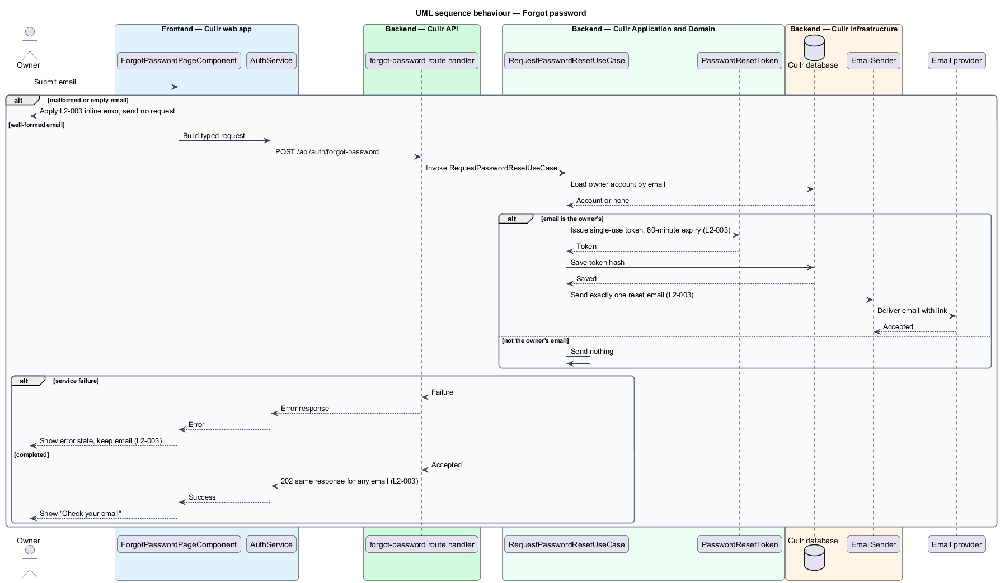

# Forgot password

## Overview

Cullr is a personal idea-curation application with a single user, the owner. When the owner forgets the password, the *forgot password* capability sends a reset link to the owner's email address. The link leads to the Reset password screen, which the `reset-password` feature describes.

*Reset link* is a single-use URL containing a secret token that authorizes one password change. Sending it by email proves control of the mailbox without exposing the password. The Forgot password screen (`/forgot-password`) is reachable without signing in.

## Description

The feature is a vertical slice from the Forgot password screen to an external email provider.

- **`ForgotPasswordPageComponent`** — Angular page component in the Cullr web app. It renders the email form and the mock states `default`, `submitting`, `invalid`, `success` and `error`.
- **`AuthService`** — typed HTTP service. It posts the email to the API.
- **forgot-password route handler** — Next.js route handler at `POST /api/auth/forgot-password`. It invokes the use case and returns the same response for any well-formed email.
- **`RequestPasswordResetUseCase`** — application-layer use case. It loads the owner account by email. When the email is the owner's, it issues a token, stores it and sends the email.
- **`PasswordResetToken`** — domain entity for a single-use token. It expires 60 minutes after issue. Only a hash of the token is stored; the hashing method is `<TO SUPPLY>`.
- **`OwnerRepository`** and **`PasswordResetTokenRepository`** — infrastructure repositories over the Cullr database. The database technology is `<TO SUPPLY>`.
- **`EmailSender`** — infrastructure adapter to the Email provider. The provider and transport are `<TO SUPPLY>`.

Key behaviours, by acceptance criterion:

- Any well-formed email shows the success state "check your email", whether or not the email is the owner's (`L2-003`, criterion 1). The response does not reveal which case applied.
- When the email is the owner's, exactly one reset email is sent. It contains a single-use link that expires in 60 minutes (`L2-003`, criterion 2).
- A malformed or empty email shows an inline error and sends no request (`L2-003`, criterion 3).
- A service failure shows the error state and keeps the typed email (`L2-003`, criterion 4).

The success mock states an expiry of 30 minutes, which differs from the 60 minutes in `L2-003`. The requirement governs, and the mock copy should align with it.

## Requirements

The feature realizes the following level-2 (L2) requirements. Each L2 requirement refines a level-1 (L1) requirement, cited by identifier.

| L2 ID | Refines (L1) | Requirement |
|-------|--------------|-------------|
| `L2-003` | `L1-001` | Forgot password. The Forgot password screen (`/forgot-password`) must send a reset link. |

## Diagrams

### System context

The owner requests a link from Cullr, which sends the email through the external Email provider.

### Containers

The Cullr API stores the token in the Cullr database and hands the message to the Email provider.

### Components

The page and client run in the browser. The route handler, use case, token entity, repositories and `EmailSender` run in the Cullr API.

### Class structure

The use case issues a `PasswordResetToken` and depends on two repositories and the `EmailSender` interface.

### Forgot-password sequence

The sequence shows validation, the owner and non-owner branches, and a service failure.

