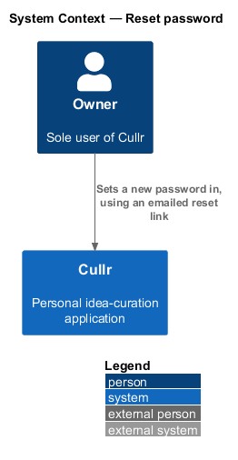
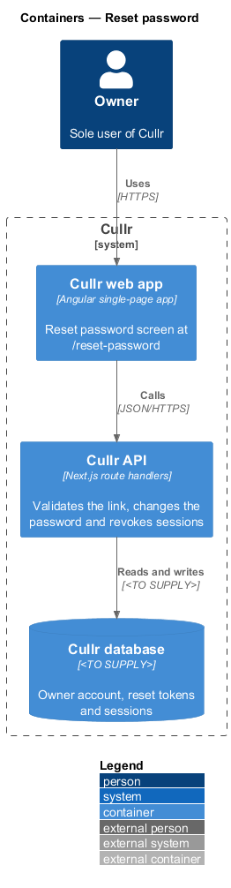
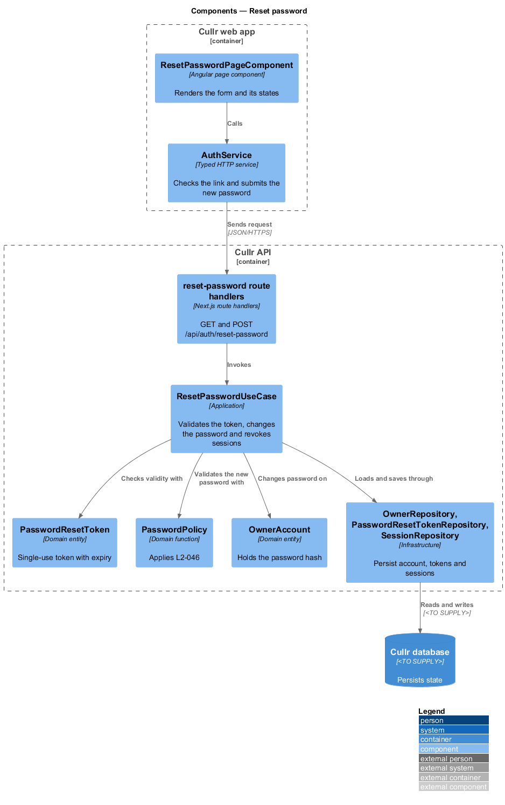
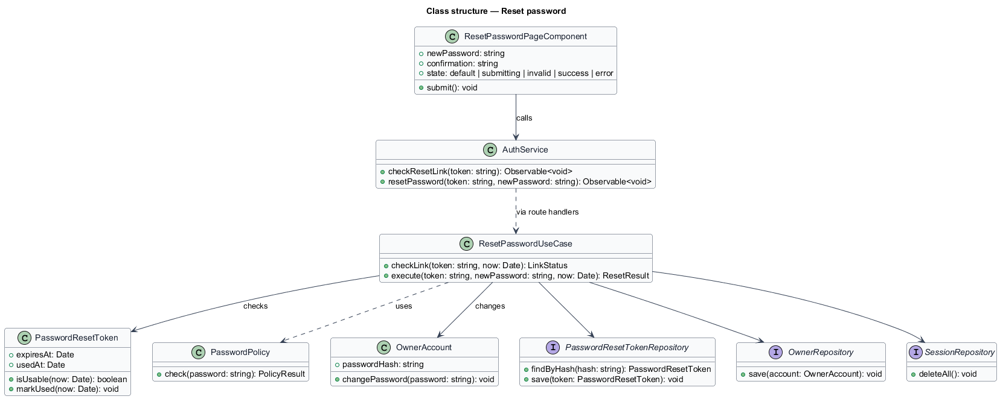
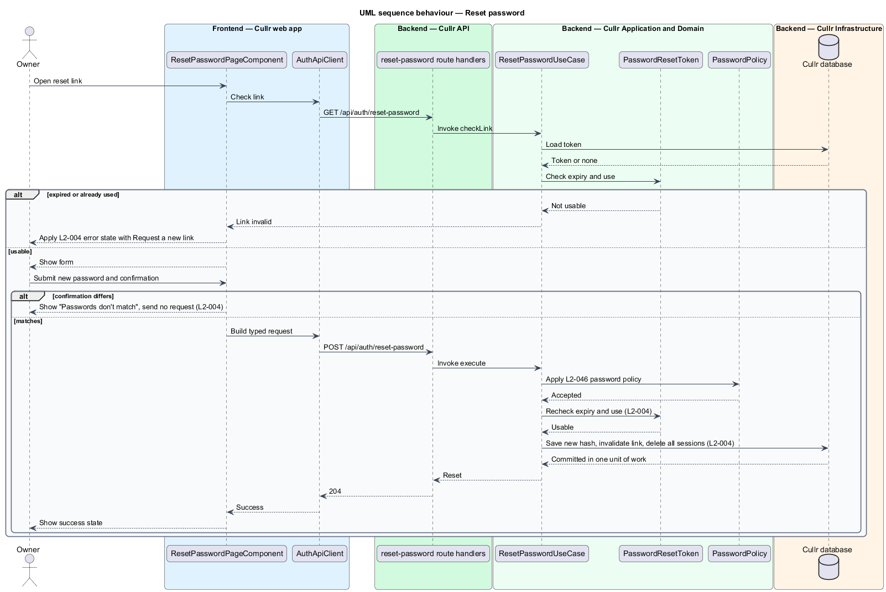

# Reset password

## Overview

Cullr is a personal idea-curation application with a single user, the owner. *Reset password* is the capability that lets the owner choose a new password after following the reset link sent by the `forgot-password` feature.

The Reset password screen (`/reset-password`) is reachable without signing in. The reset link is a single-use URL that expires 60 minutes after issue (`L2-003`). A successful reset invalidates the link and revokes every existing session, so that anyone holding an old session loses access.

The password policy that a new password shall satisfy is defined by `L2-046` and is owned by another feature. This feature applies the policy and does not restate it.

## Description

The feature is a vertical slice from the Reset password screen to the Cullr database.

- **`ResetPasswordPageComponent`** — Angular page component in the Cullr web app. It checks the link on open, then renders the new password and confirmation fields and the mock states `default`, `submitting`, `invalid`, `success` and `error`.
- **`AuthService`** — typed HTTP service. It checks the link and submits the new password.
- **reset-password route handlers** — Next.js route handlers at `GET /api/auth/reset-password` (link check) and `POST /api/auth/reset-password` (password change).
- **`ResetPasswordUseCase`** — application-layer use case. It validates the token, applies the password policy, changes the password, invalidates the token and deletes all sessions in one unit of work.
- **`PasswordResetToken`** — domain entity. Its `isUsable` method returns false when the token has expired or has been used.
- **`PasswordPolicy`** — domain function that applies `L2-046`.
- **`OwnerAccount`** — domain entity whose `changePassword` method replaces the password hash. The hashing algorithm is `<TO SUPPLY>`.
- **`OwnerRepository`**, **`PasswordResetTokenRepository`** and **`SessionRepository`** — infrastructure repositories. The database technology is `<TO SUPPLY>`.

Key behaviours, by acceptance criterion:

- A valid unexpired link, a policy-compliant password and a matching confirmation change the password, invalidate the link and show the success state (`L2-004`, criterion 1).
- A confirmation that differs shows "Passwords don't match" inline and sends no request (`L2-004`, criterion 2).
- An expired or already-used link shows the error state, which explains that the link is no longer valid and offers a "Request a new link" action. The check runs on open and again on submit (`L2-004`, criterion 3).
- A successful reset revokes every existing session (`L2-004`, criterion 4).

### Screen composition

The Reset password page entry of `docs/screen-composition.md` lists the following components. The implementation shall use them and shall build locally only the UI marked local.

- **Library:** `card`, `form-field`, `text-field`, `button`, `alert` (error and invalid), `dialog` (`.dialog__icon--info`, reused standalone for the success checkmark).
- **Local:** the Auth shell (`.auth-layout` + `.auth-card`), built once and shared by Sign in, Forgot password and Reset password.

## Requirements

The feature realizes the following level-2 (L2) requirements. Each L2 requirement refines a level-1 (L1) requirement, cited by identifier.

| L2 ID | Refines (L1) | Requirement |
|-------|--------------|-------------|
| `L2-004` | `L1-001` | Reset password. The Reset password screen (`/reset-password`) must set a new password from a reset link. |

## Diagrams

### System context

The owner sets a new password in Cullr by using the emailed link. No external system participates in this step.

### Containers

The Cullr API reads and writes the account, tokens and sessions in the Cullr database.

### Components

The page and client run in the browser. The route handlers, use case, domain types and repositories run in the Cullr API.

### Class structure

`ResetPasswordUseCase` coordinates the token, the password policy, the account and three repositories.

### Reset-password sequence

The sequence shows the link check, the mismatch branch and the commit that changes the password, invalidates the link and revokes all sessions.

