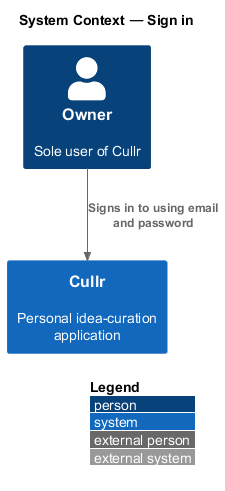
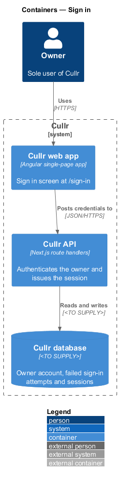
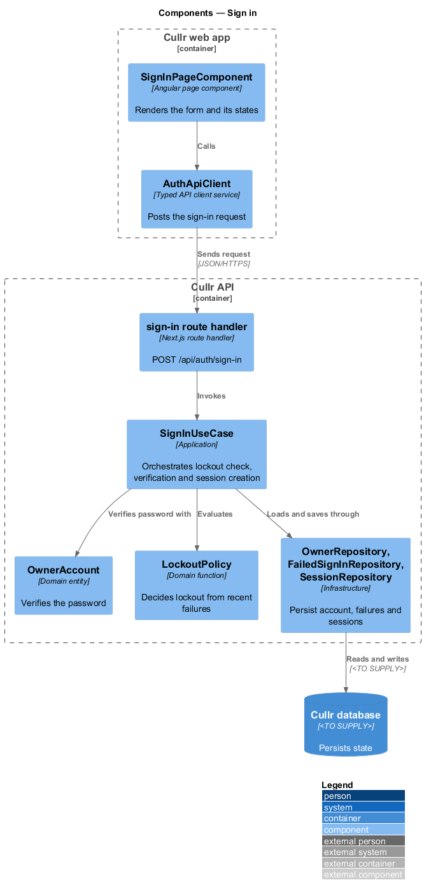
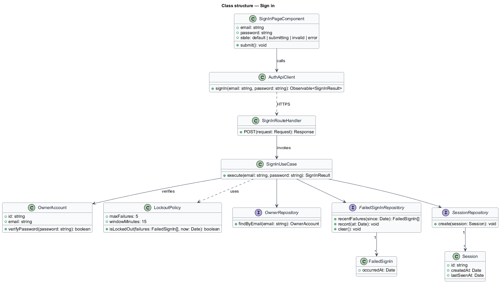
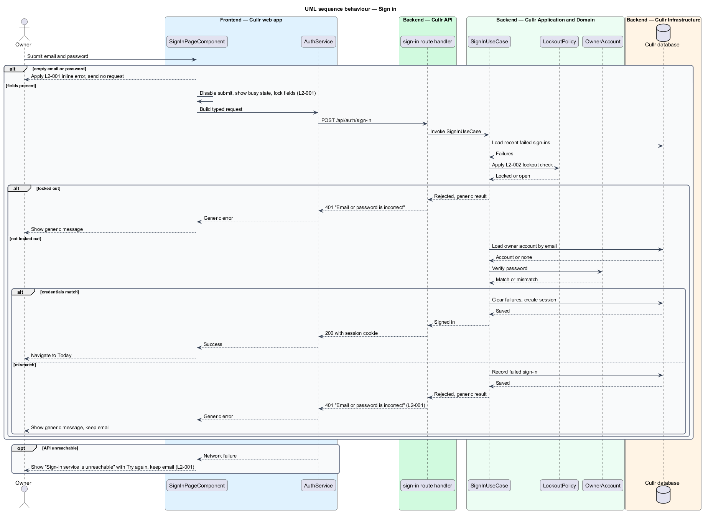

# Sign in

## Overview

Cullr is a personal idea-curation application with a single user, the owner. *Sign in* is the capability that lets the owner prove identity with an email address and a password so that the protected screens, starting with Today, become available.

The feature covers the Sign in screen (`/sign-in`) and the server-side check behind it. It also covers *sign-in lockout*, the rule that temporarily rejects further attempts after repeated failures. Lockout limits password guessing against the single account.

*Session* is the server-side record that keeps the owner signed in after a successful attempt. Session creation belongs to this feature. Session expiry and sign-out belong to the `sign-out-and-session` feature.

## Description

The feature is a vertical slice from the Sign in screen to the Cullr database.

- **`SignInPageComponent`** — Angular page component in the Cullr web app. It renders the email and password form and the mock states `default`, `loading`, `submitting`, `invalid` and `error`. When a signed-in owner opens `/sign-in`, the component redirects to Today (`L2-001`, criterion 6).
- **`AuthService`** — typed HTTP service. It posts the credentials and returns a typed `SignInResult`.
- **sign-in route handler** — Next.js route handler in the Cullr API at `POST /api/auth/sign-in`. It parses the request, invokes the use case and sets the session cookie. Cookie attributes are `<TO SUPPLY>`.
- **`SignInUseCase`** — application-layer use case. It checks lockout, loads the account, verifies the password, records the outcome and creates the session.
- **`OwnerAccount`** — domain entity holding the owner email and password hash. Its `verifyPassword` method compares a candidate password. The hashing algorithm is `<TO SUPPLY>`.
- **`LockoutPolicy`** — domain function that decides whether the account is locked out from the failures recorded within the window.
- **`FailedSignIn`** and **`Session`** — records persisted through `FailedSignInRepository` and `SessionRepository`. `OwnerRepository` loads the account. The database technology is `<TO SUPPLY>`.

Key behaviours, by acceptance criterion:

- Submitting valid credentials signs the owner in and navigates to Today (`L2-001`, criterion 1).
- While the request is in flight the submit button is disabled with a busy state and the fields are read-only (`L2-001`, criterion 2).
- A mismatch of email or password produces one generic message, "Email or password is incorrect". An unknown email and a wrong password are indistinguishable in the response (`L2-001`, criterion 3).
- An empty email or password shows an inline error and sends no request (`L2-001`, criterion 4).
- An unreachable service shows "Sign-in service is unreachable" with a "Try again" action and keeps the typed email (`L2-001`, criterion 5).
- After 5 consecutive failed sign-ins within 15 minutes, a sixth attempt is rejected with the same generic message until the 15-minute window ends. A correct password during the window is also rejected (`L2-002`, criteria 1 and 2).

The lockout response is identical to the mismatch response so the response never reveals that a lockout is active.

### Screen composition

The Sign in page entry of `docs/screen-composition.md` lists the following components. The implementation shall use them and shall build locally only the UI marked local.

- **Library:** `card`, `form-field` (via `field`), `text-field`, `button` (`btn--primary`, `btn--block`, `btn--link`), `alert` (error and invalid), `skeleton` (loading).
- **Local:** the Auth shell (`.auth-layout` + `.auth-card`), built once and shared by Sign in, Forgot password and Reset password.

## Requirements

The feature realizes the following level-2 (L2) requirements. Each L2 requirement refines a level-1 (L1) requirement, cited by identifier.

| L2 ID | Refines (L1) | Requirement |
|-------|--------------|-------------|
| `L2-001` | `L1-001` | Sign in. The Sign in screen (`/sign-in`) must authenticate the owner with email and password. |
| `L2-002` | `L1-001` | Sign-in lockout. |

## Diagrams

### System context

The owner signs in to Cullr with an email address and a password. No external system participates.

### Containers

The Cullr web app posts credentials to the Cullr API, which reads the account and failure history from, and writes sessions to, the Cullr database.

### Components

The page component and HTTP service run in the browser. The route handler, use case, domain types and repositories run in the Cullr API.

### Class structure

The use case depends on the domain entity and policy and on three repository interfaces. The lockout window of 5 failures in 15 minutes lives in `LockoutPolicy`.

### Sign-in sequence

The sequence shows the happy path with the alternates: empty fields, lockout, mismatch and an unreachable service.

