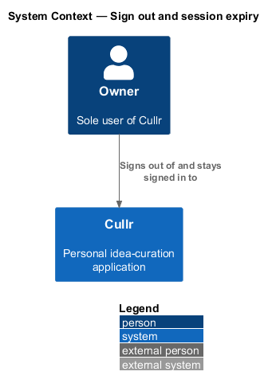
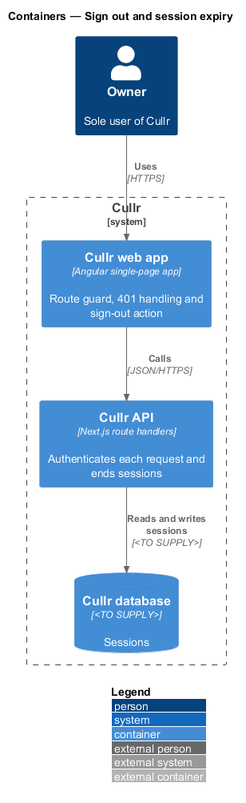
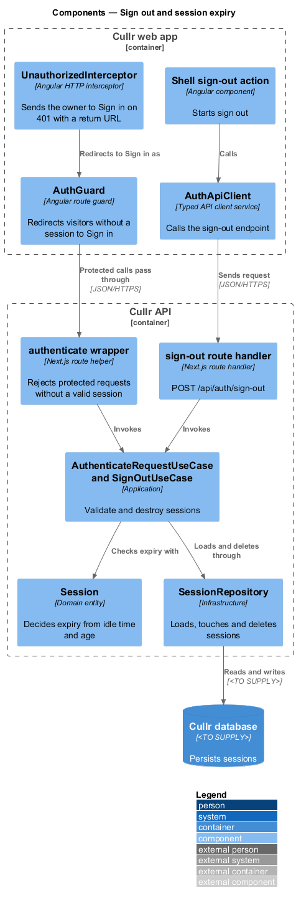
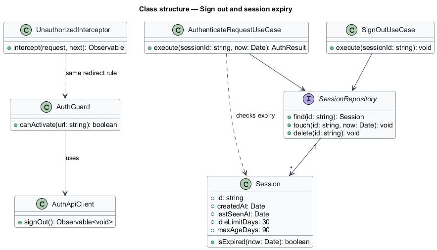
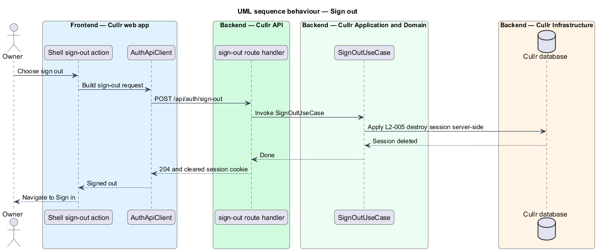
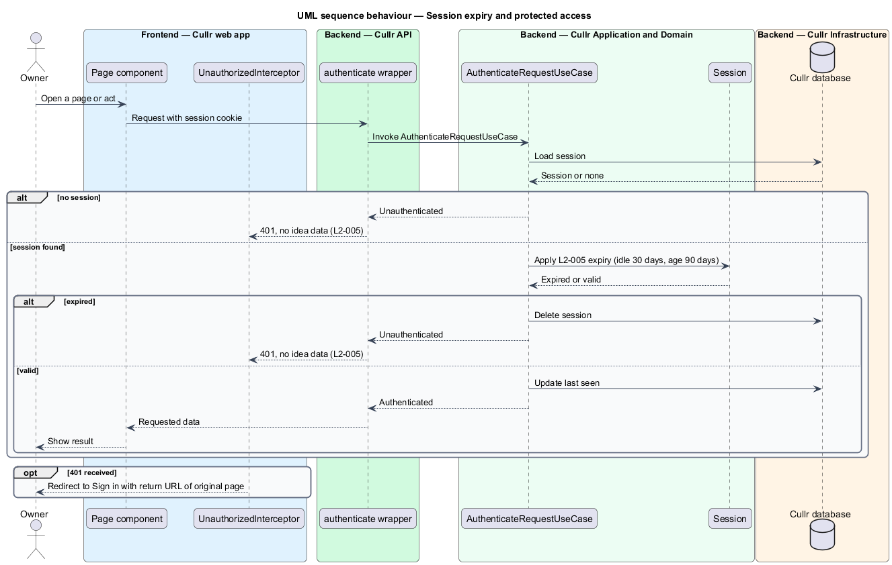

# Sign out and session expiry

## Overview

Cullr is a personal idea-curation application with a single user, the owner. A *session* is a server-side record that keeps the owner signed in between requests. Sessions are created by the `sign-in` feature.

This feature ends sessions and protects the application when no valid session exists. The owner ends a session deliberately through *sign out*. A session also ends by *expiry*, the rule that rejects a session after a period of inactivity or after a maximum age. Every protected screen and API depends on this feature, because it keeps idea data from reaching a signed-out visitor.

## Description

The feature spans the browser and the Cullr API.

- **Shell sign-out action** — control in the application shell that starts sign out from any protected page. After sign out it navigates to Sign in (`/sign-in`).
- **`AuthService`** — typed HTTP service. It calls the sign-out endpoint.
- **`AuthGuard`** — Angular route guard. It redirects a visitor without a session to Sign in.
- **`UnauthorizedInterceptor`** — Angular HTTP interceptor. On a 401 response it redirects to Sign in and passes the original page as a return URL, so the owner returns there after signing in.
- **authenticate wrapper** — Next.js route helper applied to every protected route handler. It invokes `AuthenticateRequestUseCase` and returns 401 without data when the request is unauthenticated.
- **sign-out route handler** — Next.js route handler at `POST /api/auth/sign-out`. It invokes `SignOutUseCase` and clears the session cookie.
- **`AuthenticateRequestUseCase`** and **`SignOutUseCase`** — application-layer use cases. The first loads the session, checks expiry and records last use. The second deletes the session.
- **`Session`** — domain entity. Its `isExpired` method returns true when the session has been idle for 30 days or is older than 90 days.
- **`SessionRepository`** — infrastructure repository over the Cullr database. The database technology is `<TO SUPPLY>`.

Key behaviours, by acceptance criterion:

- Signing out destroys the session server-side, and the owner lands on Sign in (`L2-005`, criterion 1).
- A request on a session idle for 30 days or older than 90 days is rejected. The owner is sent to Sign in and returns to the original page after signing in (`L2-005`, criterion 2).
- A signed-out visitor requesting a protected screen is redirected to Sign in. A protected API request receives 401, and no idea data is returned (`L2-005`, criterion 3).

### Screen composition

The Dashboard top bar entry of `docs/screen-composition.md` lists the following components. The implementation shall use them and shall build locally only the UI marked local.

- **Library:** `top-bar`, `avatar`, `button`, `tooltip`.
- **Local:** none. The sign-out action sits in the account area of the top bar. `<TO SUPPLY>`: the mocks and the composition map do not itemize the sign-out control..

## Requirements

The feature realizes the following level-2 (L2) requirements. Each L2 requirement refines a level-1 (L1) requirement, cited by identifier.

| L2 ID | Refines (L1) | Requirement |
|-------|--------------|-------------|
| `L2-005` | `L1-001` | Sign out and session expiry. |

## Diagrams

### System context

The owner signs out of, and stays signed in to, Cullr. No external system participates.

### Containers

The Cullr web app guards routes and handles 401 responses. The Cullr API authenticates each request against sessions in the Cullr database.

### Components

The guard, interceptor and sign-out action run in the browser. The authenticate wrapper, route handler, use cases, `Session` and repository run in the Cullr API.

### Class structure

`Session` carries the 30-day idle limit and the 90-day maximum age. Both use cases depend on `SessionRepository`.

### Sign-out sequence

The owner chooses sign out, the server deletes the session, and the owner lands on Sign in.

### Session expiry sequence

Each protected request is authenticated. A missing or expired session produces a 401, and the interceptor redirects to Sign in with a return URL.

