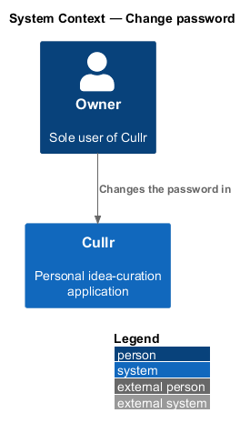
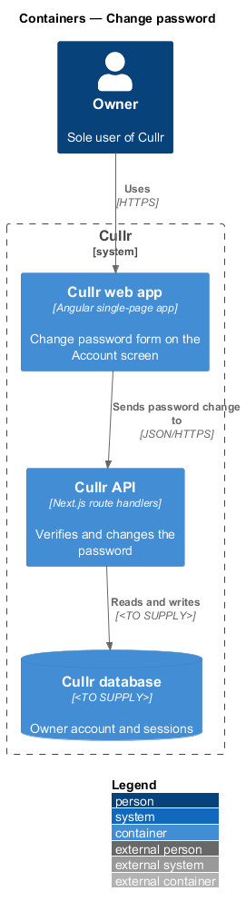
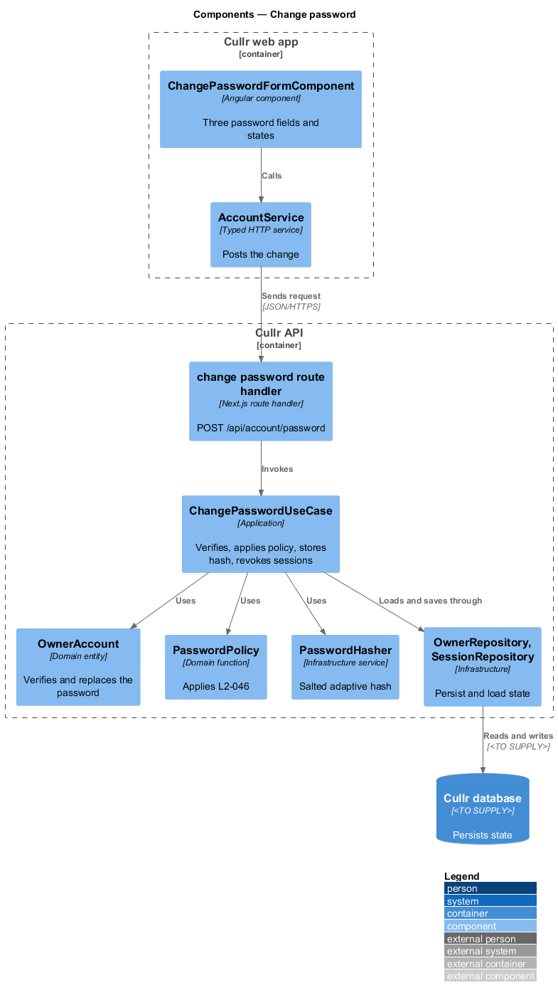
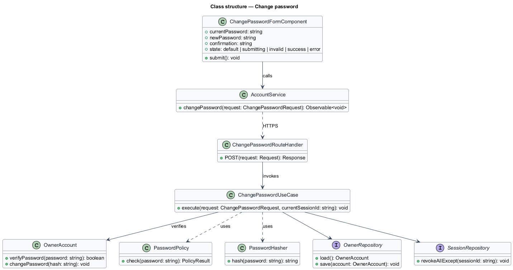
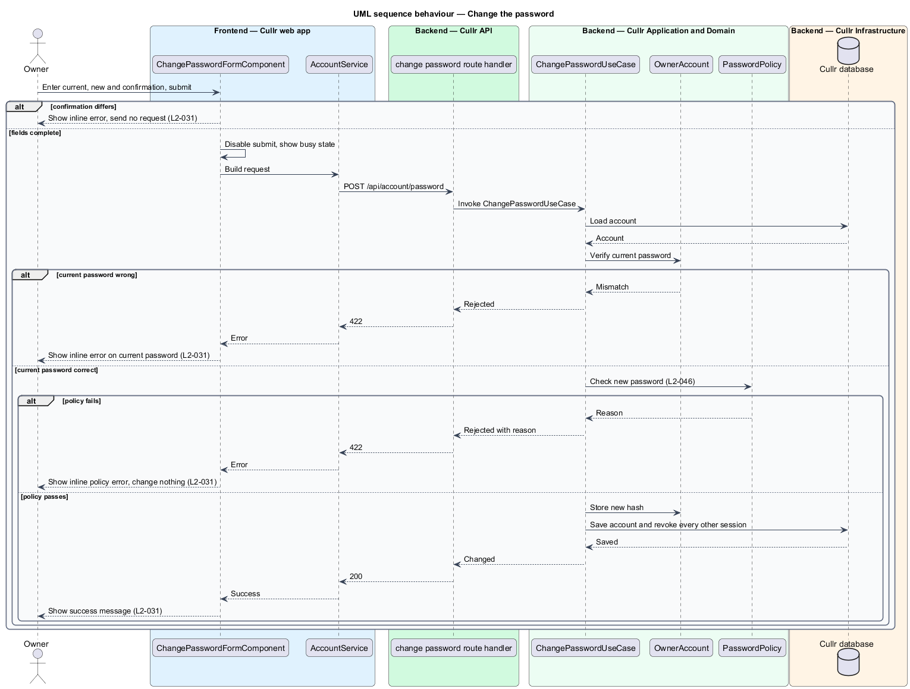

# Change password

## Overview

Cullr is a personal idea-curation application for a single owner. *Change password* is the capability that lets a signed-in owner replace the password. It sits on the Account screen at `/account`. It differs from `reset-password`, which sets a new password from an emailed link when the owner cannot sign in.

The owner proves identity again with the *current password*, then enters a *new password* and a *confirmation*. A new password has to satisfy the *password policy* (`L2-046`). A successful change *revokes every other session*, which signs out every other browser, and keeps the current session.

## Description

The feature is a vertical slice from the Account screen to the Cullr database.

- **`ChangePasswordFormComponent`** — Angular component on the Account screen. It renders current password, new password and confirmation, shows inline errors and the busy state, and shows a success message.
- **`AccountService`** — typed HTTP service for `POST /api/account/password`.
- **change password route handler** — Next.js route handler. It validates the body and maps results to 200, 400 or 422.
- **`ChangePasswordUseCase`** — application-layer use case. It verifies the current password, applies `PasswordPolicy`, stores the new hash and revokes the other sessions.
- **`OwnerAccount`** — domain entity from `sign-in`. Its `verifyPassword` method checks the current password and `changePassword` stores a new hash.
- **`PasswordPolicy`** — domain function from `reset-password` that applies `L2-046`: 12 to 128 characters and not in a list of commonly breached passwords.
- **`PasswordHasher`** — infrastructure service that produces a salted, adaptive hash (`L2-045`). The algorithm is `<TO SUPPLY>`.
- **`OwnerRepository`** and **`SessionRepository`** — infrastructure repositories.

Key behaviours, by acceptance criterion:

- A correct current password, a policy-compliant new password and a matching confirmation change the password, revoke all other sessions and show a success message (`L2-031`, criterion 1).
- An incorrect current password is rejected with an inline error (`L2-031`, criterion 2).
- A mismatched confirmation or a policy failure shows an inline error and changes nothing (`L2-031`, criterion 3).

### Screen composition

The Account page entry of `docs/screen-composition.md` lists the following components. The implementation shall use them and shall build locally only the UI marked local.

- **Library:** `form-field`, `text-field`, `button`, `alert` (invalid), `inline-message` (success).
- **Local:** the Page shell (`.sidebar-layout`, `.page-header`, `.footer`), built once and shared by every authenticated dashboard page. The change-password form is not itemized in the composition map or in the Account mock; its placement is `<TO SUPPLY>`.

## Requirements

The feature realizes the following level-2 (L2) requirements. Each L2 requirement refines a level-1 (L1) requirement, cited by identifier.

| L2 ID | Refines (L1) | Requirement |
|-------|--------------|-------------|
| `L2-031` | `L1-011` | Change password. |

## Diagrams

### System context

The owner works with Cullr directly. No external system takes part.

### Containers

The Cullr web app calls the Cullr API, which stores state in the Cullr database.

### Components

The form and client run in the browser. The route handler, use case, domain types, hasher and repositories run in the Cullr API.

### Class structure

The use case checks the current password on `OwnerAccount`, applies `PasswordPolicy` and then revokes sessions other than the current one.

### Change sequence

The sequence shows a successful change and the three rejections.

