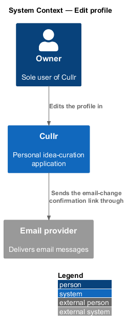
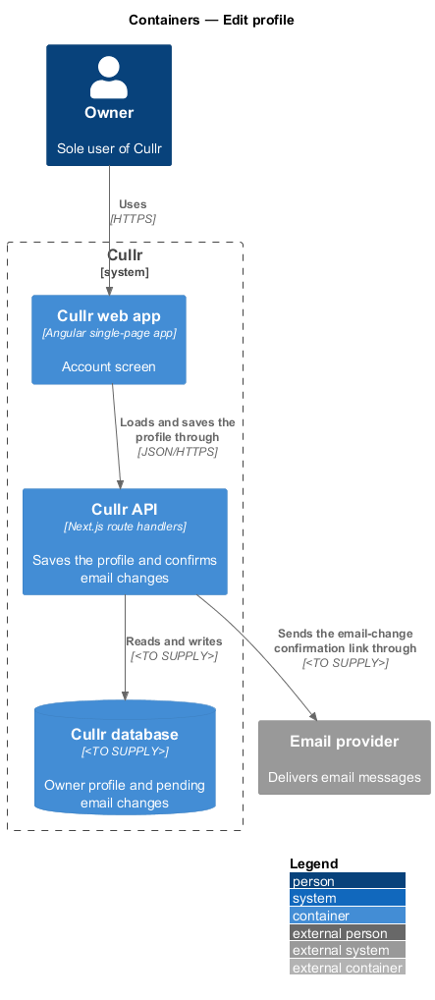
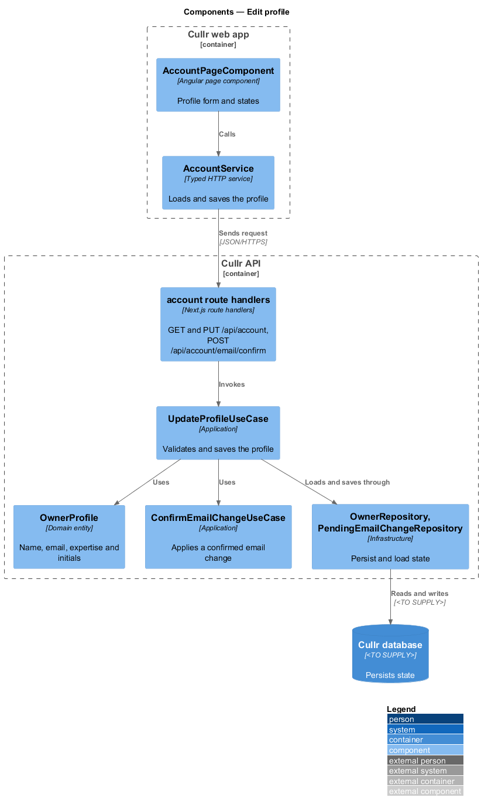
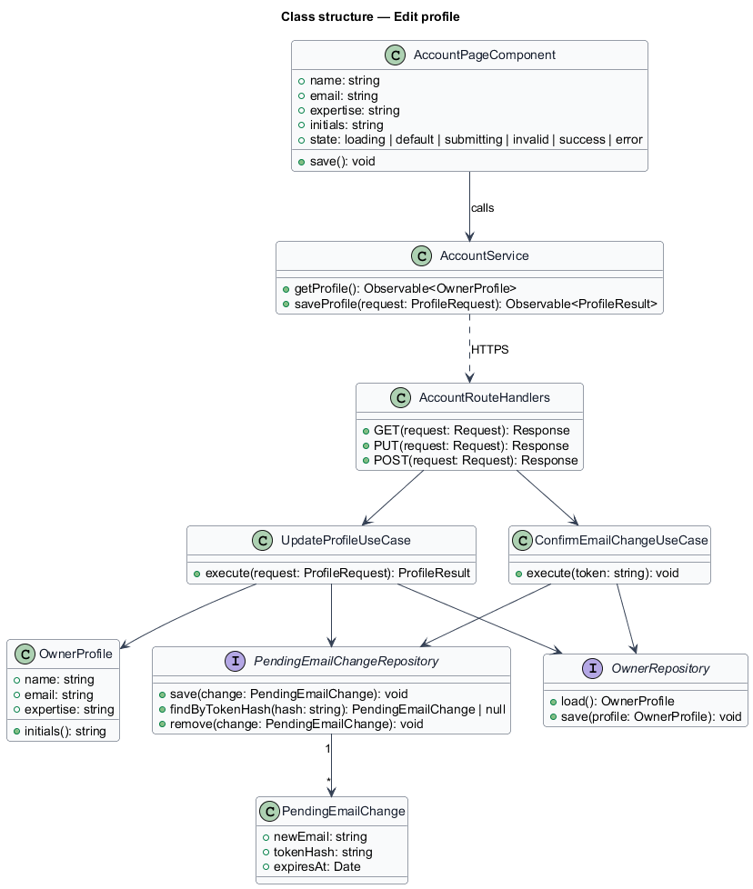
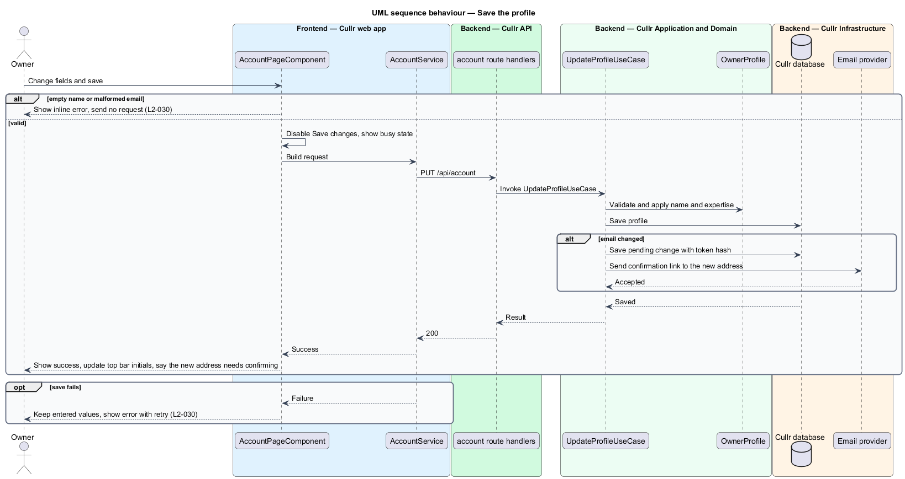
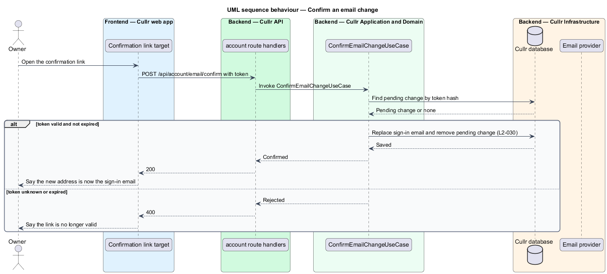

# Edit profile

## Overview

Cullr is a personal idea-curation application for a single owner. *Edit profile* is the Account screen at `/account`. It shows and edits the owner's *profile*: name, email address and areas of expertise. The profile also supplies the *initials* shown on the avatar in the top bar.

The owner's email address is also the address used to sign in. A new address therefore takes effect only after the owner *confirms* it through a link sent to that address. Until then the old address stays in use for sign-in. Password changes belong to `change-password`.

## Description

The feature is a vertical slice from the Account screen to the Cullr database and the email provider.

- **`AccountPageComponent`** — Angular page component. It renders initials, name, email and areas of expertise, validates the form and shows the states `default`, `loading`, `submitting`, `invalid`, `success` and `error`. Entered values are kept after a failed save.
- **`AccountService`** — typed HTTP service for `GET /api/account` and `PUT /api/account`.
- **account route handlers** — Next.js route handlers, including `POST /api/account/email/confirm` for the confirmation link.
- **`UpdateProfileUseCase`** — application-layer use case. It validates the profile, saves name and expertise and, when the email changed, creates a pending change and sends the confirmation link.
- **`ConfirmEmailChangeUseCase`** — application-layer use case. It checks the token, replaces the sign-in email and removes the pending change.
- **`OwnerProfile`** — domain entity with `name`, `email`, `expertise` and derived `initials`.
- **`PendingEmailChange`** — domain entity with the new address, a token hash and an expiry time. Only the hash of the token is stored (`L2-045`). The expiry period is `<TO SUPPLY>`.
- **`OwnerRepository`** and **`PendingEmailChangeRepository`** — infrastructure repositories. The email provider and transport are `<TO SUPPLY>`.

Key behaviours, by acceptance criterion:

- The screen opens with the saved initials, name, email and expertise (`L2-030`, criterion 1).
- A valid save persists the values, updates the initials in the top bar and shows the success state (`L2-030`, criterion 2).
- An empty name or a malformed email shows an inline error and saves nothing (`L2-030`, criterion 3).
- A changed email must be confirmed through the link before it replaces the sign-in email (`L2-030`, criterion 4).
- The save button is busy and disabled in flight. A failed load or save shows an error with retry and keeps the entered values (`L2-030`, criteria 5 and 6).

### Screen composition

The Account page entry of `docs/screen-composition.md` lists the following components. The implementation shall use them and shall build locally only the UI marked local.

- **Library:** `avatar` (`avatar--lg`), `form-field`, `text-field`, `textarea`, `button`, `alert` (invalid), `inline-message` (success), `error-page` (error), `skeleton` (loading).
- **Local:** the Page shell (`.sidebar-layout`, `.page-header`, `.footer`), built once and shared by every authenticated dashboard page.

## Requirements

The feature realizes the following level-2 (L2) requirements. Each L2 requirement refines a level-1 (L1) requirement, cited by identifier.

| L2 ID | Refines (L1) | Requirement |
|-------|--------------|-------------|
| `L2-030` | `L1-011` | Account profile. The Account screen (`/account`) must show and edit the profile. |

## Diagrams

### System context

The owner works with Cullr directly. No external system takes part.

### Containers

The Cullr web app calls the Cullr API, which stores state in the Cullr database.

### Components

The page and client run in the browser. The route handlers, use cases, entities and repositories run in the Cullr API, which sends the confirmation email through the email provider.

### Class structure

`UpdateProfileUseCase` saves the profile and creates a `PendingEmailChange` when the address changed. `ConfirmEmailChangeUseCase` completes the change.

### Save sequence

The sequence shows a valid save with and without an email change, and the failure path.

### Confirm sequence

The sequence shows the owner opening the confirmation link and the new address replacing the sign-in email.

