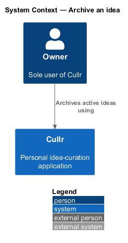
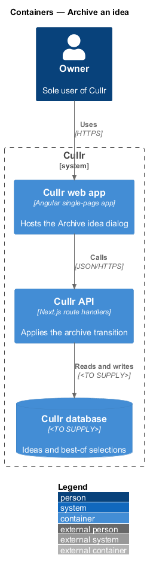
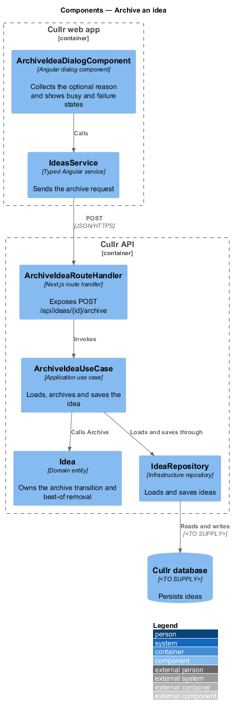
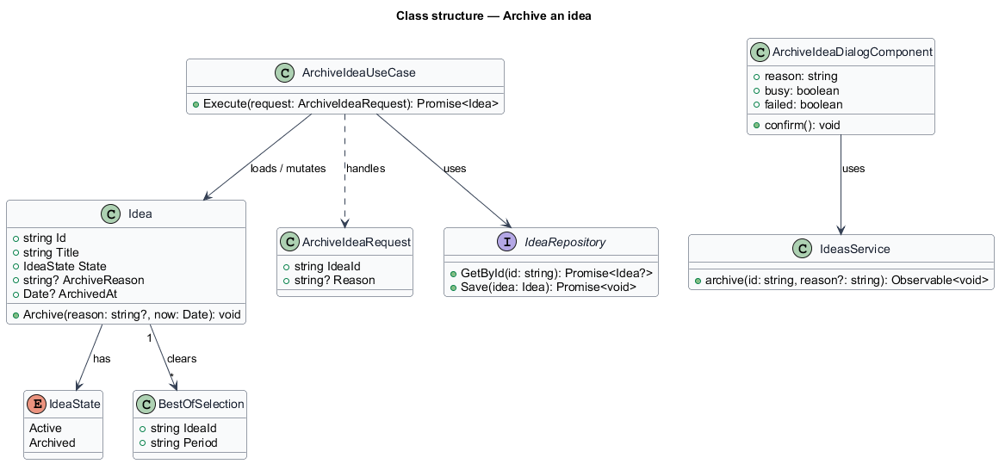
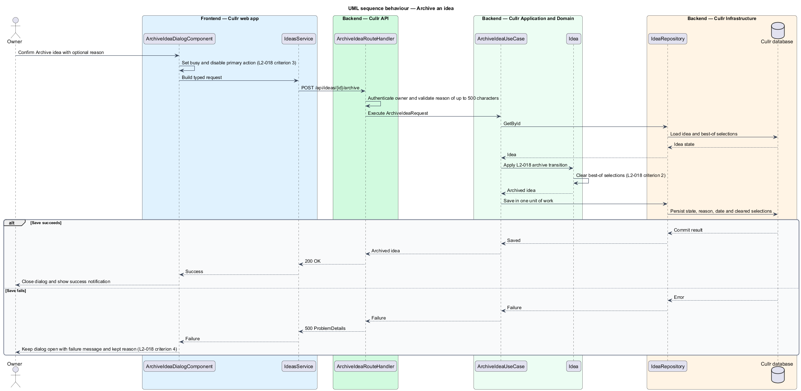

# Archive an idea

## Overview

Cullr is a single-owner idea-curation web app. An *idea* is a record of one product or concept that the owner logs, critiques and curates. An *active idea* is an idea that appears in Today, Ideas or Curated. A *best-of selection* is the marking of an idea as one of the best ideas of a period.

*Archive* is the holding area for ideas that the owner no longer pursues. This feature moves an active idea to the Archive. Archiving is reversible: the idea keeps its content, gains a reason and an archive date, and may be restored later (see `restore-idea`).

The Archive idea dialog opens from Today, Ideas (single and bulk, see L2-011) and Idea detail. The bulk case reuses the same dialog and the same archive operation for each selected idea; selection itself belongs to L2-011.

## Description

The feature is a vertical slice from the dialog to the database.

- **`ArchiveIdeaDialogComponent`** — Angular dialog component in the Cullr web app. It shows the idea title, the text "moves to the Archive. You can restore it any time.", an optional reason field, and the actions Cancel and Archive idea. It has three states in the mocks: default, busy and failed.
- **`IdeasService`** — typed Angular service. It sends the archive request and returns a typed result.
- **`ArchiveIdeaRouteHandler`** — Next.js route handler for `POST /api/ideas/{id}/archive`. It authenticates the owner, validates that the reason holds at most 500 characters and invokes the use case.
- **`ArchiveIdeaUseCase`** — application use case. It loads the idea, calls `Idea.Archive`, and saves the result in one unit of work.
- **`Idea`** — domain entity. `Archive(reason, now)` sets the state to `Archived`, stores the reason and the archive date, and clears every best-of selection of the idea.
- **`IdeaRepository`** — infrastructure repository that loads and saves ideas in the Cullr database. The database engine is `<TO SUPPLY>`.

Key behaviour, by criterion of `L2-018`:

1. Confirming with or without a reason moves the idea out of Today, Ideas and Curated and into the Archive with the reason and archive date. The dialog closes and a success notification appears.
2. Archiving an idea that was a best-of removes it from every period.
3. While the save is in flight, the primary action is busy and disabled.
4. When the save fails, the dialog stays open, shows a failure message ("Couldn't archive this idea") and keeps the typed reason.

## Requirements

| L2 ID | Refines (L1) | Requirement |
|-------|--------------|-------------|
| `L2-018` | `L1-008` | Archive an idea. The Archive idea dialog must move an active idea to the Archive. It opens from Today, Ideas (single and bulk) and Idea detail. |

## Diagrams

### System context

The owner archives ideas through Cullr. No external system takes part in this feature.

### Containers

The Cullr web app calls the Cullr API, which persists the archived state in the Cullr database.

### Components

The dialog calls the typed client, which reaches the route handler. The use case mutates the `Idea` entity and saves it through the repository.

### Class structure

`ArchiveIdeaUseCase` handles an `ArchiveIdeaRequest`, loads and mutates an `Idea`, and the entity clears its `BestOfSelection` records.

### Behaviour — archive an idea

The dialog goes busy and sends the request. The entity applies the archive transition and clears best-of status (`L2-018` criterion 2); a failed save keeps the dialog open with the reason.

