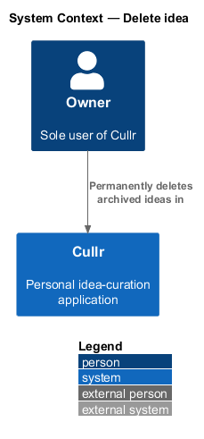
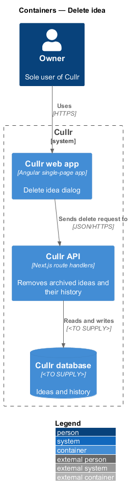
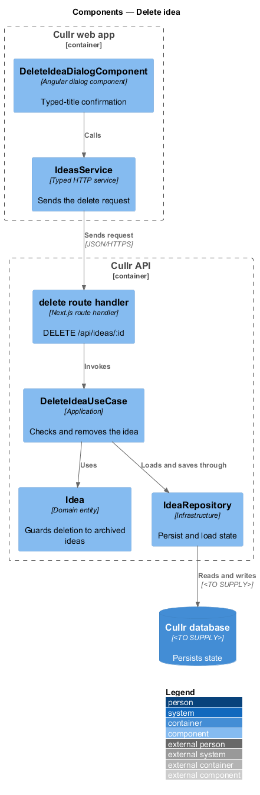
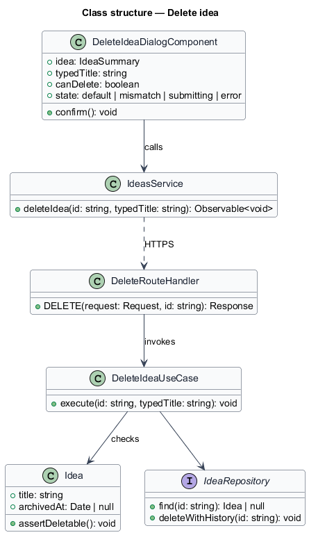
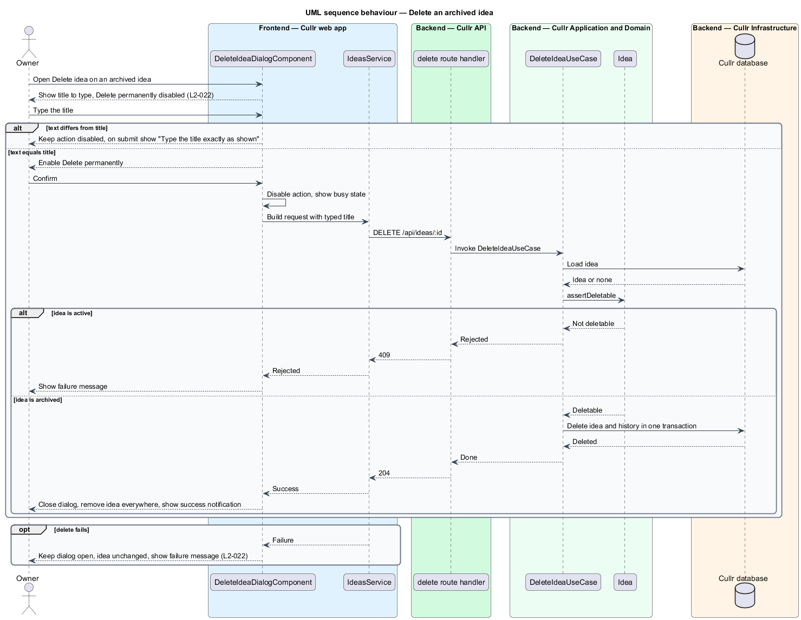

# Delete idea

## Overview

Cullr is a personal idea-curation application for a single owner. *Delete idea* is the capability that permanently removes an archived idea together with its status history. Deletion cannot be undone. It is the only way an idea ever leaves Cullr.

Because the action is destructive, the Delete idea dialog asks the owner to type the idea's title exactly before the primary action "Delete permanently" becomes available. Only an *archived* idea can be deleted. An active idea has no delete action, and the server rejects the request.

## Description

The feature is a vertical slice from the dialog to the Cullr database.

- **`DeleteIdeaDialogComponent`** — Angular dialog component. It shows the title to type, keeps "Delete permanently" disabled until the typed text equals the title, shows "Type the title exactly as shown" on a mismatch, and shows the busy state and failure message.
- **`IdeasService`** — typed HTTP service for `DELETE /api/ideas/:id`. The request carries the typed title.
- **delete route handler** — Next.js route handler. It validates the body and maps results to 204, 404 or 409.
- **`DeleteIdeaUseCase`** — application-layer use case. It loads the idea, rejects an active idea, compares the typed title with the stored title and removes the idea and its history in one transaction.
- **`Idea`** — domain entity. Its `assertDeletable` method fails for an active idea.
- **`IdeaRepository`** — persistence interface. The database technology is `<TO SUPPLY>`.
- **`NotificationEvents`** — not used. Deletion raises no notification; the owner sees the success toast from `toast-feedback`.

Key behaviours, by acceptance criterion:

- "Delete permanently" is disabled until the owner types the title exactly (`L2-022`, criterion 1).
- A mismatch on submit shows "Type the title exactly as shown" and deletes nothing (`L2-022`, criterion 2).
- An exact match removes the idea and its history. The idea appears nowhere and a success notification is shown (`L2-022`, criterion 3).
- The primary action is busy and disabled in flight. A failed delete keeps the dialog open and leaves the idea unchanged (`L2-022`, criteria 4 and 5).
- An active idea has no delete action and the server rejects deletion (`L2-022`, criterion 6).

### Screen composition

The Delete idea dialog entry of `docs/screen-composition.md` lists the following components. The implementation shall use them and shall build locally only the UI marked local.

- **Library:** `dialog`, `form-field`, `text-field` (type-to-confirm), `button`, `alert` (failed).
- **Local:** none.

## Requirements

The feature realizes the following level-2 (L2) requirements. Each L2 requirement refines a level-1 (L1) requirement, cited by identifier.

| L2 ID | Refines (L1) | Requirement |
|-------|--------------|-------------|
| `L2-022` | `L1-008` | Permanently delete an idea. |

## Diagrams

### System context

The owner works with Cullr directly. No external system takes part.

### Containers

The Cullr web app calls the Cullr API, which stores state in the Cullr database.

### Components

The dialog and client run in the browser. The route handler, use case, entity and repository run in the Cullr API.

### Class structure

The use case asks `Idea` whether it can be deleted and compares the typed title before removing it through the repository.

### Delete sequence

The sequence shows the typed-title gate, a successful delete, rejection of an active idea and a failure.

