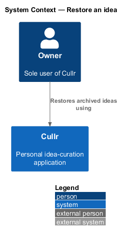
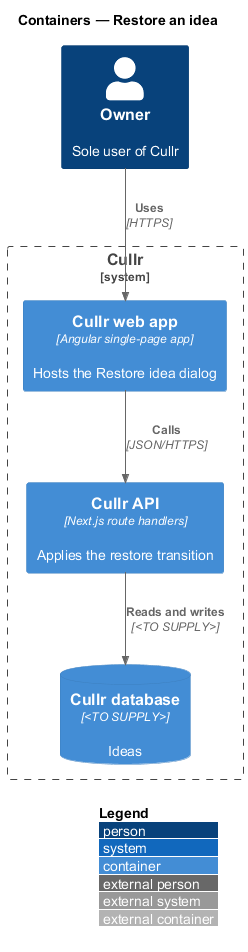
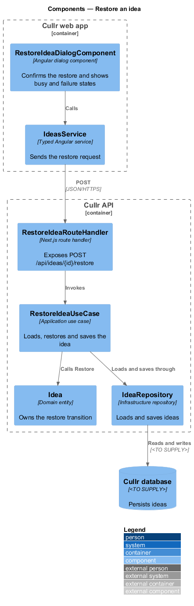
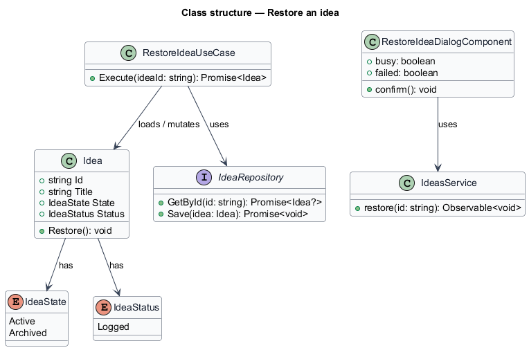
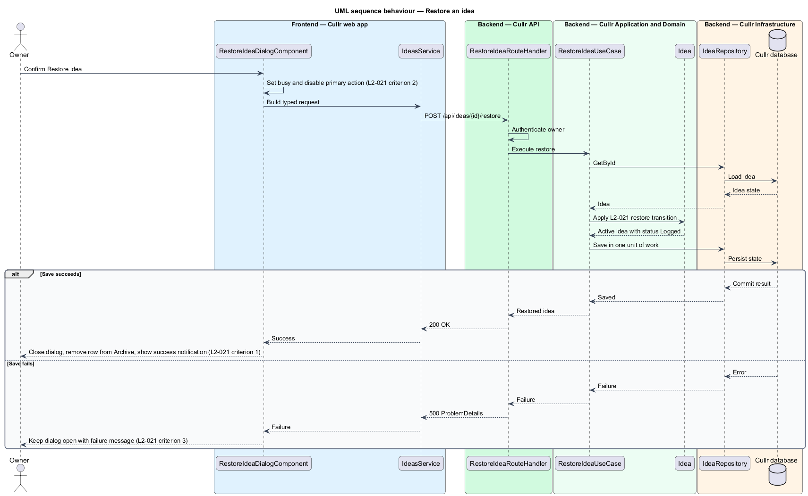

# Restore an idea

## Overview

Cullr is a single-owner idea-curation web app. An *archived idea* is an idea that the owner moved out of the active log, together with a reason and an archive date. *Restoring* is the reverse operation: it returns an archived idea to the active log.

The owner restores an idea when the reason for archiving no longer applies. The Restore idea dialog opens from the Archive screen and from the read-only Idea detail view of an archived idea. This feature complements `archive-idea` and `view-archive`.

## Description

- **`RestoreIdeaDialogComponent`** — Angular dialog component. It names the idea, states that it goes back to Logged in the active idea log, notes that the idea may be archived again at any time, and offers Cancel and Restore idea. It has three states in the mocks: default, busy and failed.
- **`IdeasService`** — typed Angular service that sends the restore request.
- **`RestoreIdeaRouteHandler`** — Next.js route handler for `POST /api/ideas/{id}/restore`. It authenticates the owner and invokes the use case.
- **`RestoreIdeaUseCase`** — application use case. It loads the idea, calls `Idea.Restore`, and saves it in one unit of work.
- **`Idea`** — domain entity. `Restore()` sets the state to `Active` and the status to `Logged`.
- **`IdeaRepository`** — infrastructure repository. The database engine is `<TO SUPPLY>`.

Key behaviour, by criterion of `L2-021`:

1. On confirmation, the idea returns to active with status Logged, appears in Ideas, leaves the Archive, and a success notification is shown.
2. While the save is in flight, the primary action is busy and disabled.
3. When the save fails, the dialog stays open with a failure message ("Couldn't restore this idea").

The reason and archive date set by `archive-idea` are not part of this requirement; whether the restore clears them is `<TO SUPPLY>`.

### Screen composition

The Restore idea dialog entry of `docs/screen-composition.md` lists the following components. The implementation shall use them and shall build locally only the UI marked local.

- **Library:** `dialog`, `button`, `alert` (failed).
- **Local:** none.

## Requirements

| L2 ID | Refines (L1) | Requirement |
|-------|--------------|-------------|
| `L2-021` | `L1-008` | Restore an idea. |

## Diagrams

### System context

The owner restores ideas through Cullr. No external system takes part.

### Containers

The Cullr web app calls the Cullr API, which persists the restored state in the Cullr database.

### Components

The dialog calls the typed client, which reaches the route handler. The use case applies the restore transition on `Idea` and saves it through the repository.

### Class structure

`RestoreIdeaUseCase` loads and mutates `Idea`, which holds an `IdeaState` and an `IdeaStatus`.

### Behaviour — restore an idea

The dialog goes busy and sends the request. The entity applies `L2-021`, and a failed save keeps the dialog open with a failure message.

