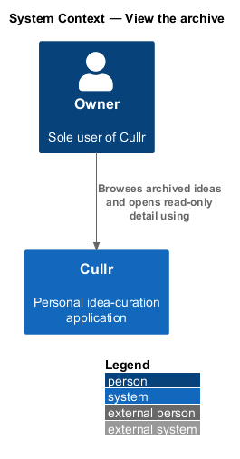
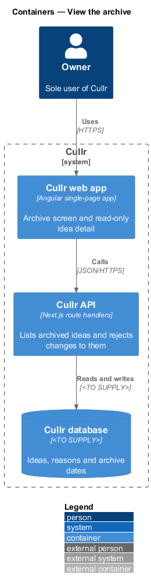
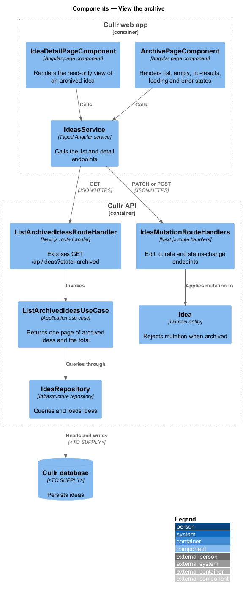
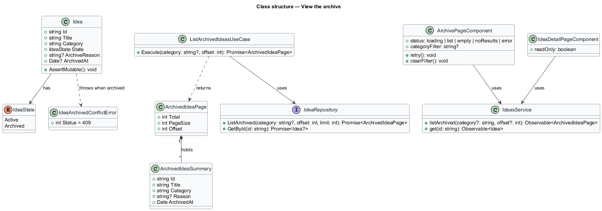
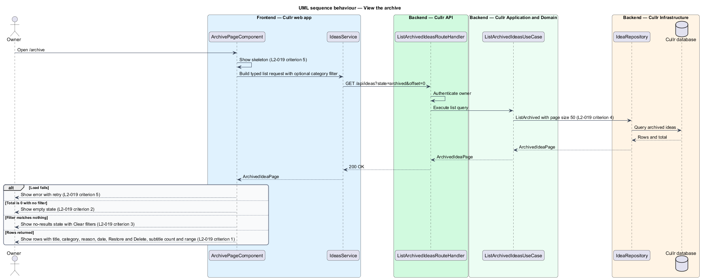
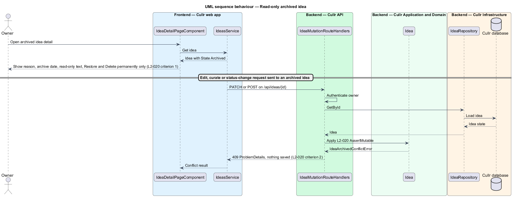

# View the archive

## Overview

Cullr is a single-owner idea-curation web app. An *archived idea* is an idea that the owner moved out of the active log with an optional reason and an archive date. The *Archive screen* is the page at `/archive` that lists archived ideas. The *read-only view* is the Idea detail presentation of an archived idea, which offers no editing.

This feature has two parts. The first lists archived ideas so that the owner can review why each was set aside and choose to restore or delete it. The second keeps archived ideas unchanged: the interface offers no editing, and the server rejects any edit, curate or status-change request with a 409 response. Restore and delete are separate features (`restore-idea`, `delete-idea`).

## Description

- **`ArchivePageComponent`** — Angular page component at `/archive`. It shows a subtitle with the count ("3 archived ideas"), a category filter, and a table with columns Idea, Reason, Archived and Actions. Each row shows title, category, reason, archived date, and the Restore and Delete actions. It renders the states in the mocks: default, loading, empty, error, no-results and long.
- **`IdeaDetailPageComponent`** — Angular page component. For an archived idea it renders the read-only view in place of the edit view.
- **`IdeasApiClient`** — typed Angular service that calls the list and detail endpoints.
- **`ListArchivedIdeasRouteHandler`** — Next.js route handler for `GET /api/ideas?state=archived`. It authenticates the owner and invokes the use case.
- **`ListArchivedIdeasUseCase`** — application use case that returns an `ArchivedIdeaPage` of at most 50 rows with the total count.
- **`ArchivedIdeaPage`** and **`ArchivedIdeaSummary`** — response types carrying the rows and the range data for "Showing 1–50 of N".
- **`Idea.AssertMutable`** — domain method that raises `IdeaArchivedConflictError` when the idea is archived. Each edit, curate and status-change route handler calls it before changing state.
- **`IdeaRepository`** — infrastructure repository. The database engine is `<TO SUPPLY>`.

Key behaviour, by criterion:

- `L2-019` criterion 1: each row shows the five data fields and two actions, and the subtitle shows the count.
- `L2-019` criterion 2: with no archived ideas, the empty state "Nothing archived yet" appears.
- `L2-019` criterion 3: when a category filter matches nothing, the no-results state offers Clear filters.
- `L2-019` criterion 4: with more than 50 archived ideas, the list paginates and shows the range.
- `L2-019` criterion 5: loading shows a skeleton; a failed load shows an error with retry.
- `L2-019` criterion 6: a very long reason wraps or truncates inside the layout.
- `L2-020` criterion 1: the read-only view shows the reason, the archive date, the text "Editing is turned off for archived ideas. Restore it first to make changes." and only the actions Restore and Delete permanently.
- `L2-020` criterion 2: the server answers any edit, curate or status-change request for an archived idea with a 409 and changes nothing. The check lives on the server so that it does not rely on the interface.

The two C4 views at container and component level carry the detail; the context view is minimal because no external system takes part.

## Requirements

| L2 ID | Refines (L1) | Requirement |
|-------|--------------|-------------|
| `L2-019` | `L1-008` | Archive screen. The Archive screen (`/archive`) must list archived ideas. |
| `L2-020` | `L1-008` | Archived ideas are read-only. |

## Diagrams

### System context

The owner browses archived ideas through Cullr. No external system takes part.

### Containers

The Cullr web app reads archived ideas from the Cullr API, which queries the Cullr database.

### Components

Two page components share the typed client. The list handler serves the Archive screen; the mutation handlers rely on the `Idea` entity to reject changes to archived ideas.

### Class structure

`ListArchivedIdeasUseCase` returns an `ArchivedIdeaPage` of `ArchivedIdeaSummary` rows, and `Idea` raises `IdeaArchivedConflictError` when it is archived.

### Behaviour — list archived ideas

The page shows a skeleton, requests the first page, and then renders one of four outcomes: error, empty, no-results or rows (`L2-019`).

### Behaviour — read-only archived idea

The detail page shows the read-only view; a mutation request reaches the entity guard and the server returns 409 (`L2-020`).

