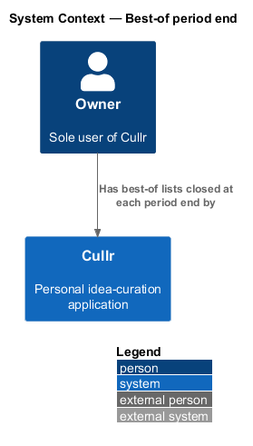
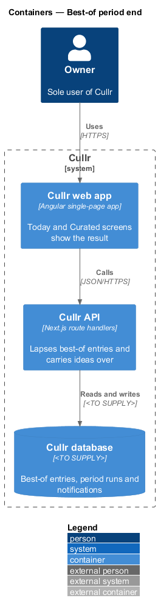
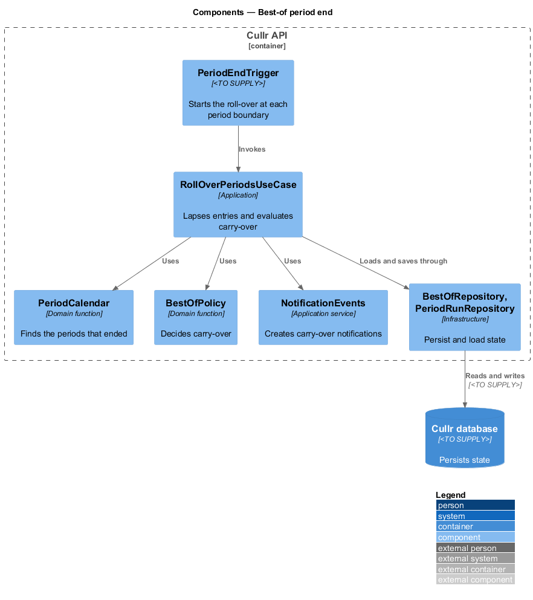
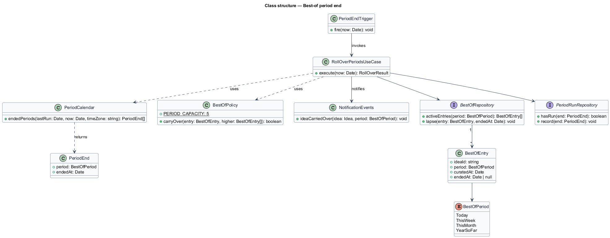
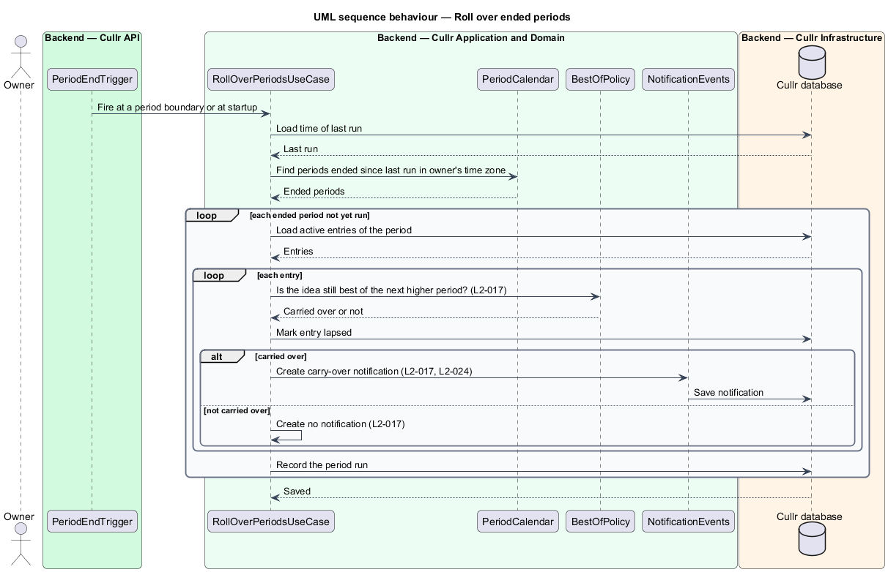

# Best-of period end

## Overview

Cullr is a personal idea-curation application for a single owner. The owner promotes ideas into *best-of lists* for four periods: today, this week, this month and the year so far (see `curate-idea`). A best-of idea is kept only for the length of its period.

*Best-of period end* is the capability that closes a period. When a day, a week or a month ends in the owner's time zone, the ideas best of that period *lapse*, which means they stop being best of it. The year-so-far list lapses when the year ends and otherwise changes only by replacement under `curate-idea`.

*Carry-over* applies when an idea lapses from a period while it is still best of the next higher period (today to week, week to month, month to year so far). The idea stays best of the higher period and Cullr creates a carry-over notification. An idea may be best of several periods at once, and lapsing from one period never removes it from another.

## Description

The feature is a scheduled backend slice. It has no screen of its own; its effects show on Today, Curated and Notifications.

- **`PeriodEndTrigger`** — mechanism that invokes the roll-over at each period boundary and as a catch-up when the API starts. The mechanism (for example a hosted cron service or a platform scheduler) is `<TO SUPPLY>`.
- **`RollOverPeriodsUseCase`** — application-layer use case. It asks `PeriodCalendar` which periods have ended, lapses their entries, evaluates carry-over for each lapsed idea and records the result in one unit of work. It is idempotent: a period that already ran is skipped.
- **`PeriodCalendar`** — domain function. It computes the end of the day, the week (Sunday), the month and the year in the owner's time zone, which defaults to America/Toronto.
- **`BestOfPolicy`** — domain function shared with `curate-idea`. Its `carryOver` operation decides whether a lapsed entry is carried over.
- **`BestOfEntry`** — domain entity for one idea in one `BestOfPeriod`, with its `curatedAt` time and an `endedAt` time once it lapses.
- **`NotificationEvents`** — application service described in `notification-events`. The use case calls it once for every carried-over idea.
- **`BestOfRepository`** and **`PeriodRunRepository`** — infrastructure repositories. `PeriodRunRepository` records which period ends have run. The database technology is `<TO SUPPLY>`.

Key behaviours, by acceptance criterion:

- Ideas best of today stop being best of today when the day ends in the owner's time zone. The same holds for the week, which ends on Sunday, and for the month (`L2-017`, criteria 1 to 3).
- Year-so-far ideas remain until replaced under `L2-015` criterion 3 or until the year ends (`L2-017`, criterion 4).
- A lapsed idea that is still best of the next higher period is carried over, and a carry-over notification is created (`L2-017`, criterion 5).
- A lapsed idea that is not best of the next higher period only stops being best of the period, and no notification is created (`L2-017`, criterion 6).

## Requirements

The feature realizes the following level-2 (L2) requirements. Each L2 requirement refines a level-1 (L1) requirement, cited by identifier.

| L2 ID | Refines (L1) | Requirement |
|-------|--------------|-------------|
| `L2-017` | `L1-007` | Best-of period end and carry-over. A period's best-of ideas are kept until the period ends, then lapse. An idea may be best of several periods at once, and lapsing from one period does not remove it from another. |

## Diagrams

### System context

Cullr closes each best-of period by itself. The owner sees the effect on Today, Curated and Notifications.

### Containers

The Cullr web app calls the Cullr API, which stores state in the Cullr database.

### Components

The trigger, use case, calendar, policy and notification service run in the Cullr API. No browser component takes part.

### Class structure

The use case combines `PeriodCalendar` and `BestOfPolicy` to decide, for each ended period, which entries lapse and which carry over.

### Roll-over sequence

The sequence shows one run: finding ended periods, lapsing entries and notifying for each carried-over idea.

