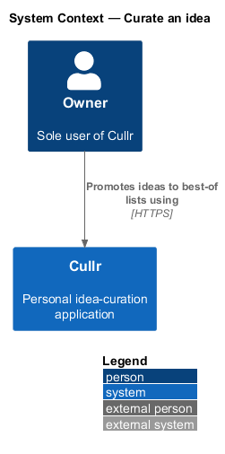
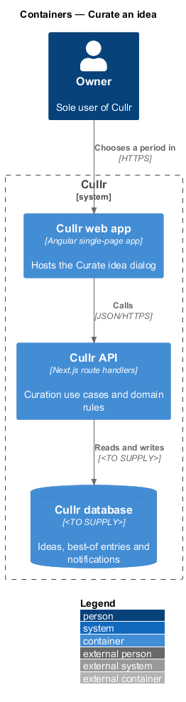
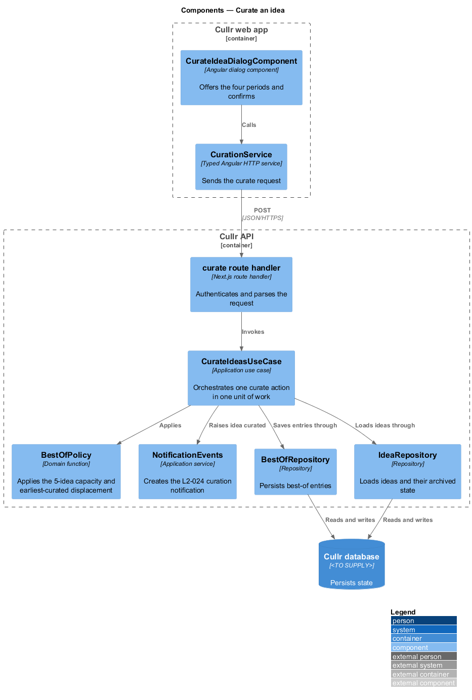
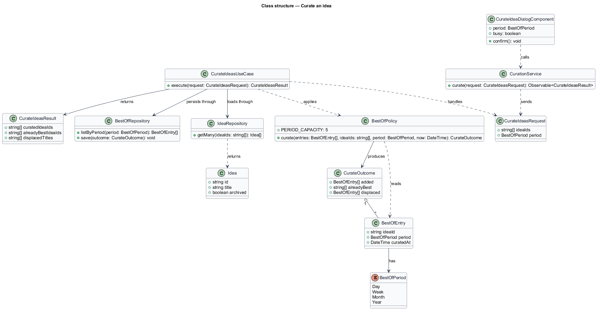
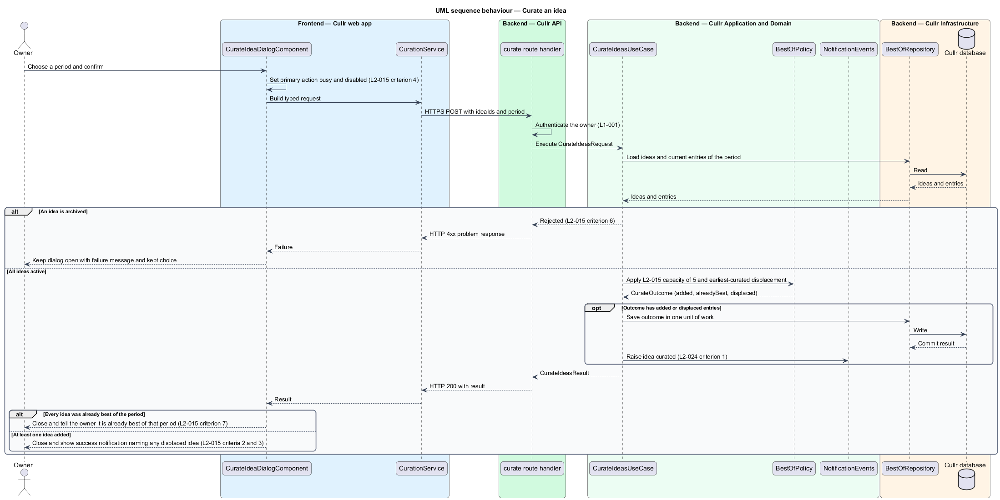
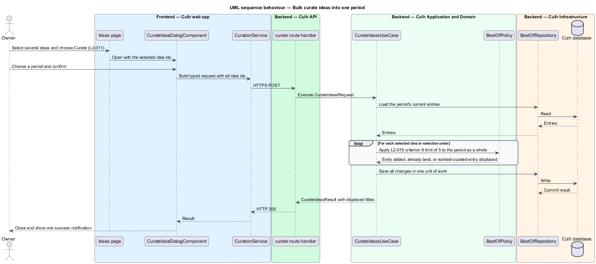

# Curate an idea

## Overview

Cullr is a single-owner idea-curation application. An *idea* is a short product or concept note that the owner logs, critiques and edits. A *best-of list* is a set of at most 5 ideas that the owner has promoted as the strongest for one period: the day, the week, the month or the year so far. *Curating* is the act of promoting an idea into one best-of list.

This feature covers the Curate idea dialog. The dialog opens from the Today screen, the Ideas screen (for one idea or for several selected ideas) and the Idea detail screen. The owner picks one of four periods and confirms; the idea then appears on the Curated screen and in the notification list.

Each best-of list holds at most 5 ideas. When a sixth idea is curated into a full period, the idea curated earliest into that period stops being best of it. The dialog does not change the idea's status directly: moving an idea to the Curating status when it is curated is owned by the `ideas/idea-status` feature, which the use case calls. The end of a period and the carry-over of ideas to the next period belong to `curation/best-of-period-end`. Display of the lists belongs to `curation/view-curated`.

## Description

The feature is a vertical slice from the dialog to the database.

- **`CurateIdeaDialogComponent`** — Angular dialog component in the Cullr web app. It offers exactly four options: Best of today, Best of this week, Best of this month and Best of the year so far, each with its carry-over rule as secondary text (for example "Carries over until Sunday"). The first option is preselected. On confirmation the primary action shows "Curating…" and is disabled (mock `busy`). On failure the dialog stays open, shows "Couldn't curate this idea", keeps the chosen period and offers "Try again" (mock `failed`).
- **`CurationService`** — typed Angular HTTP service. It sends the idea ids and the chosen period and returns a typed result.
- **curate route handler** — Next.js route handler in the Cullr API. It authenticates the owner, parses the request and invokes the use case. The route path is `<TO SUPPLY>`.
- **`CurateIdeasUseCase`** — application use case. It loads the ideas and the period's current entries, rejects archived ideas, applies `BestOfPolicy`, saves the outcome in one unit of work, calls the status change owned by `ideas/idea-status`, and raises an idea-curated event to `NotificationEvents`.
- **`BestOfPolicy`** — domain function holding the rules. `PERIOD_CAPACITY` is 5. For each idea in selection order it skips an idea that is already best of the period, adds it otherwise, and displaces the entry with the earliest `curatedAt` when the period already holds 5 entries.
- **`BestOfEntry`** — domain entity recording one idea, one `BestOfPeriod` and the `curatedAt` time. An idea may hold entries in several periods at once.
- **`BestOfRepository`** and **`IdeaRepository`** — infrastructure repositories over the Cullr database. The database engine is `<TO SUPPLY>`.

Key behaviours, cited by acceptance criterion of `L2-015`:

- Criterion 2: a confirmed choice makes the idea best of the period, closes the dialog and shows a success notification.
- Criterion 3: displacing the earliest-curated idea is reported in the result, and the success notification names the displaced idea.
- Criterion 5: a failed save keeps the dialog open with the choice intact.
- Criterion 6: the dialog does not offer curating for an archived idea, and the use case rejects it independently of the client.
- Criterion 7: curating an idea already best of the period changes nothing and the owner is told it is already best of that period.
- Criterion 8: bulk curating applies the 5-idea limit to the period as a whole in one unit of work.

The dialog is modal, closes on Escape, and is operable by keyboard (`L1-014`). The use case and the policy are pure of transport concerns, so the same rules apply to single and bulk requests.

Because the C4 context and container views for this slice carry little detail beyond the fixed Cullr architecture, the component view is the most detailed and the other two stay minimal.

## Requirements

The feature realizes the following level-2 (L2) requirement. The L2 requirement refines a level-1 (L1) requirement, cited by identifier.

| L2 ID | Refines (L1) | Requirement |
|-------|--------------|-------------|
| `L2-015` | `L1-007` | Curate an idea. The Curate idea dialog must promote an idea to a best-of list. It opens from Today, Ideas (single and bulk) and Idea detail. |

## Diagrams

### System context

The owner promotes ideas to best-of lists through Cullr.

### Containers

The Cullr web app hosts the dialog, the Cullr API applies the rules, and the Cullr database stores ideas and best-of entries.

### Components

The route handler invokes `CurateIdeasUseCase`, which applies `BestOfPolicy`, persists through the repositories and raises the curation notification.

### Class structure

`CurateIdeasUseCase` depends on `BestOfPolicy` and the repositories; `BestOfPolicy` produces a `CurateOutcome` made of `BestOfEntry` records.

### Behaviour — curate an idea

The sequence covers the happy path, an archived idea rejected under `L2-015` criterion 6, the displacement of the earliest-curated idea, and the already-best case.

### Behaviour — bulk curate

A bulk request iterates the selected ideas against one period and saves all changes in one unit of work, applying `L2-015` criterion 8.

