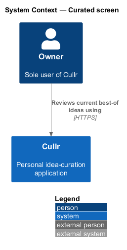
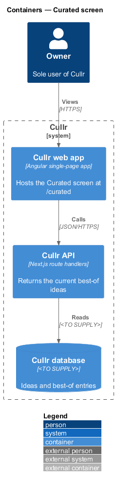
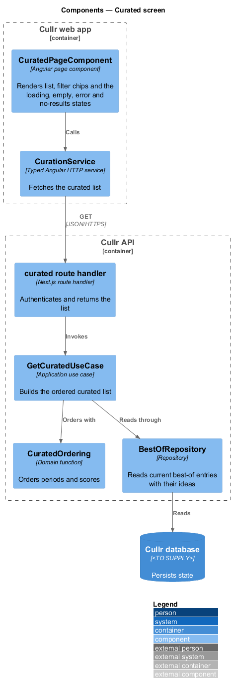
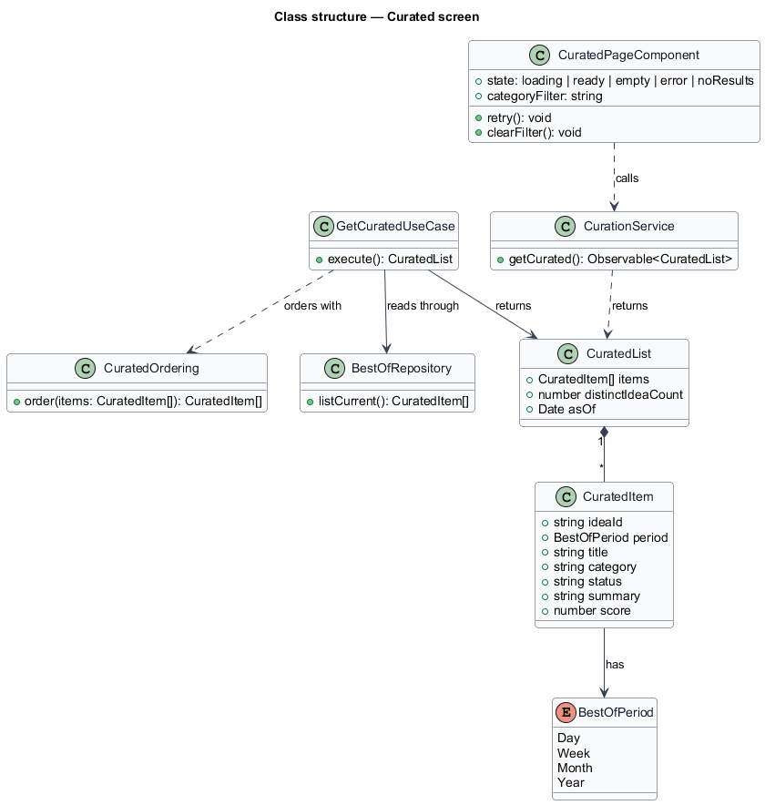
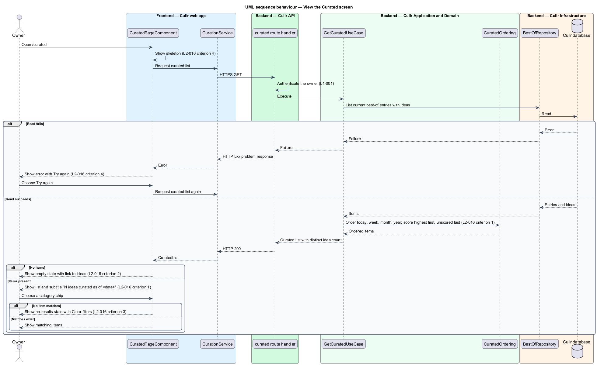

# Curated screen

## Overview

Cullr is a single-owner idea-curation application. A *best-of list* is a set of at most 5 ideas that the owner promoted as the strongest for one period: today, this week, this month or the year so far. The Curated screen at `/curated` shows the current members of all four lists in one place, so the owner sees the strongest ideas from the day up to the year.

The screen sits at the read side of the curation subsystem. The `curation/curate-idea` feature writes best-of entries, and `curation/best-of-period-end` removes them when a period ends. This feature only reads them. The screen also handles the loading, empty, error and no-results conditions required by `L1-012`.

## Description

The feature is a read-only vertical slice from the page to the database.

- **`CuratedPageComponent`** — Angular page component. It shows a skeleton while loading, then one card per best-of entry. Each card carries the period label (for example "Best of today"), the idea title as a link to Idea detail, the category and status badges, and the summary. A row of category chips narrows the list. Long titles wrap so the layout does not overflow (`L2-016` criterion 5, mock `edge`).
- **`CurationApiClient`** — typed Angular HTTP client with a `getCurated()` call.
- **curated route handler** — Next.js route handler in the Cullr API. It authenticates the owner and invokes the use case. The route path is `<TO SUPPLY>`.
- **`GetCuratedUseCase`** — application use case. It reads the current entries through `BestOfRepository`, orders them with `CuratedOrdering`, and returns a `CuratedList`.
- **`CuratedOrdering`** — domain function. It orders periods as today, this week, this month, year so far, and orders ideas within one period by score, highest first, with unscored ideas last.
- **`CuratedList`** — result holding the ordered `CuratedItem` records, the as-of date and `distinctIdeaCount`. The count counts each idea once even when the idea is best of several periods, which produces the subtitle "N ideas curated as of <date>" (`L2-016` criterion 1).
- **`BestOfRepository`** — infrastructure repository over the Cullr database. The database engine is `<TO SUPPLY>`.

Screen states, cited by acceptance criterion of `L2-016`:

- Criterion 2: with no curated ideas, the empty state links to Ideas.
- Criterion 3: when a category chip matches nothing, the no-results state shows "Clear filters". Whether filtering runs in the page or in the API is `<TO SUPPLY>`.
- Criterion 4: loading shows a skeleton; a failed load shows an error with "Try again" and "Back to Today".

The top bar bell shown on this screen is described in `notifications/notification-center`.

## Requirements

The feature realizes the following level-2 (L2) requirement. The L2 requirement refines a level-1 (L1) requirement, cited by identifier.

| L2 ID | Refines (L1) | Requirement |
|-------|--------------|-------------|
| `L2-016` | `L1-007` | Curated screen. The Curated screen (`/curated`) must show the current best-of ideas. |

## Diagrams

### System context

The owner reviews the current best-of ideas through Cullr.

### Containers

The Cullr web app requests the list from the Cullr API, which reads the Cullr database.

### Components

The route handler invokes `GetCuratedUseCase`, which reads through `BestOfRepository` and orders with `CuratedOrdering`.

### Class structure

`CuratedList` composes `CuratedItem` records, each tagged with a `BestOfPeriod`.

### Behaviour — view curated ideas

The sequence covers the loading skeleton, the failed load with retry, the empty state, the ordered list, and the filter with no results.

