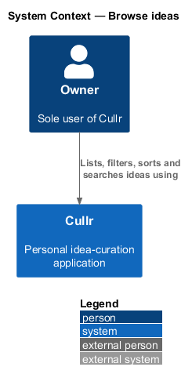
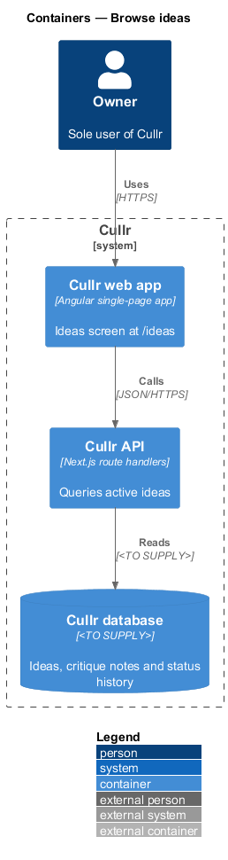
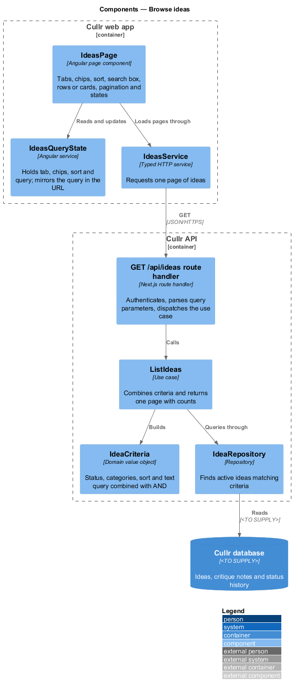
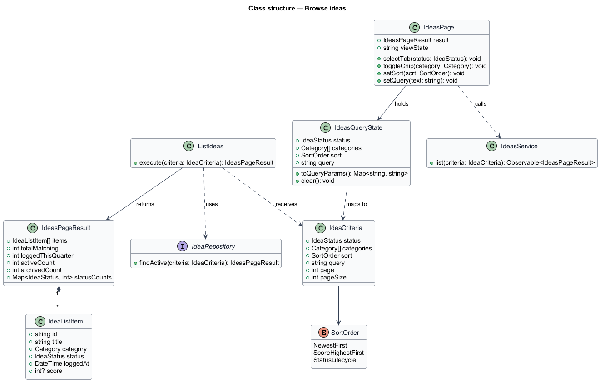
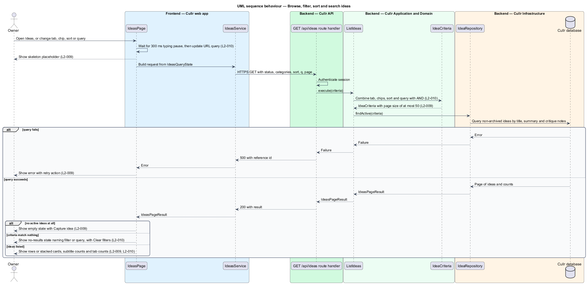

# Browse ideas

## Overview

Cullr is a personal idea-curation application used by a single owner who logs around 100 ideas a day. The Ideas screen at `/ideas` is the working list of everything that has not been archived. The owner uses it to find an idea, compare ideas and pick ideas for action.

*Idea* — titled product or project concept that the owner logs, critiques, curates and may later build

*Active idea* — idea that is not archived

*Status* — lifecycle stage of an idea: Logged, Critiquing, Curating, Building or Built

This feature covers two behaviours of the Ideas screen: listing active ideas and narrowing the list by status tab, category chips, sort order and search query. It belongs to the `ideas` subsystem. Selecting rows is described by `bulk-select-ideas`, and the per-row Edit and Archive actions are described by the edit and archive features.

## Description

The feature is a vertical slice from the Ideas page to the database. The mocks in `docs/mocks/pages/ideas/` show `default`, `loading`, `empty`, `error`, `no-results`, `long` and `edge`.

- **`IdeasPage`** — Angular page component. It renders the status tabs, category chips, Sort control, search box, the rows, pagination and the loading, empty, no-results and error states. At the XS viewport it presents rows as stacked cards with no horizontal page scroll (`L2-009` criterion 5).
- **`IdeasQueryState`** — Angular service. It holds the selected tab, chips, sort and query, keeps the sort choice while the owner stays on the screen, and mirrors the query in the URL so that the query is addressable (`L2-010` criteria 3 and 4).
- **`IdeasService`** — typed Angular client service. It requests one page of ideas for a set of criteria.
- **`GET /api/ideas` route handler** — Next.js route handler in the Cullr API. It authenticates the session, parses the query parameters and calls the use case.
- **`ListIdeas`** — application use case. It builds the criteria and returns one page with the counts.
- **`IdeaCriteria`** — domain value object. It combines tab, chips, sort and query with AND semantics (`L2-010` criterion 6).
- **`IdeaRepository`** — infrastructure repository. It finds non-archived ideas that match the criteria, with the query matched case-insensitively against title, summary and critique notes. The query mechanism is `<TO SUPPLY>`, because it depends on the database engine.

Key behaviours, by acceptance criterion:

- Each row shows title linked to the idea, category, status, logged time and score, with Edit and Archive actions. The subtitle shows the counts logged this quarter, active and archived (`L2-009` criterion 1).
- A page holds at most 50 rows (`L2-009` criterion 2).
- With no active ideas, the empty state offers a Capture idea action. A failed load shows an error with retry, and loading shows a skeleton (`L2-009` criteria 3 and 4).
- Selecting a status tab among All, Logged, Critiquing, Curating and Building lists only ideas with that status. The tab exposes `aria-selected` and the counts stay accurate (`L2-010` criterion 1).
- Each category chip exposes its pressed state, and toggled chips list only ideas in the selected categories (`L2-010` criterion 2).
- Sort offers Newest first, Score with highest first and unscored last, and Status in lifecycle order (`L2-010` criterion 3).
- Results update after a typing pause of at most 300 ms (`L2-010` criterion 4).
- When filters or a query match nothing, the no-results state names the filter or query and offers "Clear filters" (`L2-010` criterion 5).

### Screen composition

The Ideas page entry of `docs/screen-composition.md` lists the following components. The implementation shall use them and shall build locally only the UI marked local.

- **Library:** `tabs` (status filter), `chip`, `select` (sort), `table` (with the `num` and `row-actions` catalogue gaps), `pagination`, `button`, `badge`, `empty-state` (empty and no-results), `error-page` (error), `skeleton` (loading), `checkbox` (row selection).
- **Local:** the Page shell (`.sidebar-layout`, `.page-header`, `.footer`), built once and shared by every authenticated dashboard page.

## Requirements

The feature realizes the following level-2 (L2) requirements. Each L2 requirement refines a level-1 (L1) requirement, cited by identifier.

| L2 ID | Refines (L1) | Requirement |
|-------|--------------|-------------|
| `L2-009` | `L1-004` | List active ideas. The Ideas screen (`/ideas`) must list every active (non-archived) idea. |
| `L2-010` | `L1-004` | Filter, sort and search ideas. |

## Diagrams

The context diagram shows the owner using Cullr. For this slice it is near-identical to the container view, and both are kept.

The container diagram shows the web app querying the API, which reads from the database.

The component diagram shows the page, the query state and the client in the web app, and the handler, use case, criteria and repository in the API.

The class diagram shows the criteria, the page result, the list item and the frontend state types.

The sequence diagram covers loading a page after any change of tab, chip, sort or query, with the failure, empty and no-results alternates.

