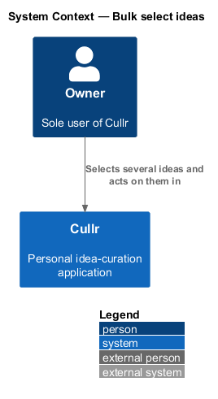
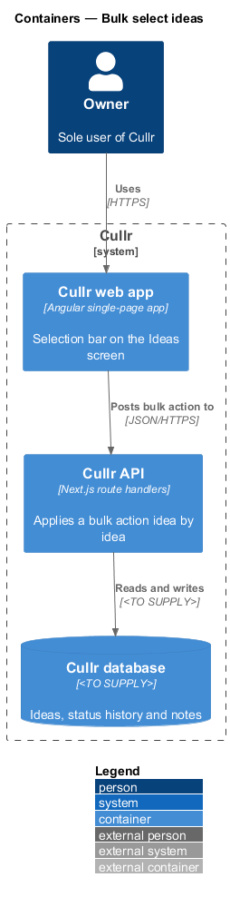
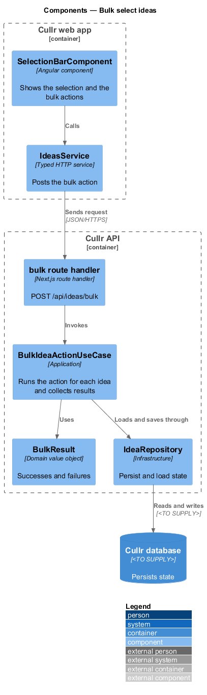
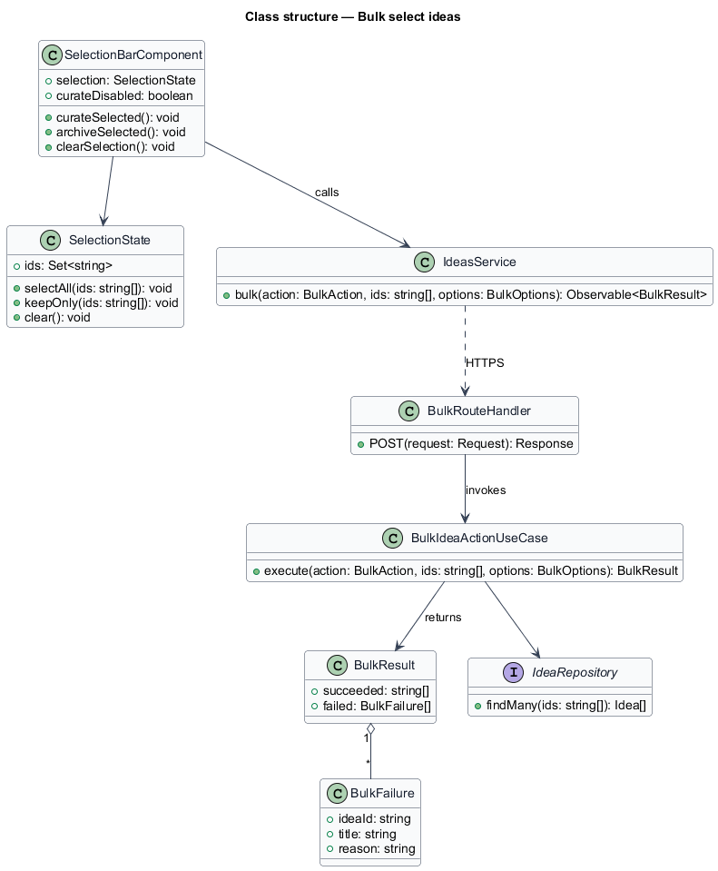
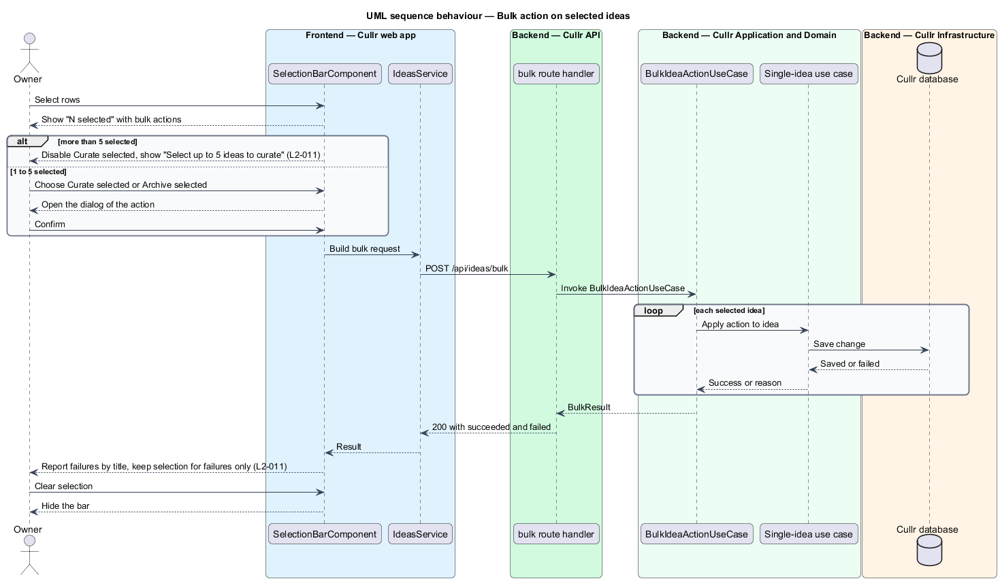

# Bulk select ideas

## Overview

Cullr is a personal idea-curation application for a single owner who handles many ideas at once. *Bulk select ideas* lets the owner select several rows on the Ideas screen and act on them together, with "Curate selected" and "Archive selected".

A *selection* is the set of idea ids the owner has ticked. A *bulk action* applies one operation to every idea in the selection. A bulk action may succeed for some ideas and fail for others, so the result is reported per idea.

## Description

The feature is a vertical slice that adds a selection bar to the Ideas screen and a bulk endpoint in the Cullr API.

- **`SelectionBarComponent`** — Angular component. It shows "N selected" with "Curate selected", "Archive selected" and "Clear selection". "Select all" selects every row currently listed, not only the visible page, and the bar says so.
- **`SelectionState`** — client state holding the selected ids. After a partial failure it keeps only the failed ids.
- **`IdeasService`** — typed HTTP service for `POST /api/ideas/bulk`.
- **bulk route handler** — Next.js route handler. It validates the action and the ids.
- **`BulkIdeaActionUseCase`** — application-layer use case. It runs the single-idea use case for each id (`CurateIdeaUseCase` or `ArchiveIdeaUseCase`) and collects a `BulkResult` with the succeeded ids and the failed ids with reasons.
- **`BulkResult`** — result type listing successes and failures by title.

The bulk action reuses the dialogs and use cases of `curate-idea` and `archive-idea`. The feature adds only selection and result handling.

Key behaviours, by acceptance criterion:

- Selecting rows shows the bar. "Clear selection" hides it and clears the rows (`L2-011`, criteria 1 and 4).
- "Select all" covers every row in the current result, not only the rendered page (`L2-011`, criterion 2).
- When some items fail, the successes are applied, the failures are reported by title and selection is kept for the failures only (`L2-011`, criterion 3).
- With more than 5 ideas selected, "Curate selected" is disabled with the explanation "Select up to 5 ideas to curate". With 1 to 5 active ideas selected it opens the Curate idea dialog and applies the chosen period to every selected idea (`L2-011`, criterion 5).

## Requirements

The feature realizes the following level-2 (L2) requirements. Each L2 requirement refines a level-1 (L1) requirement, cited by identifier.

| L2 ID | Refines (L1) | Requirement |
|-------|--------------|-------------|
| `L2-011` | `L1-004` | Select multiple ideas. |

## Diagrams

### System context

The owner works with Cullr directly. No external system takes part.

### Containers

The Cullr web app calls the Cullr API, which stores state in the Cullr database.

### Components

The selection bar and client run in the browser. The route handler, bulk use case, result type and repository run in the Cullr API.

### Class structure

The bar holds a `SelectionState`. The bulk use case returns a `BulkResult` that the page uses to narrow the selection to the failures.

### Bulk action sequence

The sequence shows a confirmed bulk action with a partial failure.

