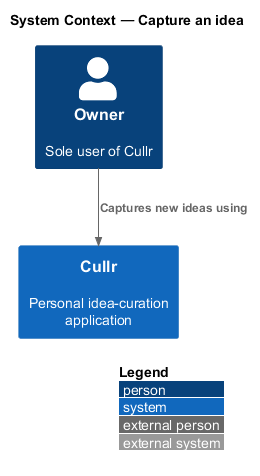
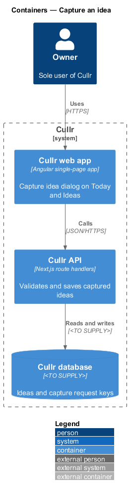
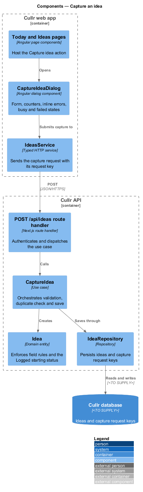
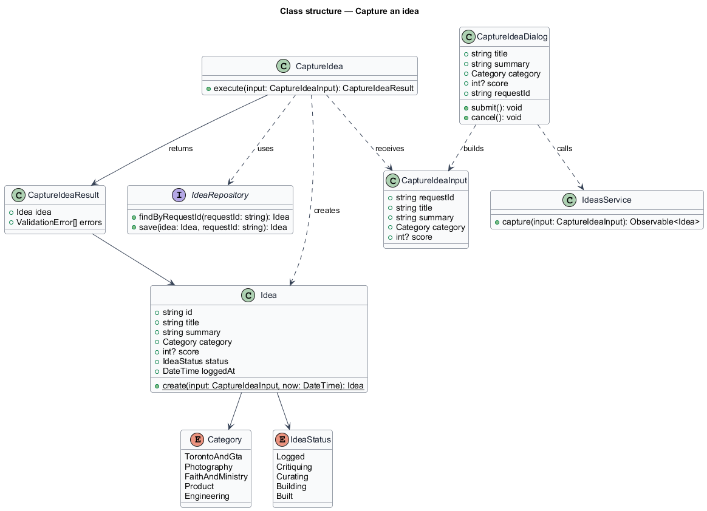
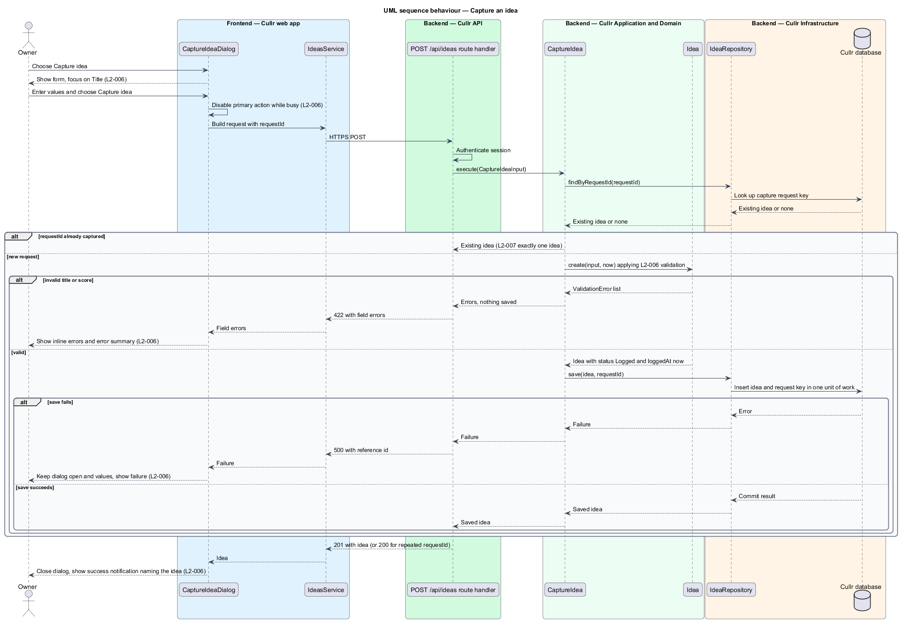

# Capture an idea

## Overview

Cullr is a personal idea-curation application used by a single owner. The owner generates around 100 ideas a day, so logging one has to be quick and has to be safe against accidental repeats.

This feature covers the entry point of the idea lifecycle: the Capture idea dialog. The dialog opens from the "Capture idea" action on the Today and Ideas screens and logs a new idea.

*Idea* — titled product or project concept that the owner logs, critiques, curates and may later build

*Logged* — first status of an idea, set at capture and later advanced by critique, curation and build activity.

*Capture request key* — client-generated identifier that labels one capture attempt, so that repeated deliveries of the same attempt create one idea.

The feature belongs to the `ideas` subsystem. Its results appear in the Today summary and the Ideas list, which other features describe.

## Description

The feature is a vertical slice from the dialog to the database. The mocks in `docs/mocks/dialogs/capture-idea/` show five states: `default`, `invalid`, `busy`, `failed` and `success`.

- **`CaptureIdeaDialog`** — Angular dialog component. It shows Title, Summary, Category and Score, places focus on Title, and offers "Capture idea" as the primary action. It shows a visible counter and rejects input at the limit (`L2-006` criterion 6). It generates one capture request key when it opens and reuses that key for every retry.
- **`IdeasService`** — typed Angular client service. It sends the capture request and returns the saved idea or the typed field errors.
- **`POST /api/ideas` route handler** — Next.js route handler in the Cullr API. It authenticates the session, passes the body to the use case and maps the result to a status code.
- **`CaptureIdea`** — application use case. It looks up the capture request key, creates the entity, and saves the idea and key in one unit of work.
- **`Idea`** — domain entity. Its `create` function enforces the field rules and sets the status to `Logged` and `loggedAt` to the current time.
- **`IdeaRepository`** — infrastructure repository. It finds an idea by capture request key and saves an idea together with its key. The key column carries a uniqueness constraint so that two simultaneous deliveries cannot both insert.
- **`Category`** and **`IdeaStatus`** — enumerations. Category holds exactly one of Toronto & GTA, Photography, Faith & ministry, Product and Engineering.

Key behaviours, by acceptance criterion:

- Title is 1 to 120 characters, summary is up to 1,000 characters, and score is an optional whole number from 1 to 10 (`L2-006` criteria 2 and 8).
- An empty or whitespace-only title shows "Enter a title for this idea" inline. The error summary reads "Fix 1 error before capturing this idea". Nothing is saved (`L2-006` criterion 3).
- An invalid score shows "Enter a whole number from 1 to 10" inline and nothing is saved (`L2-006` criterion 8).
- While the save is in flight, the primary action is busy and disabled. Cancel and Escape are the only exits, and a second submit is not possible (`L2-006` criterion 4).
- A failed save keeps the dialog open with all entered values and a failure message. Retrying reuses the capture request key and therefore creates no duplicate (`L2-006` criterion 5).
- Escape or Cancel with unsaved input closes the dialog and saves nothing (`L2-006` criterion 7).
- A missing score is stored as no score and shown as "Not scored" (`L2-006` criterion 9).
- When the same request is delivered twice, the repository returns the first idea for the second delivery and exactly one idea exists (`L2-007` criterion 1). The server enforces this independently of the disabled button.
- On success the dialog closes, a success notification names the idea, and the idea appears on Today and at the top of Ideas (`L2-006` criterion 2).

The database engine and the transport for the uniqueness constraint are `<TO SUPPLY>`.

## Requirements

The feature realizes the following level-2 (L2) requirements. Each L2 requirement refines a level-1 (L1) requirement, cited by identifier.

| L2 ID | Refines (L1) | Requirement |
|-------|--------------|-------------|
| `L2-006` | `L1-002` | Capture an idea. The Capture idea dialog must log a new idea. It opens from the "Capture idea" action on Today and Ideas. |
| `L2-007` | `L1-002` | Duplicate-safe capture. |

## Diagrams

The system context diagram shows the owner as the only actor. The context is near-identical to the container view for this slice, and both are kept because the container view adds the three deployable parts.

The container diagram shows the web app sending the capture request to the API, which writes the idea and its capture request key to the database.

The component diagram shows the dialog, the typed client, and the route handler, use case, entity and repository that handle the request.

The class diagram shows the entity, the input and result types, the repository contract and the two frontend types.

The sequence diagram covers the happy path and the alternates for a repeated request, validation failure and save failure.

