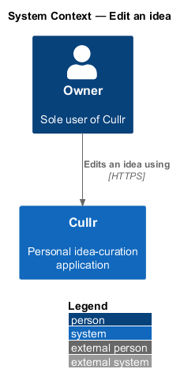
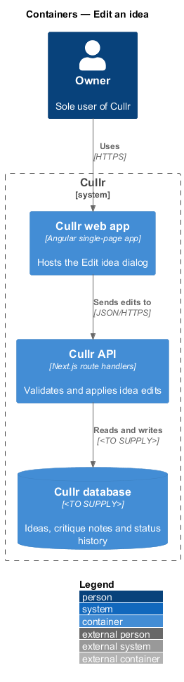
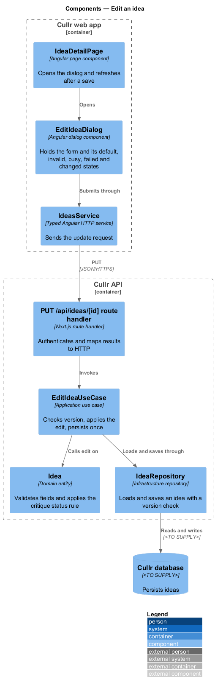
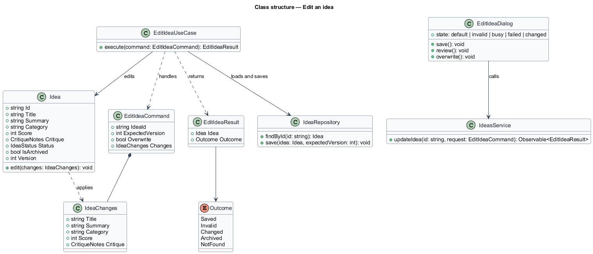
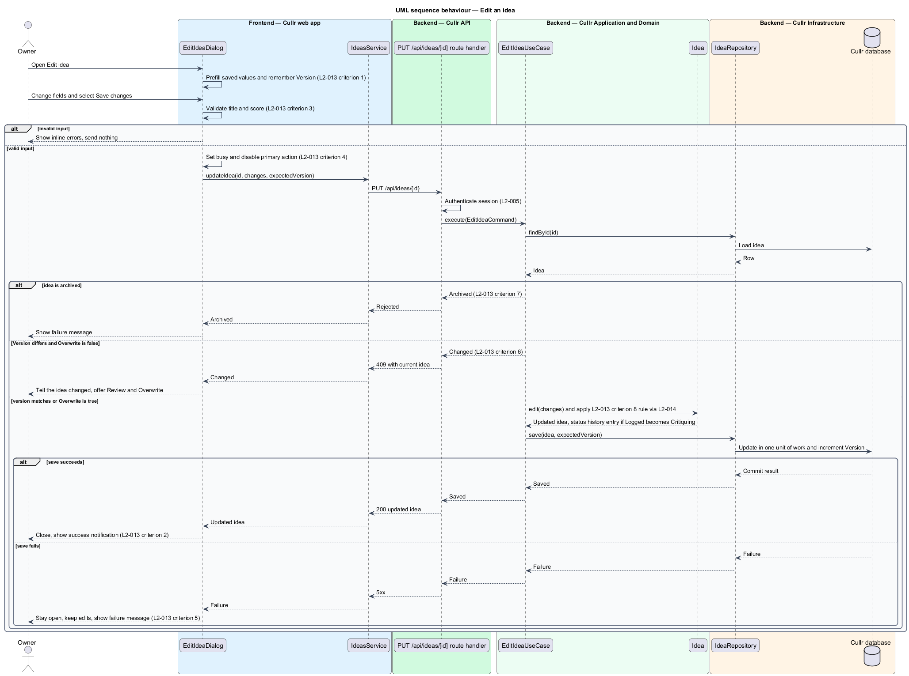

# Edit an idea

## Overview

Cullr is a single-owner idea-curation application. An *idea* is a titled, categorised record of a product or project concept, and an idea is *active* until the owner archives it. The *Edit idea dialog* is the modal form that changes the saved fields of one active idea: Title, Summary, Category, Score and Critique notes.

The owner opens the dialog from the Edit idea action on Idea detail or from the Edit action on a row of Ideas. *Critique notes* are the owner-written fields Strengths, Risks and Next step. Saving critique notes also drives one status rule: an idea with status Logged moves to Critiquing, as defined in the `idea-status` design.

*Optimistic concurrency* is a conflict-detection technique in which a writer states the version of the record it read and the server rejects the write when the stored version differs. The feature uses it so that an edit made from a stale copy cannot overwrite a newer change without the owner's knowledge.

## Description

The feature is a vertical slice from the dialog to the database.

- **`EditIdeaDialog`** — Angular dialog component. It prefills the saved values, validates input, and presents the default, invalid, busy, failed and changed states. It keeps the `Version` read at open time and sends it with the save.
- **`IdeasApiClient`** — typed Angular HTTP service. Its `updateIdea` method sends the changes and the expected version and returns a typed result.
- **`PUT /api/ideas/[id]` route handler** — Next.js route handler. It authenticates the session, calls the use case and maps each outcome to an HTTP response.
- **`EditIdeaUseCase`** — application use case. It loads the idea, rejects an archived idea, compares versions, applies the edit and saves in one unit of work.
- **`Idea`** — domain entity. Its `edit(changes)` method validates the fields and applies the Logged-to-Critiquing rule owned by `idea-status`. It carries an integer `Version` that increases on each save.
- **`IdeaRepository`** — infrastructure repository. Its `save` method writes only when the stored version equals the expected version. The database technology is `<TO SUPPLY>`.

Key behaviours, by criterion of `L2-013`:

1. Criterion 1: the dialog opens with the saved values prefilled.
2. Criterion 2: a valid save updates the idea everywhere it appears (Today, Ideas, Curated, Idea detail), closes the dialog and shows a success notification.
3. Criterion 3: an empty title or a score that is not a whole number from 1 to 10 shows an inline error with the summary "Fix 1 error before saving", and nothing is sent. Title length 1 to 120 characters and summary length up to 1,000 characters follow `L2-006`; limits for critique notes are `<TO SUPPLY>`.
4. Criterion 4: while the save is in flight, the primary action reads "Saving…" and is disabled.
5. Criterion 5: a failed save keeps the dialog open with the message "Couldn't save changes" and the edits, and offers "Try again".
6. Criterion 6: when the stored `Version` differs from the expected version, the server answers `409` with the current idea. The dialog tells the owner the idea changed and offers Review, which shows the current values, and Overwrite, which resends with `Overwrite` set. The wording and layout of this state are `<TO SUPPLY>`; no mock exists in `dialogs\edit-idea` for it.
7. Criterion 7: no edit action is offered for an archived idea, and the use case rejects the edit with the `Archived` outcome. The status code for this rejection is `<TO SUPPLY>`.
8. Criterion 8: when the idea is Logged and the saved critique notes are non-empty, `Idea.edit` sets the status to Critiquing and appends a status history entry. The rule belongs to `idea-status`.

Mocks: `dialogs\edit-idea\default`, `invalid`, `busy` and `failed`.

## Requirements

The feature realizes the following level-2 (L2) requirements. Each L2 requirement refines a level-1 (L1) requirement, cited by identifier.

| L2 ID | Refines (L1) | Requirement |
|-------|--------------|-------------|
| `L2-013` | `L1-005` | Edit an idea. The Edit idea dialog must change an existing active idea. |

## Diagrams

### System context

The owner edits ideas through Cullr; the feature involves no external system.

### Containers

The Cullr web app sends the edit to the Cullr API, which reads and writes the Cullr database.

### Components

`EditIdeaDialog` submits through `IdeasApiClient`; in the API the route handler invokes `EditIdeaUseCase`, which edits the `Idea` and saves it through `IdeaRepository`.

### Class structure

`EditIdeaUseCase` handles an `EditIdeaCommand` carrying `IdeaChanges` and an expected version, and returns an `EditIdeaResult` with one of five `Outcome` values.

### Behaviour — edit an idea

Client-side validation runs first. On the server, an archived idea and a version mismatch each end the flow with a distinct outcome, and a successful save applies the critique status rule and increments the version.

