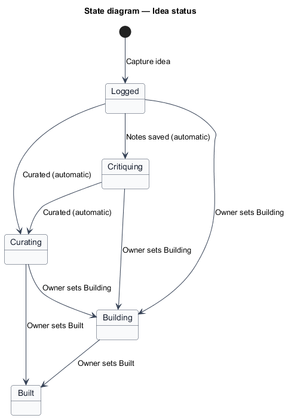
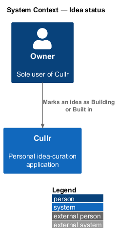
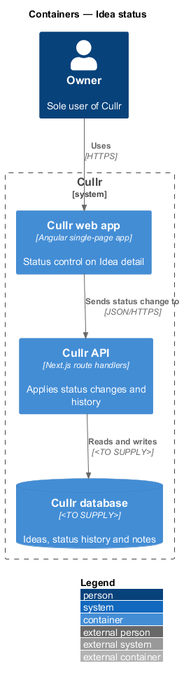
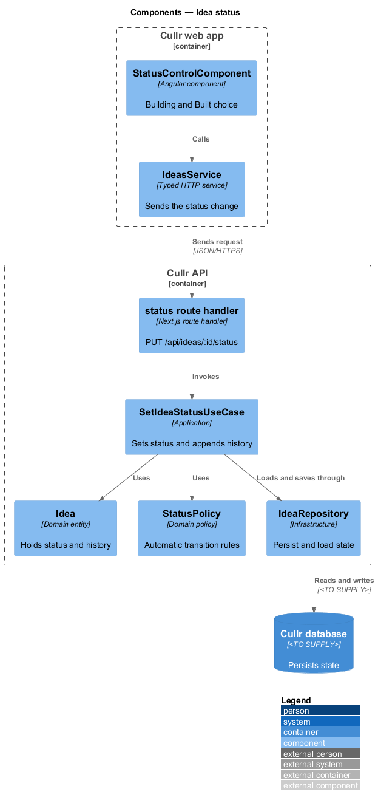
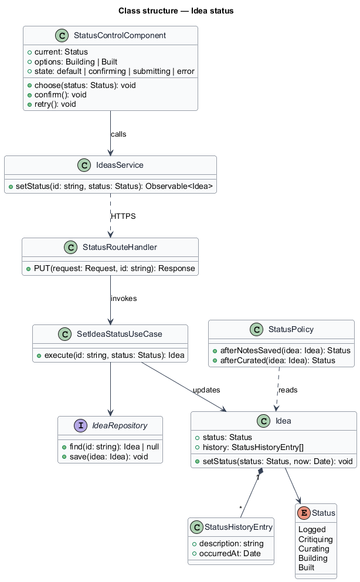
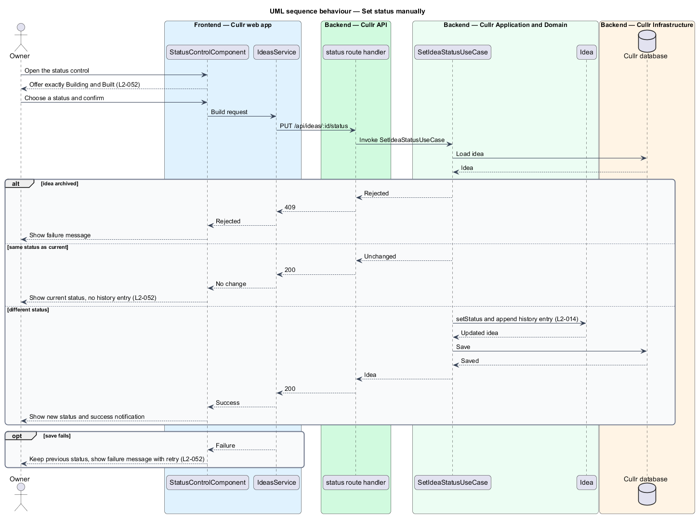
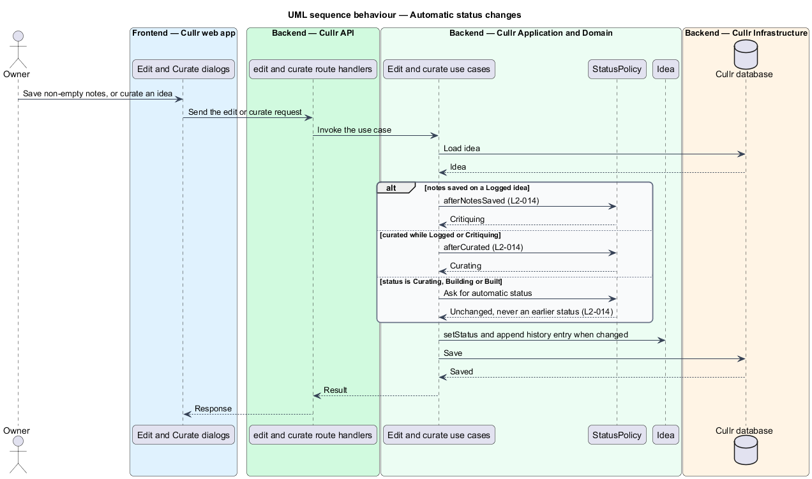

# Idea status

## Overview

Cullr is a personal idea-curation application for a single owner. Every idea has a *status* that records how far it has progressed. The status is exactly one of Logged, Critiquing, Curating, Building or Built.

*Idea status* is the capability that owns these rules. Cullr sets *Critiquing* and *Curating* automatically as the owner works. The owner sets *Building* and *Built* manually on the Idea detail screen. Every change adds an entry to the idea's *status history*, a list that is never edited or removed.

## Description

The feature is a vertical slice that spans the domain rules and the manual control on Idea detail.

- **`StatusPolicy`** — domain policy that holds the automatic rules. `afterNotesSaved` moves `Logged` to `Critiquing`. `afterCurated` moves `Logged` or `Critiquing` to `Curating`. No automatic rule moves an idea to an earlier status.
- **`StatusHistoryEntry`** — immutable record with a description and a time. The `Idea` entity only appends entries.
- **`StatusControlComponent`** — Angular component on Idea detail. It offers exactly Building and Built, asks for confirmation, and shows the success notification, or the failure message with a retry action while the previous status stays shown.
- **`IdeasApiClient`** — typed API client service for `PUT /api/ideas/:id/status`.
- **status route handler** — Next.js route handler.
- **`SetIdeaStatusUseCase`** — application-layer use case. It rejects an archived idea, ignores a request for the current status, and otherwise sets the status and appends a history entry.
- **`IdeaRepository`** — persistence interface. The database technology is `<TO SUPPLY>`.

Status transitions:

Key behaviours, by acceptance criterion:

- A newly captured idea is `Logged` (`L2-014`, criterion 1).
- Curating, archiving and restoring add history entries, as in "Curated as best of <period>" (`L2-014`, criteria 4 and 5).
- Choosing the status the idea already has changes nothing and adds no entry (`L2-052`, criterion 3).
- An archived idea hides the control and the server rejects the change (`L2-052`, criterion 5).

## Requirements

The feature realizes the following level-2 (L2) requirements. Each L2 requirement refines a level-1 (L1) requirement, cited by identifier.

| L2 ID | Refines (L1) | Requirement |
|-------|--------------|-------------|
| `L2-014` | `L1-006` | Idea status lifecycle. |
| `L2-052` | `L1-006` | Set status manually. The Idea detail screen must let the owner mark an active idea as Building or Built. |

## Diagrams

### System context

The owner changes status by hand in Cullr. Cullr sets the other statuses by itself.

### Containers

The Cullr web app calls the Cullr API, which stores state in the Cullr database.

### Components

The control and client run in the browser. The route handler, use case, entity, policy and repository run in the Cullr API.

### Class structure

`Idea` owns the status and the append-only history. `StatusPolicy` supplies the automatic transitions used by edit and curate.

### Manual status sequence

The sequence shows a manual change to Building or Built, the no-op case and the failure path.

### Automatic status sequence

The sequence shows how notes and curation move an idea forward without the owner choosing a status.

