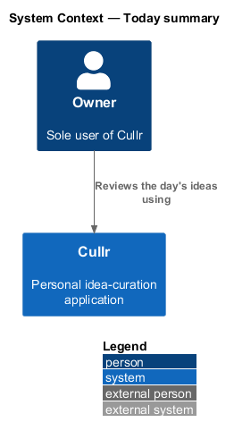
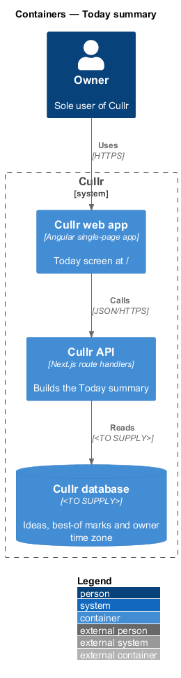
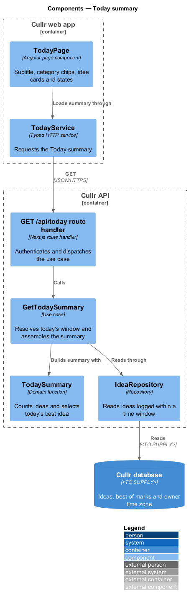
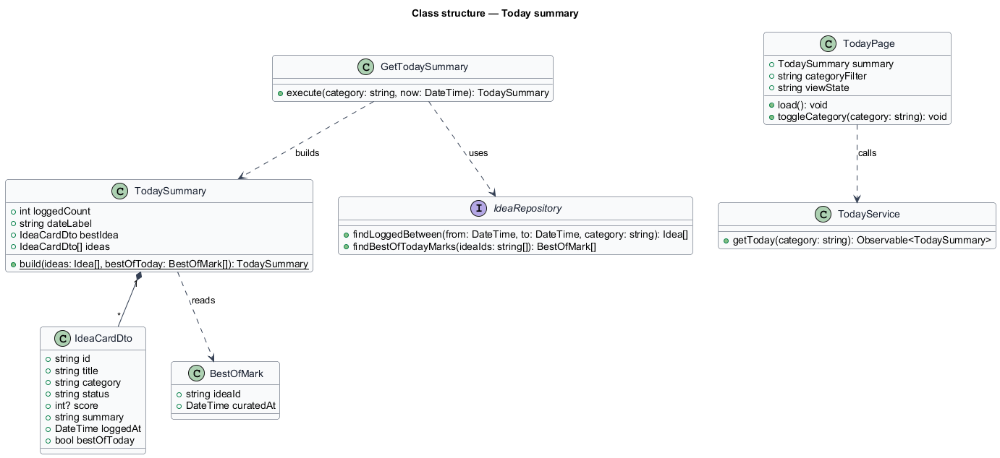
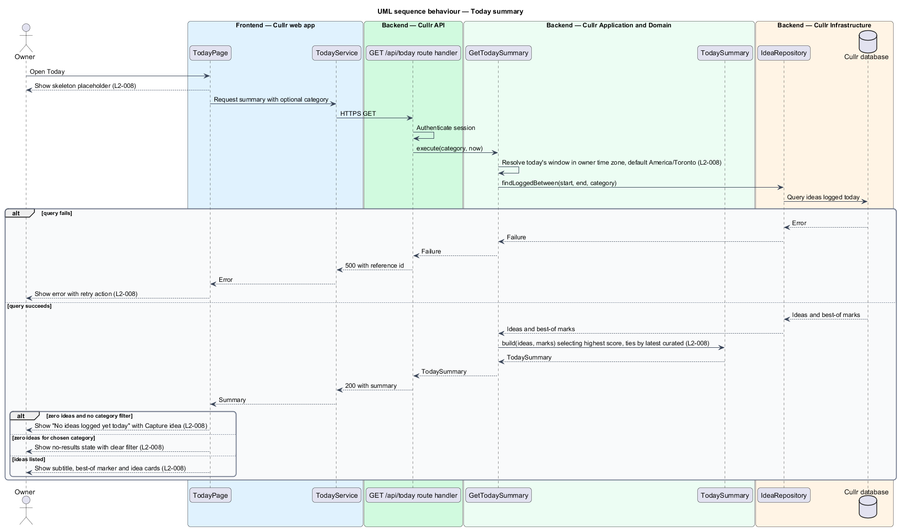

# Today summary

## Overview

Cullr is a personal idea-curation application used by a single owner who logs around 100 ideas a day. The Today screen at `/` is the first screen of the day. It answers one question: what was logged today, and which idea is best.

*Idea* — titled product or project concept that the owner logs, critiques, curates and may later build

*Best of today* — marker on an idea that the owner has curated as a best idea for the current day

*Today's best idea* — best-of-today idea with the highest score, with ties broken by the latest curated

The feature belongs to the `ideas` subsystem. It reads ideas created by the capture feature and presents Curate and Archive actions whose behaviour other features define.

## Description

The feature is a vertical slice from the Today page to the database. The mocks in `docs/mocks/pages/today/` show six states: `default`, `loading`, `empty`, `error`, `no-results` and `edge`.

- **`TodayPage`** — Angular page component. It renders the subtitle, the category filter chips, the idea cards and the loading, empty, no-results and error states.
- **`TodayService`** — typed Angular client service. It requests the summary, with an optional category.
- **`GET /api/today` route handler** — Next.js route handler in the Cullr API. It authenticates the session and calls the use case.
- **`GetTodaySummary`** — application use case. It resolves the start and end of today in the owner's time zone, reads the ideas logged in that window and builds the summary.
- **`TodaySummary`** — domain function and result. It counts the ideas, finds today's best idea and marks each best-of-today idea.
- **`IdeaCardDto`** — read model for one card: title, category, status, score, summary, logged time and the best-of-today flag.
- **`IdeaRepository`** — infrastructure repository. It reads ideas logged within a window, with an optional category filter, and the best-of-today marks for them.

Key behaviours, by acceptance criterion:

- The subtitle reads "N ideas logged today" followed by today's date. When at least one idea is best of today, the subtitle also names today's best idea (`L2-008` criterion 1).
- Each card shows title, category, status, score out of 10 or "Not scored", summary excerpt and logged time, with Curate and Archive actions. Each best-of-today idea carries the "Best of today" marker (`L2-008` criterion 2).
- When no idea is logged today, the page shows "No ideas logged yet today" with a Capture idea action (`L2-008` criterion 3).
- Choosing a category chip lists only today's ideas in that category. When none match, the no-results state offers to clear the filter (`L2-008` criterion 4).
- Long titles and summaries wrap or truncate with an accessible full value and do not overflow at any viewport width (`L2-008` criterion 5).
- Counts over 999 use thousands separators, for example 1,284 (`L2-008` criterion 6).
- A skeleton placeholder shows while loading. A failed load shows an error with a retry action (`L2-008` criterion 7).
- The day boundary uses the owner's time zone, with `America/Toronto` as the default (`L2-008` criterion 8). Where the time zone is stored is `<TO SUPPLY>`.

The Curate and Archive actions on each card open dialogs described by the curate and archive features. The Capture idea action opens the dialog described by `capture-idea`.

## Requirements

The feature realizes the following level-2 (L2) requirements. Each L2 requirement refines a level-1 (L1) requirement, cited by identifier.

| L2 ID | Refines (L1) | Requirement |
|-------|--------------|-------------|
| `L2-008` | `L1-003` | Today summary. The Today screen (`/`) must summarise the day. |

## Diagrams

The context diagram shows the owner using Cullr. For this slice it is near-identical to the container view, and both are kept.

The container diagram shows the web app requesting the summary from the API, which reads from the database.

The component diagram shows the page and client in the web app, and the route handler, use case, domain function and repository in the API.

The class diagram shows the summary, the card read model, the best-of mark and the repository contract.

The sequence diagram covers loading, the load failure, the empty state, the no-results state and the populated list.

