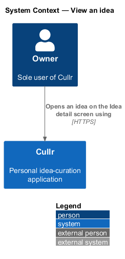
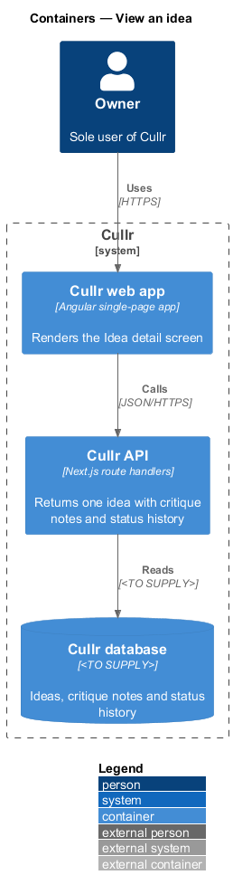
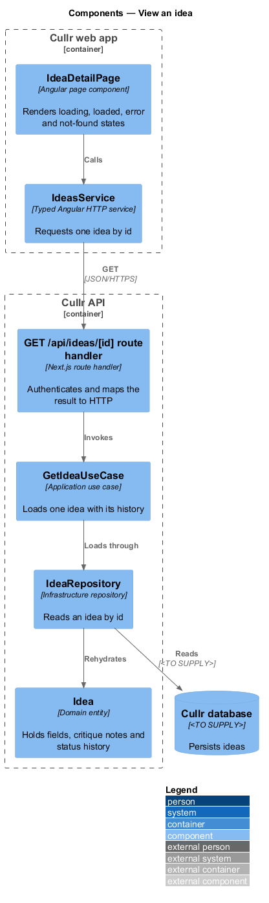
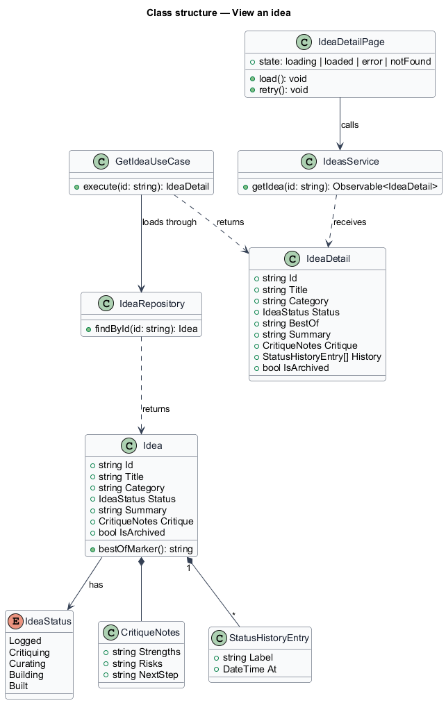
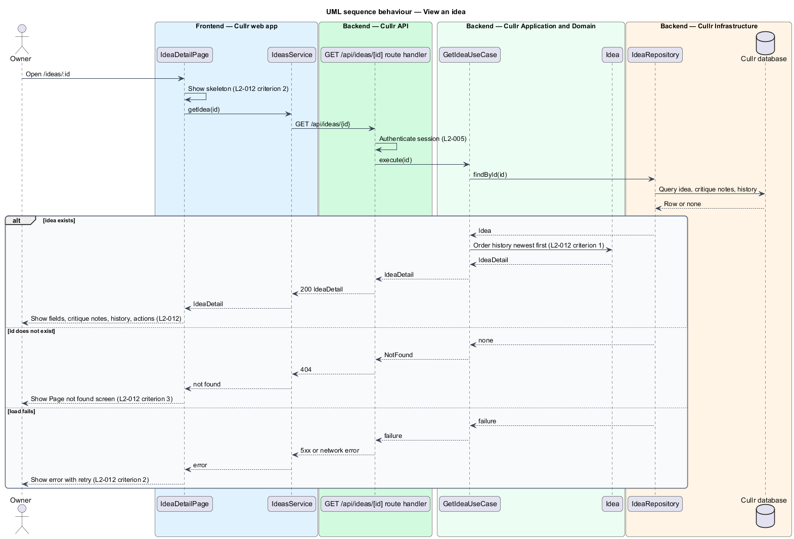

# View an idea

## Overview

Cullr is a single-owner idea-curation application. An *idea* is a titled, categorised record of a product or project concept that the owner logs, critiques, curates and may later build. *Idea detail* is the screen at `/ideas/:id` that shows one idea in full.

The owner opens Idea detail from a title link on Today, Ideas or Curated to read everything recorded about one idea in one place. The screen is the entry point for the per-idea actions Curate, Archive and Edit idea, and for the manual status control described in the `idea-status` design.

*Status history* is the ordered record of status changes, curation, archiving and restoring for one idea, each entry carrying a timestamp. *Critique notes* are the three owner-written fields Strengths, Risks and Next step.

This feature is read-only. Changing an idea belongs to the `edit-idea` design, and status rules belong to the `idea-status` design.

## Description

The feature is a vertical slice from the Angular page to the database.

- **`IdeaDetailPage`** — Angular page component at `/ideas/:id`. It renders four states: loading skeleton, loaded, error with retry, and not found. In the loaded state it shows the title, category, status, best-of marker, summary, critique notes and status history. It places Curate, Archive and Edit idea in the page header for an active idea.
- **`IdeasService`** — typed Angular HTTP service. It requests one idea by id and returns an `IdeaDetail`.
- **`GET /api/ideas/[id]` route handler** — Next.js route handler in the Cullr API. It authenticates the session and maps the use case result to `200`, `404` or an error status.
- **`GetIdeaUseCase`** — application use case. It loads the idea through the repository and returns an `IdeaDetail` whose history is ordered newest first.
- **`Idea`** — domain entity holding title, category, status, summary, critique notes, archived flag and status history.
- **`IdeaRepository`** — infrastructure repository that reads one idea by id from the Cullr database. The database technology is `<TO SUPPLY>`.

Key behaviours, by criterion of `L2-012`:

1. Criterion 1: the page shows title, category, status, the best-of marker when present, summary, Strengths, Risks, Next step, and the status history newest first with timestamps.
2. Criterion 2: a skeleton shows while loading; a failed load shows an error with a "Try again" action and a "Back to Ideas" link.
3. Criterion 3: an unknown id yields `404`, and the page shows the Page not found screen.
4. Criterion 4: long titles and summaries wrap at every viewport width without overflow.
5. Criterion 5: Curate, Archive and Edit idea are offered for an active idea. For an archived idea the page shows the Archived badge, Restore and Delete permanently, and a note that editing is turned off.

Mocks: `pages\idea-detail\default`, `loading`, `error`, `edge` (long text) and `read-only` (archived idea); `pages\not-found\default` for the unknown id.

## Requirements

The feature realizes the following level-2 (L2) requirements. Each L2 requirement refines a level-1 (L1) requirement, cited by identifier.

| L2 ID | Refines (L1) | Requirement |
|-------|--------------|-------------|
| `L2-012` | `L1-005` | View an idea. The Idea detail screen (`/ideas/:id`) must show one idea. |

## Diagrams

### System context

The owner reads an idea through Cullr; the feature involves no external system.

### Containers

The Cullr web app requests one idea from the Cullr API, which reads it from the Cullr database.

### Components

`IdeaDetailPage` calls `IdeasService`; in the API the route handler invokes `GetIdeaUseCase`, which reads the `Idea` through `IdeaRepository`.

### Class structure

`GetIdeaUseCase` returns an `IdeaDetail` built from an `Idea`, which holds `CritiqueNotes`, an `IdeaStatus` and a list of `StatusHistoryEntry` items.

### Behaviour — view an idea

The page shows a skeleton while the request runs. The result is the loaded idea, the Page not found screen for an unknown id, or an error with retry when the load fails.

