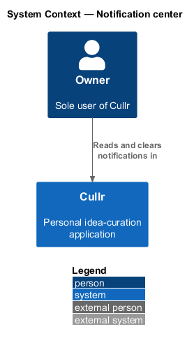
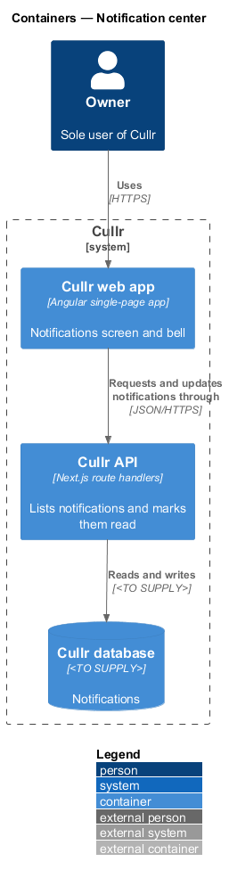
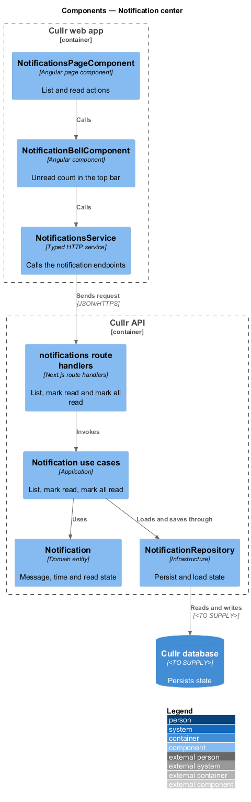
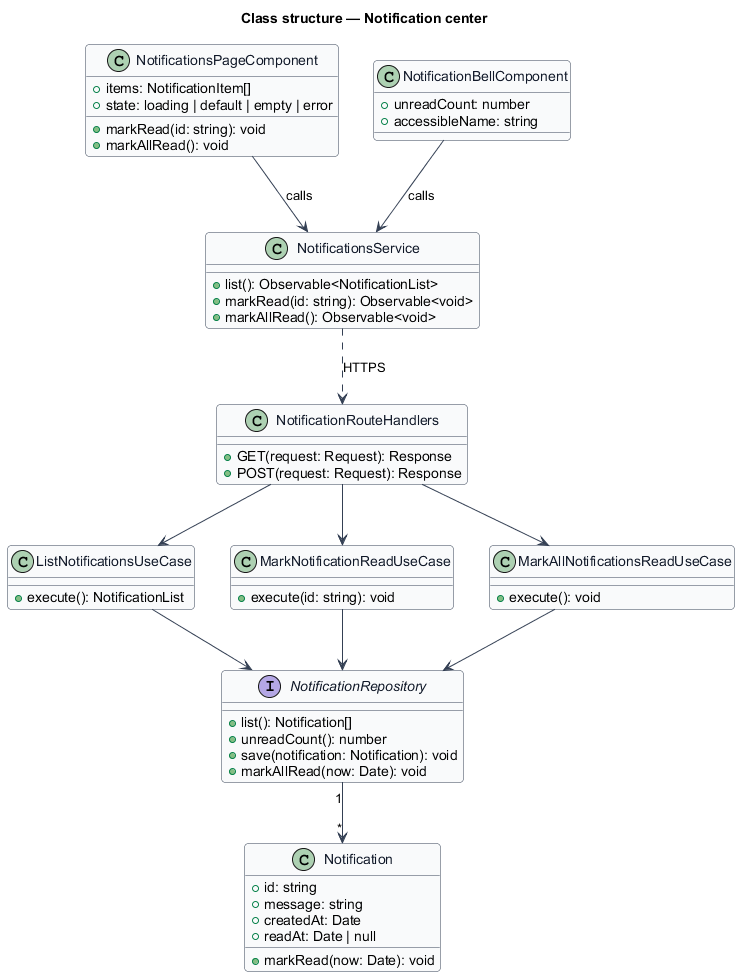
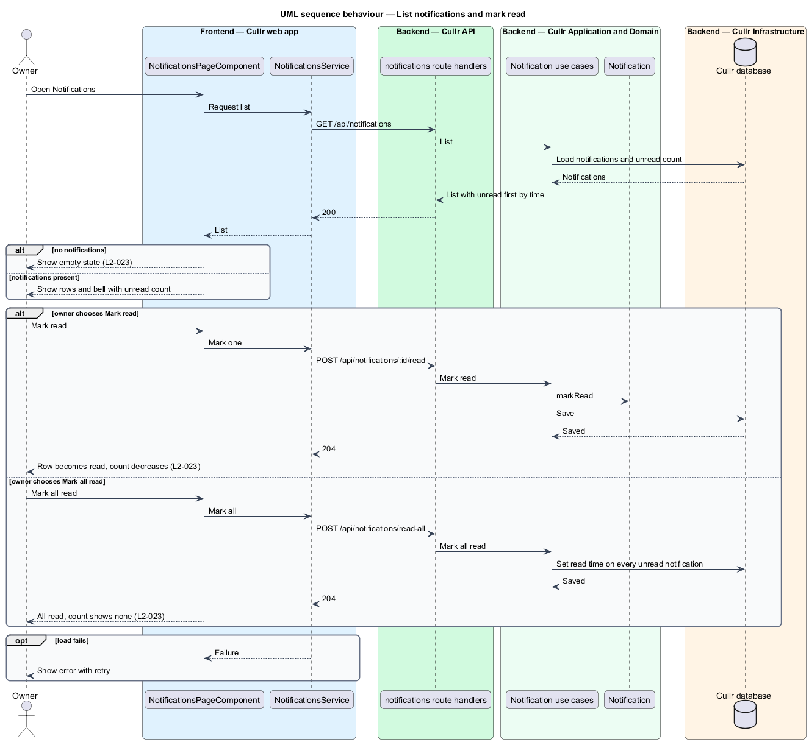

# Notification center

## Overview

Cullr is a personal idea-curation application for a single owner. *Notification center* is the Notifications screen at `/notifications` together with the bell in the top bar. It lists the notifications that Cullr created for the owner and lets the owner mark them read.

A *notification* is a short message with a time and a *read state*. The *unread count* is the number of unread notifications. The creation of notifications belongs to `notification-events`, and short-lived feedback belongs to `toast-feedback`.

## Description

The feature is a vertical slice from the screen and the bell to the Cullr database.

- **`NotificationsPageComponent`** — Angular page component. It lists each notification with message, time and read state, unread first by time, with "Mark read" and "Mark all read" actions. States are `default`, `loading`, `empty` and `error`.
- **`NotificationBellComponent`** — Angular component in the top bar. It shows the unread count and the accessible name, for example "Notifications, 3 unread".
- **`NotificationsService`** — typed HTTP service.
- **notifications route handlers** — Next.js route handlers: `GET /api/notifications`, `POST /api/notifications/:id/read` and `POST /api/notifications/read-all`.
- **`ListNotificationsUseCase`**, **`MarkNotificationReadUseCase`** and **`MarkAllNotificationsReadUseCase`** — application-layer use cases.
- **`Notification`** — domain entity with `message`, `createdAt` and `readAt`. Its `markRead` method is idempotent.
- **`NotificationRepository`** — persistence interface, shared with `notification-events`. The database technology is `<TO SUPPLY>`.

Key behaviours, by acceptance criterion:

- Each notification shows message, time and read state, with unread first by time. The bell shows the unread count with an accessible name (`L2-023`, criterion 1).
- "Mark read" makes one notification read and lowers the count. "Mark all read" makes all read and the count shows none (`L2-023`, criteria 2 and 3).
- No notifications show the empty state. Loading shows a skeleton and a failed load shows an error with retry (`L2-023`, criterion 4).

## Requirements

The feature realizes the following level-2 (L2) requirements. Each L2 requirement refines a level-1 (L1) requirement, cited by identifier.

| L2 ID | Refines (L1) | Requirement |
|-------|--------------|-------------|
| `L2-023` | `L1-009` | Notification list. The Notifications screen (`/notifications`) must list the owner's notifications. |

## Diagrams

### System context

The owner works with Cullr directly. No external system takes part.

### Containers

The Cullr web app calls the Cullr API, which stores state in the Cullr database.

### Components

The page, bell and client run in the browser. The route handlers, use cases, entity and repository run in the Cullr API.

### Class structure

Three use cases act on `Notification` through one repository. The bell reads the unread count from the same client.

### List and mark read sequence

The sequence shows the list load, marking one notification read and marking all read.

