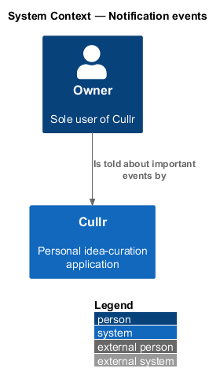
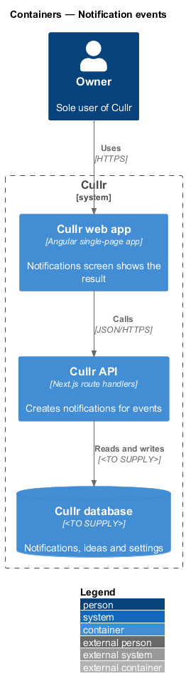
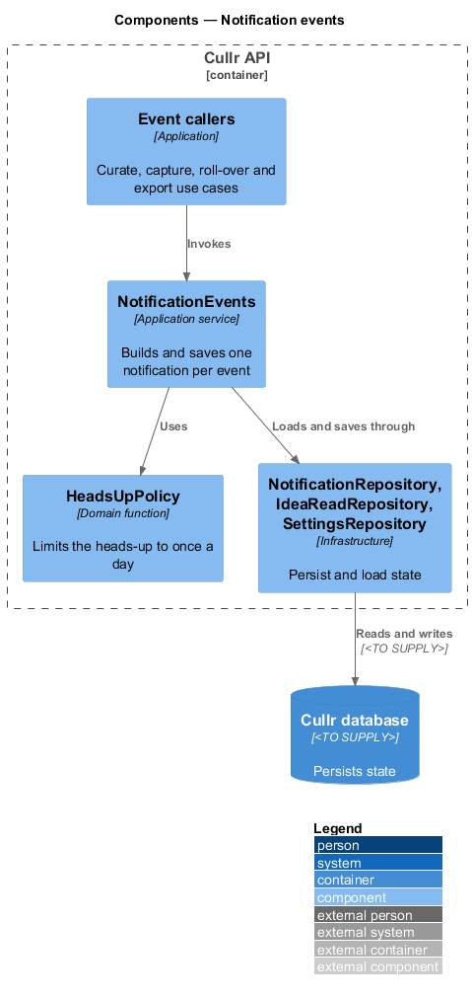
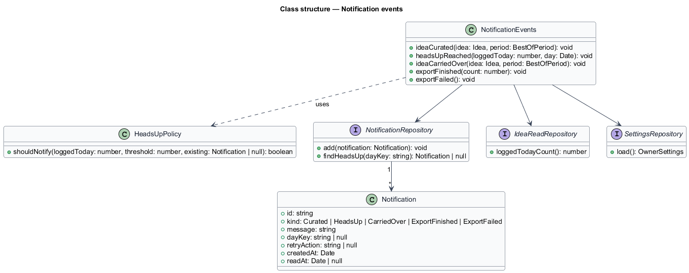
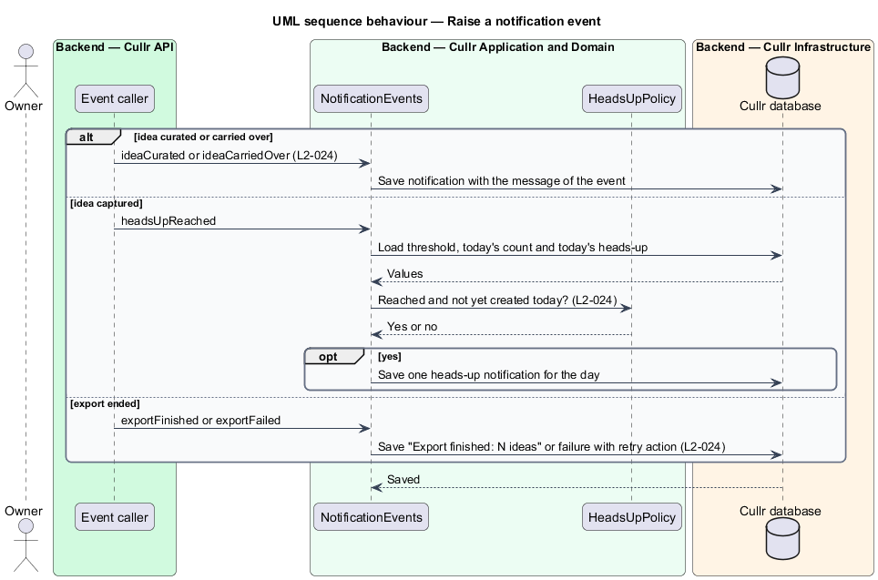

# Notification events

## Overview

Cullr is a personal idea-curation application for a single owner. *Notification events* is the capability that decides when Cullr creates a notification. It has no screen of its own; the notifications it creates appear in the `notification-center`.

An *event* is something that happened in Cullr and that the owner should hear about. Four kinds of event create notifications: an idea is curated, the heads-up threshold is reached, an idea is carried over to a higher best-of period, and an export finishes or fails. The daily capture reminder is described in `daily-reminder`.

The *heads-up threshold* is a number the owner sets in Settings. It warns the owner when the number of ideas logged in one day approaches a volume the owner wants to watch.

## Description

The feature is a backend slice shared by several other features.

- **`NotificationEvents`** — application service with one method per event: `ideaCurated`, `headsUpReached`, `ideaCarriedOver`, `exportFinished` and `exportFailed`. Each method builds a `Notification` and saves it.
- **`HeadsUpPolicy`** — domain function. It reports whether the count of ideas logged today has reached the threshold and whether the heads-up for that day already exists, so that exactly one heads-up is created per day.
- **`Notification`** — domain entity shared with `notification-center`. It has a `kind` and an optional `retryAction` for the failed-export case.
- **`NotificationRepository`**, **`IdeaReadRepository`** and **`SettingsRepository`** — infrastructure repositories. `SettingsRepository` supplies the threshold. The database technology is `<TO SUPPLY>`.

Callers: `CurateIdeasUseCase` in `curate-idea` calls `ideaCurated`. `CaptureIdeaUseCase` in `capture-idea` calls `headsUpReached` after each save. `RollOverPeriodsUseCase` in `best-of-period-end` calls `ideaCarriedOver`. The export use case in `export-ideas` calls `exportFinished` and `exportFailed`.

Message formats, by acceptance criterion:

- "<title> curated as best of <period>" (`L2-024`, criterion 1).
- "N ideas logged today — approaching your <threshold> heads-up", created exactly once per day (`L2-024`, criterion 2).
- "<title> carried over as best of <period>" (`L2-024`, criterion 3).
- "Export finished: N ideas", and a failure message that offers to try again (`L2-024`, criterion 4).

## Requirements

The feature realizes the following level-2 (L2) requirements. Each L2 requirement refines a level-1 (L1) requirement, cited by identifier.

| L2 ID | Refines (L1) | Requirement |
|-------|--------------|-------------|
| `L2-024` | `L1-009` | Notification events. |

## Diagrams

### System context

Cullr creates notifications by itself. The owner reads them in the Notifications screen.

### Containers

The Cullr web app calls the Cullr API, which stores state in the Cullr database.

### Components

Four use cases in the Cullr API call `NotificationEvents`. No browser component takes part.

### Class structure

`NotificationEvents` builds every notification kind. `HeadsUpPolicy` keeps the heads-up to one per day.

### Event sequence

The sequence shows the heads-up check after a capture, and the curated, carry-over and export events.

