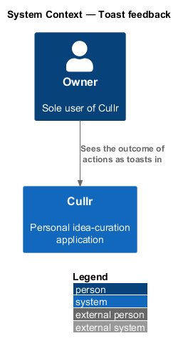
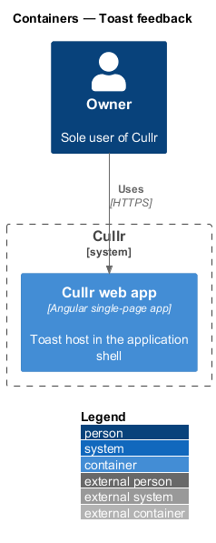
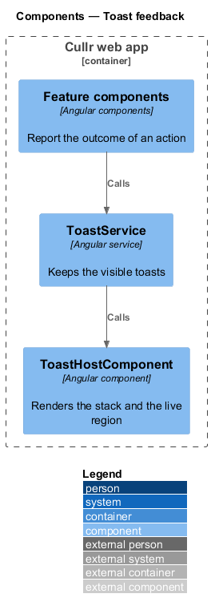
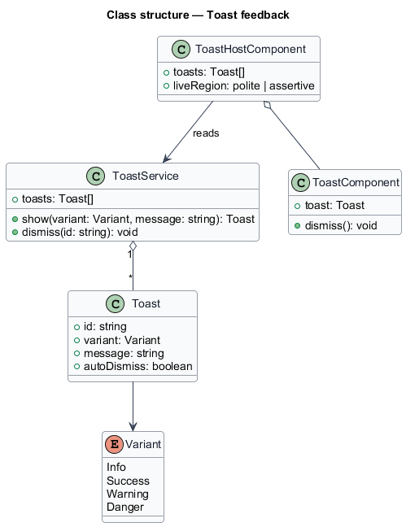
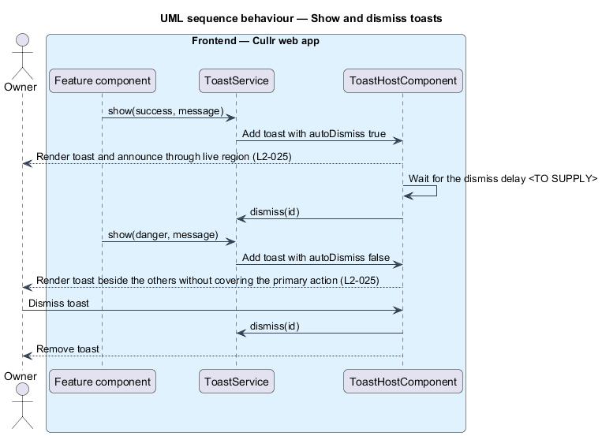

# Toast feedback

## Overview

Cullr is a personal idea-curation application for a single owner. *Toast feedback* is the capability that tells the owner the outcome of an action right away without leaving the screen. A *toast* is a small, non-blocking message that appears over the page and, in most cases, disappears on its own.

A toast has one of four *variants*: info, success, warning and danger. Toasts differ from notifications. A notification is stored and listed in `notification-center`. A toast is shown once in the browser and is not stored.

## Description

The feature is a browser-only slice. It adds no endpoint and no stored data.

- **`ToastService`** — Angular service. Feature components call `show(variant, message)` after an action succeeds or fails. It keeps the list of visible toasts.
- **`ToastHostComponent`** — Angular component placed once in the application shell. It renders the stack of toasts and announces each through a live region so that assistive technology reads it.
- **`ToastComponent`** — Angular component for one toast. It shows the variant, the message and a dismiss control with an accessible name.
- **`Toast`** — value type with `id`, `variant`, `message` and `autoDismiss`.

Rules, by acceptance criterion:

- Each idea action reports its outcome with the matching variant. A toast is announced and does not block the page (`L2-025`, criterion 1).
- Several toasts stack without covering the primary action, and each can be dismissed (`L2-025`, criterion 2).
- A danger toast does not auto-dismiss. The other variants dismiss after a delay of `<TO SUPPLY>` (`L2-025`, criterion 3).

## Requirements

The feature realizes the following level-2 (L2) requirements. Each L2 requirement refines a level-1 (L1) requirement, cited by identifier.

| L2 ID | Refines (L1) | Requirement |
|-------|--------------|-------------|
| `L2-025` | `L1-009` | Transient feedback. |

## Diagrams

### System context

The owner sees a toast after each action in Cullr. No external system takes part.

### Containers

The Cullr web app calls the Cullr API, which stores state in the Cullr database.

### Components

Feature components call `ToastService`, which feeds `ToastHostComponent`. The Cullr API takes no part.

### Class structure

The service owns the list of toasts and the host renders it. Danger toasts carry `autoDismiss` false.

### Toast sequence

The sequence shows a success toast that dismisses itself and a danger toast that stays until the owner dismisses it.

