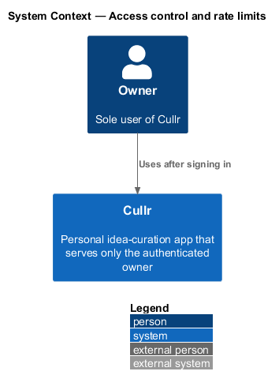
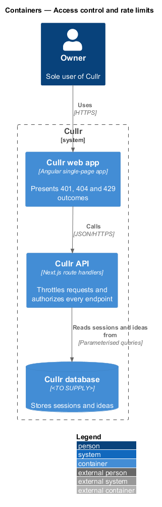
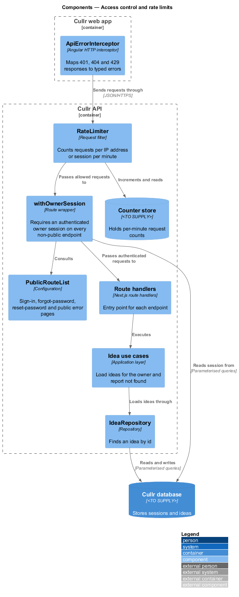
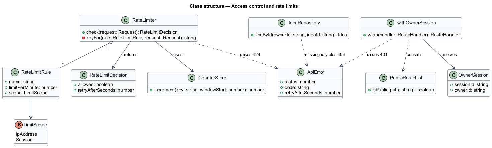
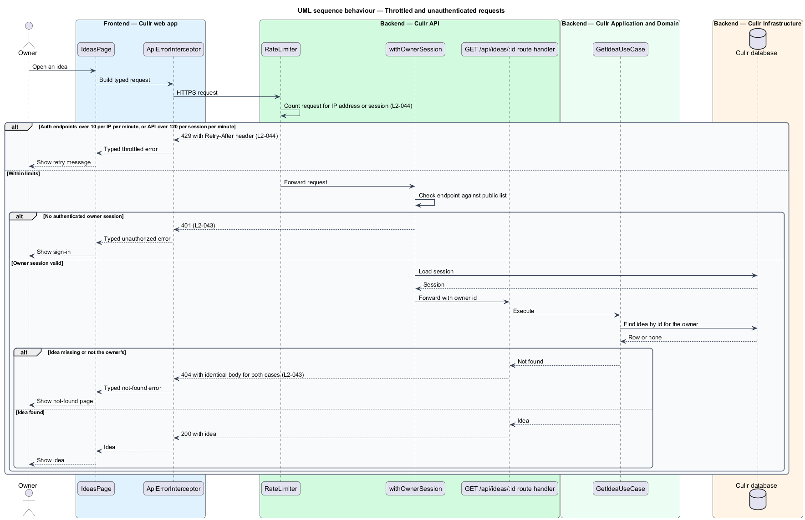

# Access control and rate limits

## Overview

Cullr is a personal idea-curation app used by one person, the owner. *Authorization* is the check that a request carries an authenticated owner session before the server acts on it. *Rate limiting* is the rejection of requests that exceed a fixed count within a time window. Both protect the owner's ideas and credentials (`L1-015`).

Two failure modes motivate the feature. Without authorization on each endpoint, an unauthenticated caller could read or change ideas. Without rate limiting, a caller could guess passwords or flood the API. The feature applies to every endpoint, so it has no single screen; the Sign in, Forgot password and Reset password screens exercise the strictest limit, and every other screen exercises the session limit.

Single-owner ownership simplifies the model: there is one owner, so authorization reduces to "is this request signed in", and the not-found rule prevents the API from revealing which idea ids exist.

## Description

The design places both checks in the Cullr API ahead of every route handler.

- **`RateLimiter`** — request filter that runs first. It counts requests per minute using a `CounterStore` and returns a `RateLimitDecision`. Two `RateLimitRule` values apply:
  - sign-in, forgot-password and reset-password requests are limited to 10 per IP address per minute; the eleventh request is rejected with `429` and a `Retry-After` header (`L2-044`, criterion 1);
  - API requests are limited to 120 per signed-in session per minute; the next request is rejected with `429` (`L2-044`, criterion 2).
- **`CounterStore`** — holds the per-minute counts. Its technology (in-memory or database-backed) is `<TO SUPPLY>`.
- **`withOwnerSession`** — route wrapper applied to every route handler. It consults `PublicRouteList` and, for any other endpoint, requires a valid `OwnerSession`. Without one the response is `401` (`L2-043`, criterion 1). `PublicRouteList` contains sign-in, forgot-password, reset-password and public error pages only.
- **`IdeaRepository.findById`** — scopes the lookup to the owner. A missing idea and an idea that is not the owner's both yield `404` with an identical body, so the response does not distinguish them (`L2-043`, criterion 2).
- **`ApiErrorInterceptor`** — Angular HTTP interceptor in the Cullr web app. It maps `401`, `404` and `429` to typed errors for the page. It reads `Retry-After` for the throttled message. Presentation of these outcomes uses the existing error-page and notification mocks.

The wrapper is applied by construction: a route handler that is not wrapped is not exported. Whether a unit test enumerates routes is outside this design.

## Requirements

The feature realizes the following level-2 (L2) requirements. The specification gives each only a title and acceptance criteria; the criteria are summarised in the Description above.

| L2 ID | Refines (L1) | Requirement |
|-------|--------------|-------------|
| `L2-043` | `L1-015` | Authorization of every endpoint |
| `L2-044` | `L1-015` | Rate limiting |

## Diagrams

### System context

Only the owner uses Cullr, and only after signing in. The context is near-identical to the container level for this slice, so the container and component views carry the detail.

### Containers

The Cullr API throttles and authorizes before touching the Cullr database; the Cullr web app presents the outcomes.

### Components

`RateLimiter` runs before `withOwnerSession`, which runs before each route handler and use case.

### Class structure

`RateLimiter` aggregates `RateLimitRule` values and returns a `RateLimitDecision`. `withOwnerSession` consults `PublicRouteList` and resolves an `OwnerSession`.

### Behaviour — throttle and authorize a request

A request is first counted. Over the limit it receives `429` with `Retry-After`. Within the limit, a request without a session receives `401`, a request for a missing idea receives `404`, and a valid request succeeds.

