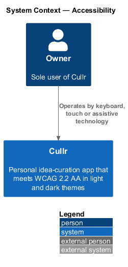
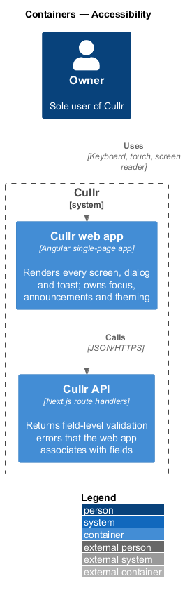
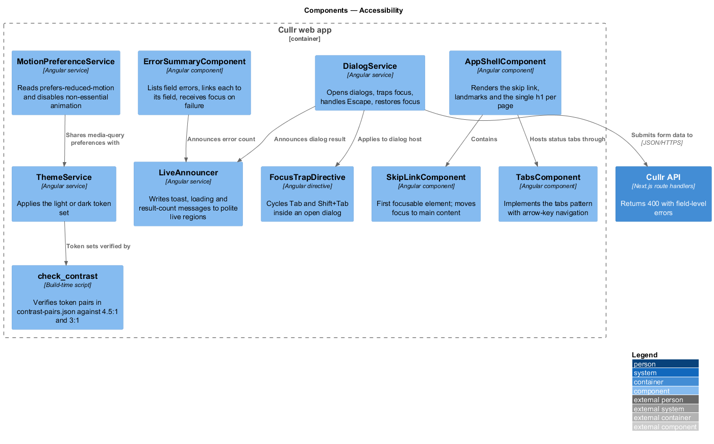
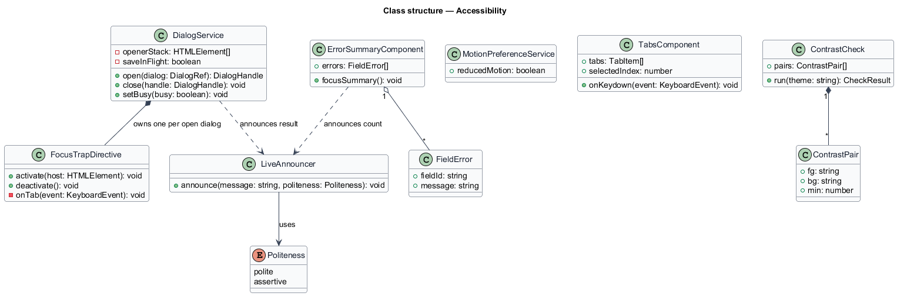
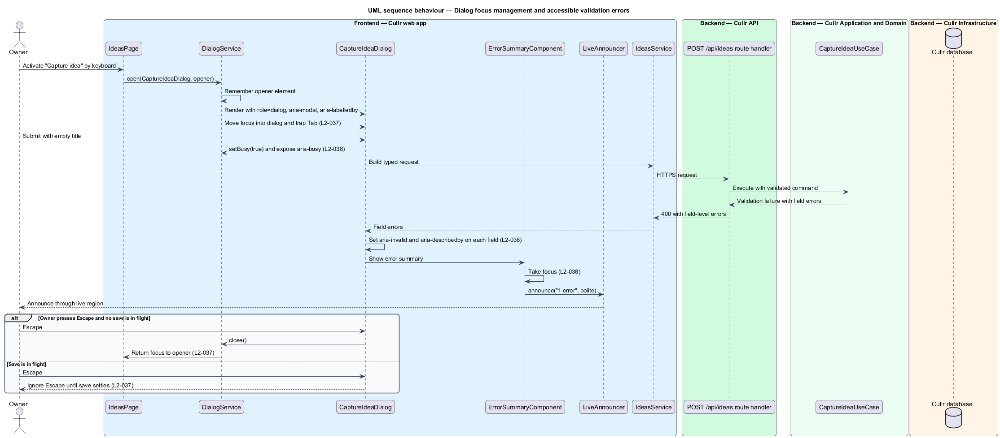
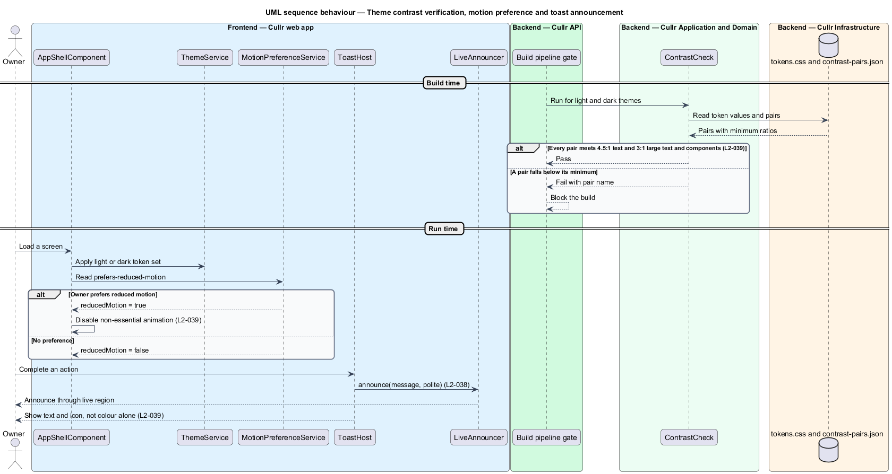

# Accessibility

## Overview

Cullr is a personal idea-curation app used by one person, the owner. *WCAG 2.2 AA* is the Web Content Accessibility Guidelines conformance level that Cullr targets in both light and dark themes (`L1-014`). *Assistive technology* is software or hardware, such as a screen reader or switch device, that the owner uses to operate the app instead of, or alongside, a mouse and screen.

Accessibility is a cross-cutting feature. No single screen owns it: every page, dialog and toast in the mocks under `docs/mocks/pages`, `docs/mocks/dialogs` and `docs/mocks/notifications` depends on the same shared behaviours. This document defines those behaviours once so that each screen inherits them. The three requirements group into keyboard and focus (`L2-037`), assistive-technology semantics (`L2-038`) and colour, contrast and motion (`L2-039`).

The feature lives entirely in the Cullr web app, with one backend dependency: the Cullr API returns field-level validation errors that the web app binds to fields.

## Description

The design introduces a small set of shared frontend building blocks and one build-time check.

- **`AppShellComponent`** — renders the landmarks (navigation, main, search) and exactly one `h1` per page (`L2-038`, criterion 1). Each table carries a caption and column `scope`.
- **`SkipLinkComponent`** — the first focusable element on every screen. It moves focus to the main landmark (`L2-037`, criterion 2).
- **`DialogService`** — opens dialogs from the mocks (capture, edit, archive, restore, curate, delete, export). It records the opener element, moves focus into the dialog, closes on Escape unless a save is in flight, and returns focus to the opener (`L2-037`, criterion 3). The dialog host exposes `role="dialog"`, `aria-modal="true"`, `aria-labelledby` and `aria-describedby`, matching the mocks.
- **`FocusTrapDirective`** — cycles Tab and Shift+Tab within an open dialog. The page behind the dialog is marked inert, as in the mocks.
- **`TabsComponent`** — implements the tabs pattern with arrow-key navigation for status tabs (`L2-037`, criterion 4).
- **`LiveAnnouncer`** — writes toast text, loading states and result-count changes to a polite live region (`L2-038`, criterion 3). The toast region in the mocks uses `role="status"` and `aria-live="polite"`.
- **`ErrorSummaryComponent`** — lists validation errors, links each to its field and takes focus after a failed submit. Each invalid field carries `aria-invalid="true"` and an `aria-describedby` reference to its error text (`L2-038`, criterion 2).
- **Busy state** — a busy action exposes `aria-busy` (`L2-038`, criterion 5). Icon-only buttons carry an `aria-label`; decorative icons carry `aria-hidden="true"` (`L2-038`, criterion 4).
- **`ThemeService`** — applies the light or dark token set from `docs/design-system/tokens`.
- **`MotionPreferenceService`** — reads `prefers-reduced-motion` and disables non-essential animation (`L2-039`, criterion 3).
- **`ContrastCheck`** — a build-time script that reads `docs/design-system/tokens/contrast-pairs.json` and fails the build when a pair falls below 4.5:1 for text or 3:1 for large text and UI components in either theme (`L2-039`, criterion 1). The same 3:1 minimum applies to the focus indicator (`L2-037`, criterion 1).
- **Status presentation** — every status shows text as well as colour (`L2-039`, criterion 2). Interactive targets measure at least 24 by 24 CSS pixels (`L2-039`, criterion 4).

Whether automated accessibility checks run in the end-to-end suite is `<TO SUPPLY>`.

## Requirements

The feature realizes the following level-2 (L2) requirements. The specification gives each only a title and acceptance criteria; the criteria are summarised in the Description above.

| L2 ID | Refines (L1) | Requirement |
|-------|--------------|-------------|
| `L2-037` | `L1-014` | Keyboard and focus |
| `L2-038` | `L1-014` | Assistive technology |
| `L2-039` | `L1-014` | Colour, contrast and motion |

## Diagrams

### System context

The owner operates Cullr by keyboard, touch or assistive technology. The context is near-identical to the container level for this slice, so the container and component views carry the detail.

### Containers

The Cullr web app owns focus, announcements and theming. The Cullr API contributes only the field-level errors.

### Components

Inside the Cullr web app, `DialogService` composes the focus trap and the announcer, while `ThemeService` and `ContrastCheck` govern colour.

### Class structure

`DialogService` owns a `FocusTrapDirective` per open dialog and uses `LiveAnnouncer`. `ErrorSummaryComponent` aggregates `FieldError` items.

### Behaviour — dialog focus and accessible validation errors

A dialog opens with focus inside and trapped. A failed save returns field errors, which receive `aria-invalid`, `aria-describedby` and a focused summary. Escape closes the dialog only when no save is in flight, and focus returns to the opener.

### Behaviour — theme contrast, reduced motion and toast announcement

The build blocks a release when a token pair misses its contrast minimum. At run time the app disables non-essential animation when the owner prefers reduced motion and announces toasts through a live region.

