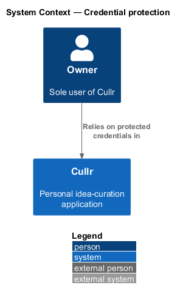
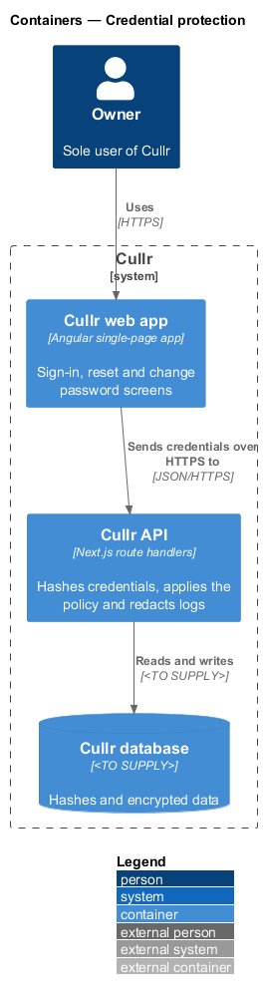
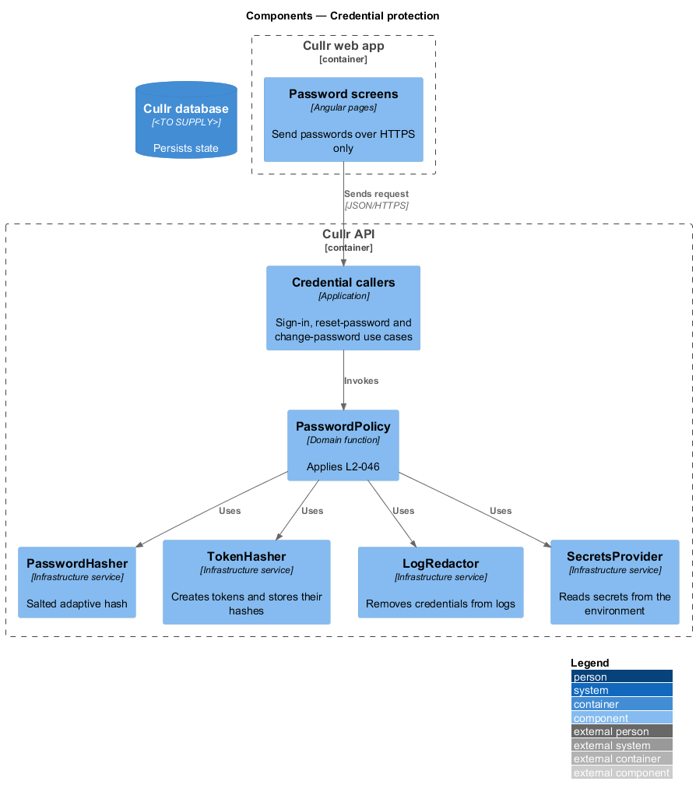
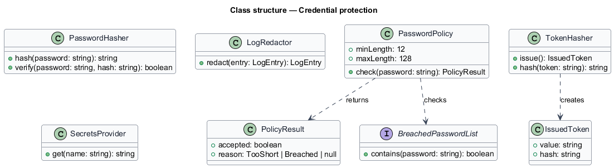
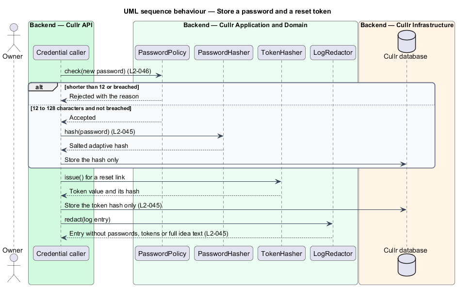

# Credential protection

## Overview

Cullr is a personal idea-curation application for a single owner, and the owner's account guards every idea. *Credential protection* is the set of rules that keep passwords, tokens and secrets safe, and the rule that sets how strong a new password has to be.

A *credential* is a password or a token. A *reset token* is the single-use value in a password-reset link. A *hash* is a one-way transformation of a credential, so that storing the hash does not reveal the credential. A *salted, adaptive hash*, for example Argon2id, adds a random value per credential and is deliberately slow to compute, which makes guessing expensive. A *secret* is a value such as a database password or signing key that the application needs to run.

## Description

The feature is a cross-cutting slice. Sign-in, reset-password and change-password call it. It has no screen of its own.

- **`PasswordHasher`** — infrastructure service. It stores only a salted, adaptive hash of a password and verifies a candidate against it. The algorithm and its parameters are `<TO SUPPLY>`; Argon2id is the example named in the requirement.
- **`TokenHasher`** — infrastructure service. It creates a random token for a reset link or an email-change link and stores only a hash of it.
- **`PasswordPolicy`** — domain function. It rejects a password shorter than 12 characters or found in a list of commonly breached passwords, with the reason, and accepts any characters, including spaces, for 12 to 128 characters. The list source is `<TO SUPPLY>`.
- **`LogRedactor`** — infrastructure service in the logging path. It removes passwords, tokens and full idea text from log lines, error messages and analytics events.
- **`SecretsProvider`** — infrastructure service. It reads secrets and credentials from the environment, so that none exists in source control.
- **dependency audit step** — a build step that checks dependencies for known critical or high vulnerabilities and blocks release when it finds one. The tool is `<TO SUPPLY>`.
- **encryption at rest** — the Cullr database and its backups are encrypted. The mechanism is `<TO SUPPLY>`.

Key behaviours, by acceptance criterion:

- A stored password is only a salted, adaptive hash. A stored reset token is only a hash (`L2-045`, criteria 1 and 2).
- Logs, error messages and analytics never contain passwords, tokens or full idea text (`L2-045`, criterion 3).
- A new password shorter than 12 characters or in the breached list is rejected with the reason. A password of 12 to 128 characters with any characters is accepted (`L2-046`).
- Data at rest and backups are encrypted, secrets come from the environment, and critical or high dependency vulnerabilities block release (`L2-047`).

## Requirements

The feature realizes the following level-2 (L2) requirements. Each L2 requirement refines a level-1 (L1) requirement, cited by identifier.

| L2 ID | Refines (L1) | Requirement |
|-------|--------------|-------------|
| `L2-045` | `L1-015` | Password and secret handling. |
| `L2-046` | `L1-015` | Password policy. |
| `L2-047` | `L1-015` | Data protection. |

## Diagrams

### System context

The owner works with Cullr directly. No external system takes part.

### Containers

The Cullr web app calls the Cullr API, which stores state in the Cullr database.

### Components

The use cases that handle credentials call the policy and the two hashers. The redactor and the secrets provider serve every part of the Cullr API.

### Class structure

The hashers, the policy, the redactor and the secrets provider are independent services that the credential use cases and the logging path call.

### Credential storage sequence

The sequence shows a new password passing the policy and being stored as a hash, and a reset token being stored as a hash.

