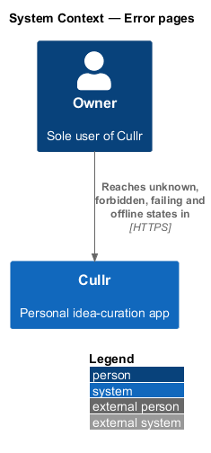
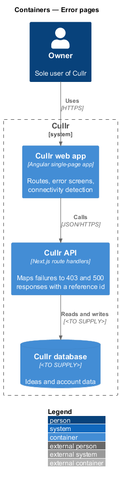
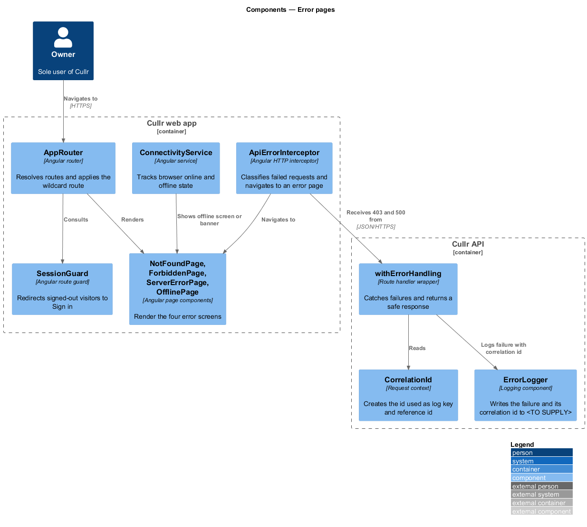
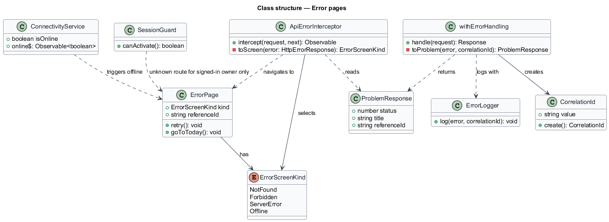
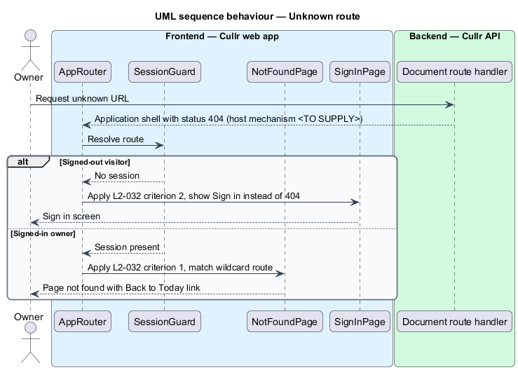
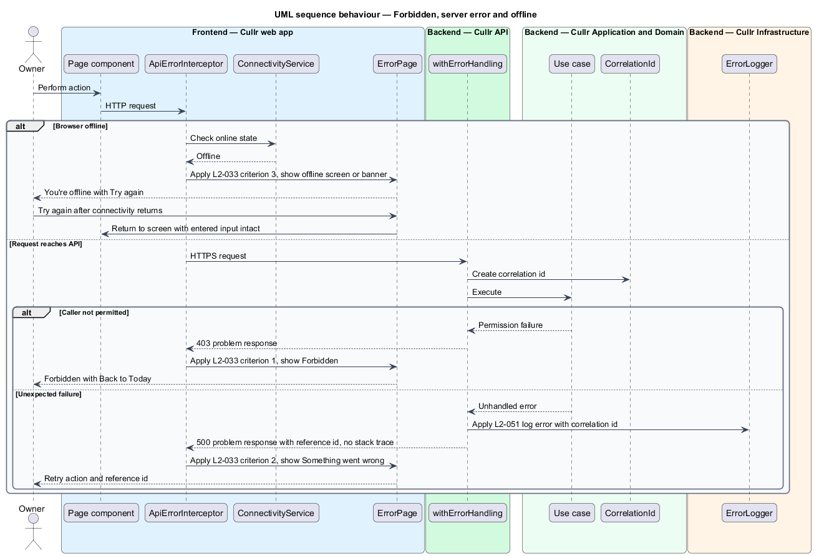

# Error pages

## Overview

Cullr is a single-owner idea-curation web app. An *error page* is a full-screen state that replaces a normal page when a request cannot be satisfied. Cullr has four: Page not found, Forbidden, Something went wrong and You're offline.

*Reference id* — short identifier returned with a server failure so the owner can quote it and the failure can be found in the log. The reference id is the correlation id defined by `L2-051`, which this document cites but does not design.

The feature exists so that each failure ends in a clear screen with a next step, never a blank page, a stack trace or a raw status code. Every screen offers a way back to Today, and the server-error screen additionally offers a retry. The feature belongs to the platform subsystem and applies to every route and every API call.

## Description

The feature is a vertical slice from the Angular route table to the Next.js route handlers.

- **`AppRouter`** — Angular router. A wildcard route at the end of the route table resolves any unknown path to `NotFoundPage`.
- **`SessionGuard`** — route guard. It redirects a signed-out visitor to Sign in before the wildcard route applies, so unknown routes disclose nothing to a signed-out visitor (criterion 2 of `L2-032`).
- **`NotFoundPage`, `ForbiddenPage`, `ServerErrorPage`, `OfflinePage`** — page components matching the mocks in `docs/mocks/pages/not-found`, `forbidden`, `server-error` and `offline`. Each shows a heading, one sentence of explanation and a primary action. Not found and Forbidden offer *Back to Today*; Something went wrong offers *Try again* and *Back to Today* and prints the reference id; You're offline offers *Try again* and *Back to Today*.
- **`ApiErrorInterceptor`** — Angular HTTP interceptor. It reads a failed response, maps the status to an `ErrorScreenKind` and navigates to the matching page. A 403 maps to Forbidden and a 5xx maps to Something went wrong. The interceptor passes other statuses, such as validation failures, to the caller so that forms handle them (see the `preserve-input` design).
- **`ConnectivityService`** — Angular service that exposes the browser online state as `isOnline` and `online$`. When the state becomes offline, the owner sees the offline screen or a banner. When the state becomes online, the owner can retry.
- **`withErrorHandling`** — wrapper applied to each Next.js route handler. It creates a `CorrelationId`, catches any unhandled failure, passes the error and id to `ErrorLogger`, and returns a `ProblemResponse` that contains the status, a generic title and the `referenceId`. The response never contains a stack trace or internal detail.
- **`CorrelationId`** and **`ErrorLogger`** — the id and the log writer. The log destination is `<TO SUPPLY>`.

Key behaviours, by acceptance criterion:

- Unknown route, signed in: Page not found with HTTP 404 and a link to Today (`L2-032`, criterion 1). The mechanism that gives the document request a 404 status depends on hosting and is `<TO SUPPLY>`.
- Unknown route, signed out: Sign in is shown, not a 404 (`L2-032`, criterion 2).
- Disallowed request: Forbidden with HTTP 403 and a link to Today (`L2-033`, criterion 1).
- Unexpected server failure: Something went wrong with a retry action and a reference id, and no internal detail (`L2-033`, criterion 2).
- Offline: the offline screen or banner appears; when connectivity returns, the owner retries and entered input remains (`L2-033`, criterion 3).

The context and container diagrams are near-identical to the component diagram in scope for this slice. All three are kept because the component view adds the error mapping on each side.

## Requirements

The feature realizes the following level-2 (L2) requirements. Each L2 requirement refines a level-1 (L1) requirement, cited by identifier.

| L2 ID | Refines (L1) | Requirement |
|-------|--------------|-------------|
| `L2-032` | `L1-012` | Page not found |
| `L2-033` | `L1-012` | Forbidden, server error and offline |

## Diagrams

The context diagram shows the owner reaching Cullr, the system in which all four error states occur.

The container diagram shows where each concern lives: routing and screens in the web app, status mapping and the reference id in the API.

The component diagram shows the interceptor, guard and connectivity service in the web app, and the error-handling wrapper, correlation id and logger in the API.

The class diagram shows the error screen kinds, the problem response and the types that select a screen.

The first sequence shows an unknown route, which resolves to Page not found for a signed-in owner and to Sign in for a signed-out visitor.

The second sequence shows a failing request, which resolves to the offline screen, Forbidden or Something went wrong with a reference id.

