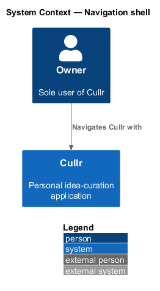
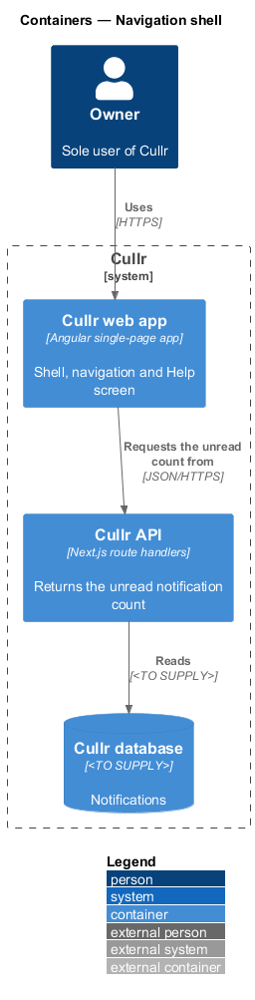
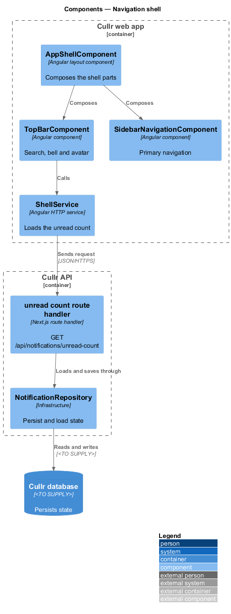
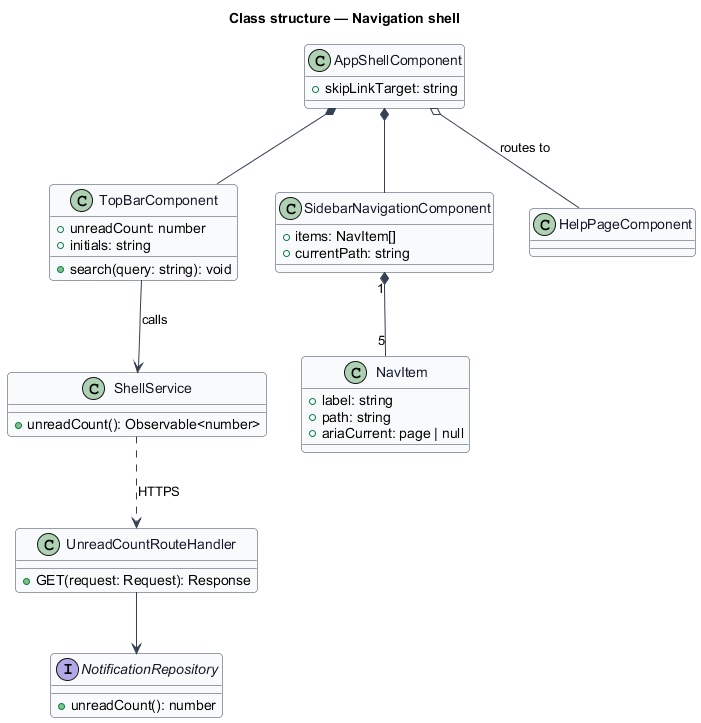
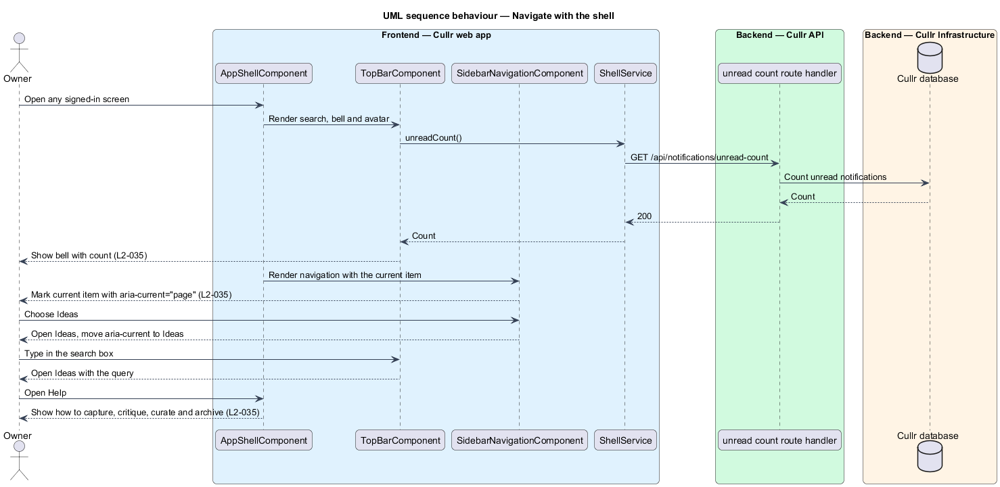

# Navigation shell

## Overview

Cullr is a personal idea-curation application for a single owner. The *navigation shell* is the frame around every screen of the signed-in area. It holds the *top bar*, the *sidebar* and the *Help* screen.

The top bar carries a search box, the notification bell and the account avatar. The sidebar carries the *primary navigation*: Today, Ideas, Curated, Archive and Settings. The Help screen at `/help` explains how to capture, critique, curate and archive ideas.

## Description

The feature is mostly a browser slice. It reads one value from the Cullr API: the unread notification count.

- **`AppShellComponent`** — Angular layout component. It composes the top bar, the sidebar, the content outlet and the footer, and places the skip link first (see `accessibility`).
- **`TopBarComponent`** — shows the search box, the notification bell and the avatar. The bell and its count come from `notification-center`. The avatar initials come from `edit-profile`.
- **`SidebarNavigationComponent`** — lists the five destinations and marks the current one with `aria-current="page"`.
- **`HelpPageComponent`** — static page that describes capture, critique, curate and archive.
- **`ShellService`** — Angular HTTP service for the unread count at `GET /api/notifications/unread-count`.
- **unread count route handler** — Next.js route handler that returns the count through `NotificationRepository`.

Search sends the query to the Ideas screen, where `browse-ideas` runs it. The layout at each viewport belongs to `responsive-layout`.

Key behaviours, by acceptance criterion:

- A signed-in owner sees navigation to Today, Ideas, Curated, Archive and Settings, a search box, notifications and the account avatar (`L2-035`, criterion 1).
- The navigation item of the current screen carries `aria-current="page"` (`L2-035`, criterion 2).
- The Help screen is reachable from the shell and describes how to capture, critique, curate and archive ideas (`L2-035`, criterion 3).

### Screen composition

The Shell and Help page entry of `docs/screen-composition.md` lists the following components. The implementation shall use them and shall build locally only the UI marked local.

- **Library:** `skip-link`, `top-bar`, `text-field` (`.search`), `button`, `badge` (`.badge--count`), `tooltip`, `avatar`, `sidebar-navigation`, and on Help `card` and `description-list`.
- **Local:** the Page shell (`.sidebar-layout`, `.page-header`, `.footer`), built once and shared by every authenticated dashboard page; the bare top bar variant for authentication and error pages.

## Requirements

The feature realizes the following level-2 (L2) requirements. Each L2 requirement refines a level-1 (L1) requirement, cited by identifier.

| L2 ID | Refines (L1) | Requirement |
|-------|--------------|-------------|
| `L2-035` | `L1-012` | Navigation shell. |

## Diagrams

### System context

The owner works with Cullr directly. No external system takes part.

### Containers

The Cullr web app calls the Cullr API, which stores state in the Cullr database.

### Components

The shell components and the service run in the browser. One route handler and the repository run in the Cullr API.

### Class structure

The shell composes the top bar, the sidebar and the content. The top bar reads the unread count through `ShellService`.

### Navigation sequence

The sequence shows the shell loading its unread count, the owner moving to a screen and the owner opening Help.

