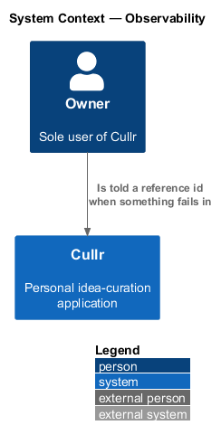
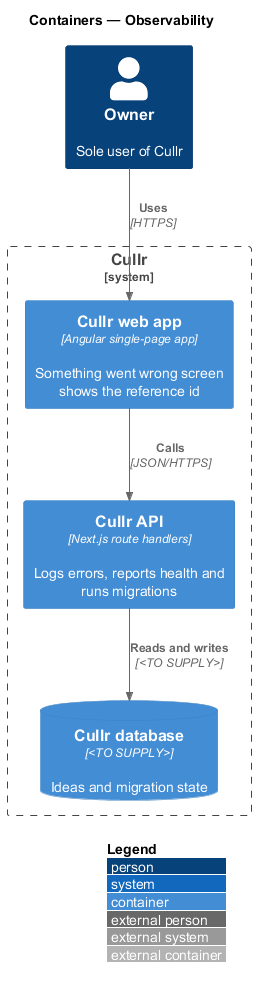
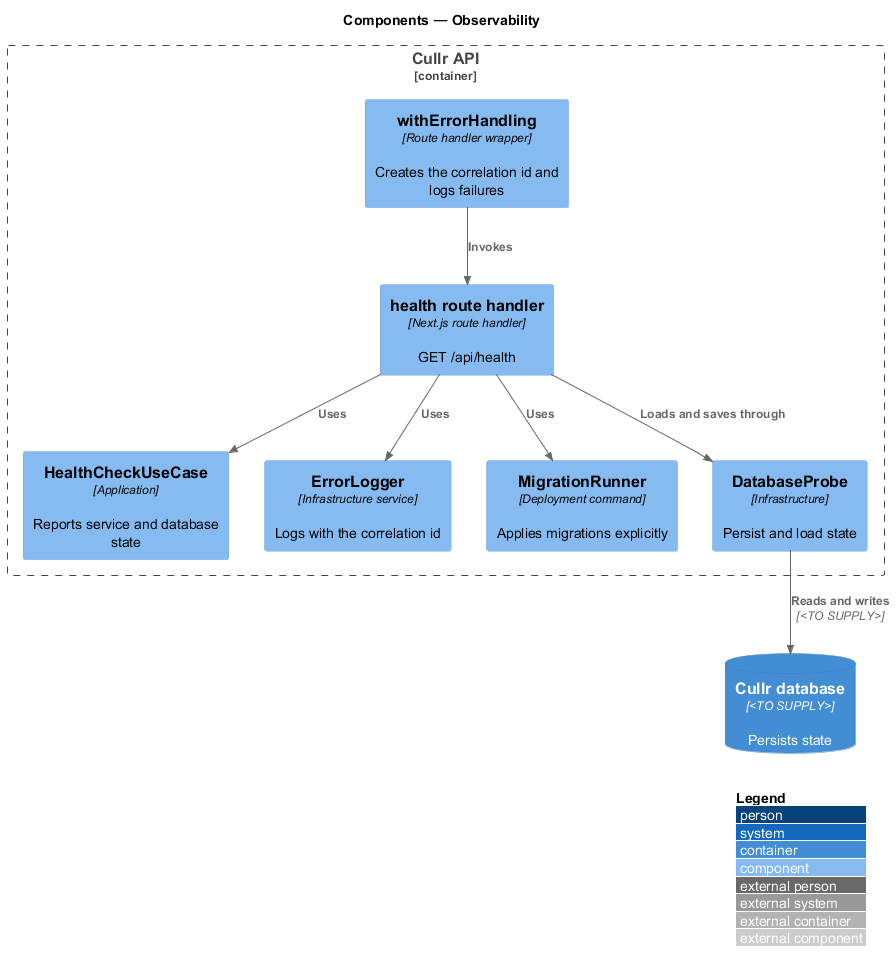
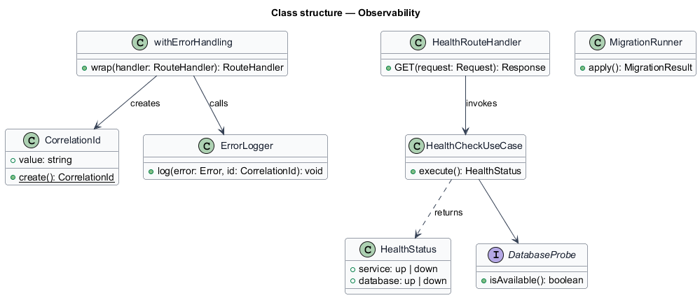
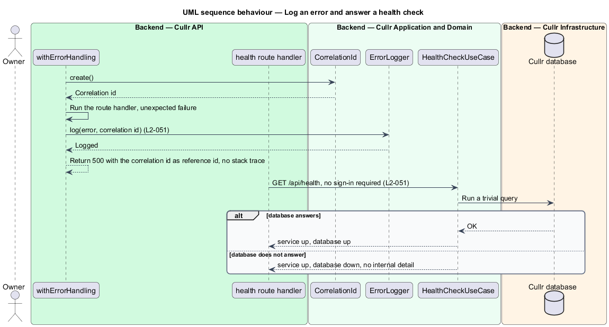

# Observability

## Overview

Cullr is a personal idea-curation application for a single owner. *Observability* is the set of capabilities that let the owner and the maintainer see what went wrong and whether Cullr is healthy, without exposing internal detail.

A *correlation id* is a unique value attached to one request. When a server error happens, Cullr logs it with the correlation id and returns the same value to the client as the *reference id*, so the owner can quote it and the maintainer can find the log line. A *health check* is an endpoint that reports whether the service and its database are available. A *migration* is a change to the database structure.

## Description

The feature is a backend slice that every route handler shares. The error-response wrapper and the screens that show the reference id belong to `error-pages`.

- **`withErrorHandling`** — wrapper around each route handler, described in `error-pages`. It creates the `CorrelationId` and calls `ErrorLogger` on an unexpected failure.
- **`ErrorLogger`** — writes the error with the correlation id, passed through `LogRedactor` (see `credential-protection`). The log destination is `<TO SUPPLY>`.
- **health route handler** — Next.js route handler at `GET /api/health`. It does not require sign-in.
- **`HealthCheckUseCase`** — application-layer use case. It checks that the service runs and that the database answers, and returns only `up` or `down` for each, with no internal detail.
- **`MigrationRunner`** — explicit command that applies pending database migrations during a deployment. The API never applies migrations on startup. The migration tool is `<TO SUPPLY>`.
- **`DatabaseProbe`** — infrastructure service that runs a trivial query against the Cullr database.

Key behaviours, by acceptance criterion:

- A server error is logged with a correlation id that is also returned as the reference id (`L2-051`, criterion 1).
- A health check request reports whether the service and the database are available, needs no sign-in and exposes no internal detail (`L2-051`, criterion 2).
- A deployment preserves stored ideas and applies migrations explicitly, never silently on startup (`L2-051`, criterion 3).

## Requirements

The feature realizes the following level-2 (L2) requirements. Each L2 requirement refines a level-1 (L1) requirement, cited by identifier.

| L2 ID | Refines (L1) | Requirement |
|-------|--------------|-------------|
| `L2-051` | `L1-012` | Reliability and observability. |

## Diagrams

### System context

The owner works with Cullr directly. No external system takes part.

### Containers

The Cullr web app calls the Cullr API, which stores state in the Cullr database.

### Components

The wrapper, the logger, the health handler and the probe run in the Cullr API. The migration runner runs during a deployment.

### Class structure

The wrapper creates a `CorrelationId` and passes it to the logger. The health use case asks the probe whether the database answers.

### Error log and health sequence

The sequence shows an unexpected failure logged with a correlation id and a health check answered without sign-in.

