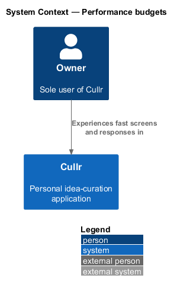
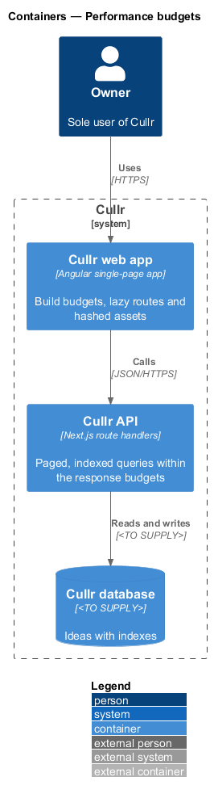
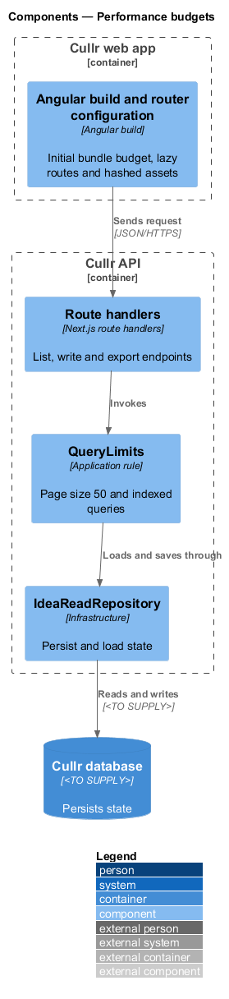
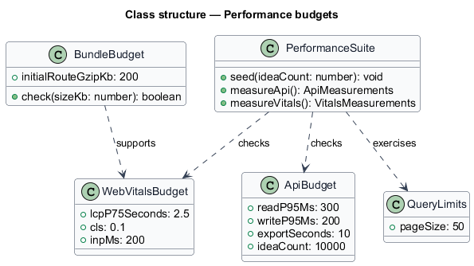
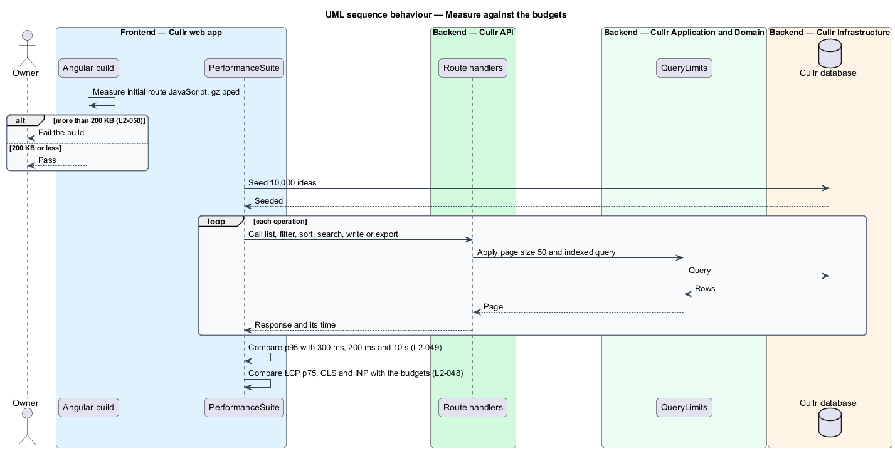

# Performance budgets

## Overview

Cullr is a personal idea-curation application for a single owner who logs about 100 ideas a day, so the data grows quickly. *Performance budgets* are the measurable limits that keep Cullr fast: how soon a screen shows content, how quickly the server answers and how much JavaScript the first screen downloads.

*Largest Contentful Paint* (LCP) is the time until the biggest visible element appears. *Cumulative Layout Shift* (CLS) measures unexpected movement of content. *Interaction to Next Paint* (INP) measures how soon the screen responds to an input. The 75th percentile (p75) and the 95th percentile (p95) are the values below which 75 or 95 percent of measurements fall.

## Description

The feature is cross-cutting. It adds limits and checks that the other features meet. It adds no screen.

- **Angular build budget** — a build check that fails when the JavaScript transferred for the initial route exceeds 200 KB gzipped (`L2-050`).
- **lazy-loaded routes** — every route other than the initial one loads on demand through the Angular router.
- **content-hashed assets** — static assets carry a hash in the file name and a long-lived cache header, so a repeat visit uses the cache (`L2-048`, criterion 3).
- **skeleton and reserved space** — loading states reserve the final size of their content to keep CLS at 0.1 or less.
- **`QueryLimits`** — application rule in the Cullr API. List responses return at most 50 rows (`browse-ideas`), and queries are indexed so that they meet the response budgets. The indexes are `<TO SUPPLY>`.
- **performance test suite** — a load test that stores 10,000 ideas and measures the p95 server response time for each operation, and a field and lab measurement of LCP, CLS and INP. The tools are `<TO SUPPLY>`.

Budgets:

| Measure | Budget | Scope |
|---|---|---|
| LCP at p75 | 2.5 s or less | Today and Ideas, cold load, mid-range phone on 4G |
| CLS | 0.1 or less | Every screen |
| INP | 200 ms or less | Every screen |
| List, filter, sort, search p95 | 300 ms or less | 10,000 ideas |
| Capture, edit, curate, archive, restore p95 | 200 ms or less | 10,000 ideas |
| Export | 10 s or less | 10,000 ideas |
| Initial route JavaScript | 200 KB gzipped or less | Initial route |

## Requirements

The feature realizes the following level-2 (L2) requirements. Each L2 requirement refines a level-1 (L1) requirement, cited by identifier.

| L2 ID | Refines (L1) | Requirement |
|-------|--------------|-------------|
| `L2-048` | `L1-016` | Screen load time. |
| `L2-049` | `L1-016` | API response time. |
| `L2-050` | `L1-016` | Bundle size. |

## Diagrams

### System context

The owner works with Cullr directly. No external system takes part.

### Containers

The Cullr web app calls the Cullr API, which stores state in the Cullr database.

### Components

The build and router configuration run in the browser build. The route handlers, the query limits and the read repository run in the Cullr API.

### Class structure

The budgets are values that the build and the performance suite check. The query limits cap the rows a list returns.

### Measurement sequence

The sequence shows a build failing on bundle size and the suite measuring the API against 10,000 stored ideas.

