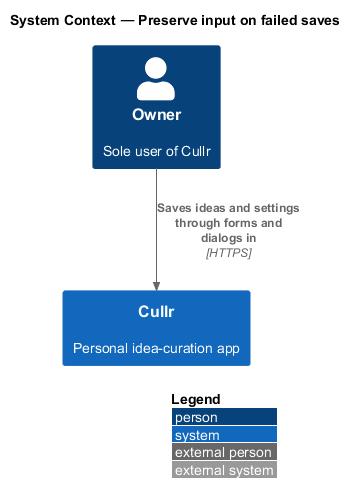
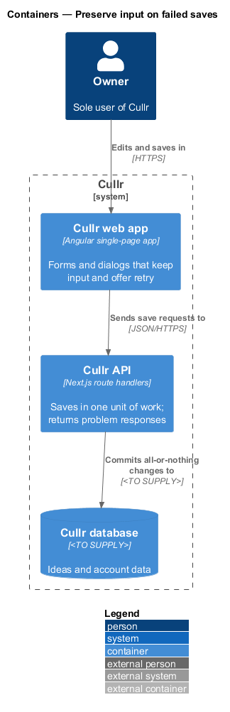
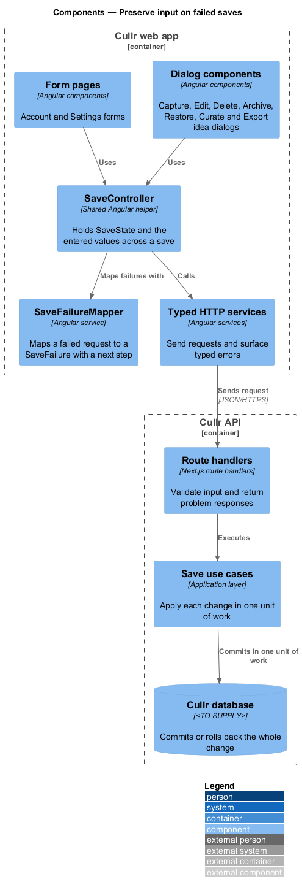
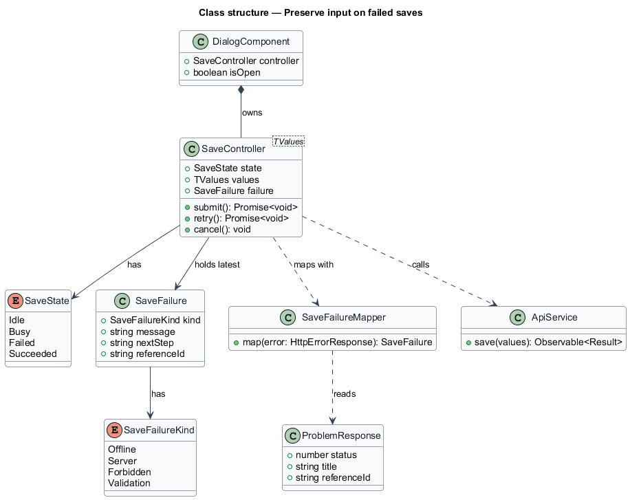
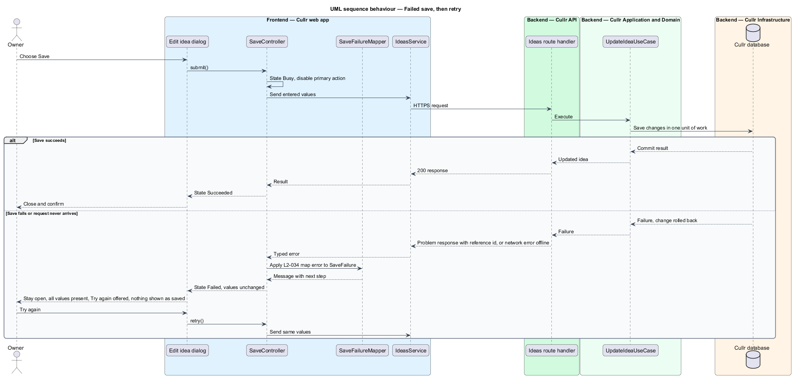

# Never lose input on failed saves

## Overview

Cullr is a single-owner idea-curation web app in which the owner types titles, summaries, reasons and settings into dialogs and forms. A *failed save* is a save request that does not complete, because the server returns an error, rejects the input or cannot be reached.

The feature guarantees that a failed save never costs the owner typing. Every entered value remains in place, the failure message says what to do next, an explicit retry is offered, and nothing is shown as saved unless the server committed it. The behaviour is cross-cutting: it applies to each dialog (Capture, Edit, Delete, Archive, Restore, Curate and Export idea) and to the Account and Settings forms.

## Description

The design is a shared frontend mechanism plus one backend guarantee.

- **`SaveController<TValues>`** — shared Angular helper owned by each dialog or form component. It holds the entered `values`, the current `SaveState` (`Idle`, `Busy`, `Failed`, `Succeeded`) and the latest `SaveFailure`. It exposes `submit()`, `retry()` and `cancel()`.
- **`SaveFailureMapper`** — Angular service that converts a failed request into a `SaveFailure`. A `SaveFailure` has a `kind` (`Offline`, `Server`, `Forbidden`, `Validation`), a `message`, a `nextStep` and an optional `referenceId` taken from the problem response (`L2-051`).
- **Dialog and form components** — render the controller state. They match the mocks `docs/mocks/dialogs/*/busy.html` and `failed.html`.
- **Typed HTTP services** — existing Angular services. They return typed errors and do not clear or reset caller state.
- **Route handlers and use cases** — each save runs as one unit of work in the application layer, so a failure rolls back the whole change. The database transaction mechanism is `<TO SUPPLY>`.

Behaviour by acceptance criterion:

- In `Busy` the primary action is disabled and relabelled, for example "Capturing…", and values stay editable only as the dialog design permits.
- In `Failed` the dialog or form remains open and all values are unchanged. A message such as "Couldn't save changes" is shown with a next step, for example "Your edits are still here — try again." The primary action reads *Try again* (`L2-034`, criteria 1 and 2).
- *Try again* calls `retry()`, which sends the same values. Cancel discards them only by explicit choice.
- The interface shows no partial change as saved: the idea list or detail view updates only after a successful result (`L2-034`, criterion 2).
- A failure of kind `Forbidden` or an unrecoverable `Server` error may also navigate to an error page (see the `error-pages` design); the dialog values remain available when the owner returns.

The mapped message texts for each kind are `<TO SUPPLY>`, apart from the wording in the mocks.

## Requirements

The feature realizes the following level-2 (L2) requirements. Each L2 requirement refines a level-1 (L1) requirement, cited by identifier.

| L2 ID | Refines (L1) | Requirement |
|-------|--------------|-------------|
| `L2-034` | `L1-012` | Never lose input |

## Diagrams

The context diagram shows the owner saving through Cullr. The container view is kept as well, because the all-or-nothing save is a backend guarantee.

The container diagram shows the web app holding the input and the API committing changes in one unit of work.

The component diagram shows the shared controller and mapper used by every dialog and form, and the save path in the API.

The class diagram shows the save state, the failure types and the controller that owns them.

The sequence shows a save that succeeds, and a failed save that keeps the values and offers a retry.

