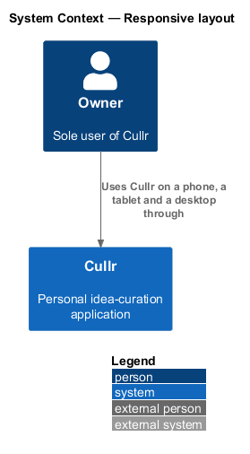
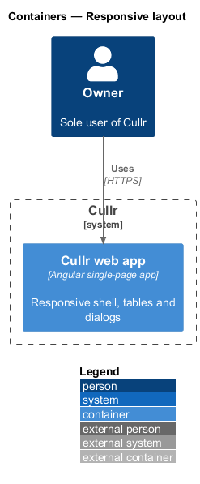
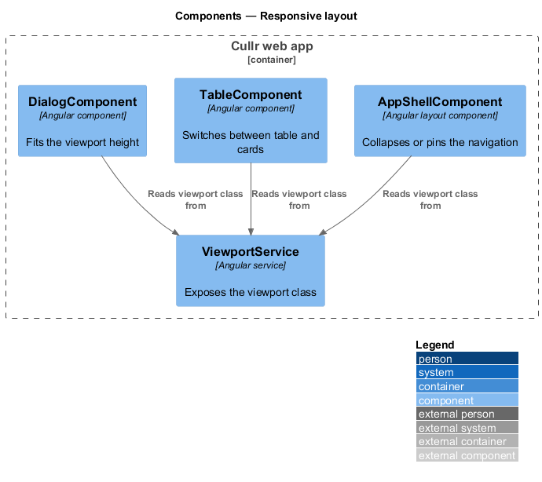
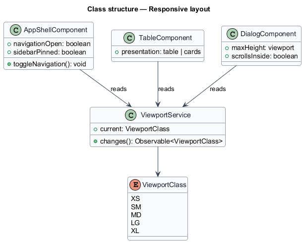
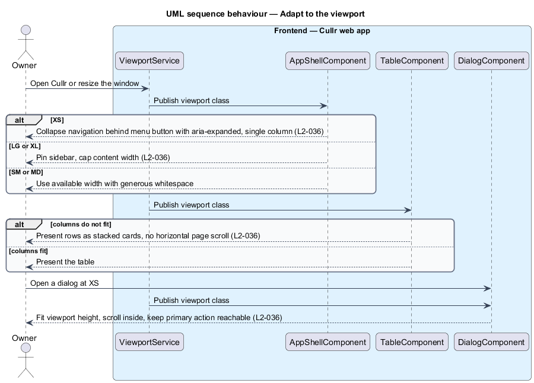

# Responsive layout

## Overview

Cullr is a personal idea-curation application for a single owner who works on a phone, a tablet and a desktop. *Responsive layout* is the set of rules that adapt every screen to the width of the viewport without losing any action.

The design system defines five *viewport classes*: XS below 576 px, SM from 576 px, MD from 768 px, LG from 992 px and XL from 1200 px. A *card* presentation of a table stacks each row as a small card so that the page does not scroll sideways.

## Description

The feature is a browser-only slice. It adds no endpoint and no stored data.

- **`AppShellComponent`** — Angular layout component from `navigation-shell`. At XS it collapses the navigation behind a menu button with `aria-expanded` and uses a single column. At LG and XL the sidebar is permanently visible and content width is capped at a readable maximum.
- **`ViewportService`** — Angular service that exposes the current viewport class from media queries, so that components such as tables can switch presentation.
- **table-to-card presentation** — on SM and MD, a table becomes cards when its columns do not fit without horizontal page scroll. On XS the Ideas rows are stacked cards.
- **dialog sizing** — at XS a dialog fits the viewport height, scrolls inside itself and keeps its primary action reachable.
- **layout primitives** — `container`, `stack`, `cluster` and `grid` from the design system carry the generous whitespace.

Key behaviours, by acceptance criterion:

- At XS, navigation is behind a menu button with `aria-expanded`, content is one column and every action remains available (`L2-036`, criterion 1).
- At SM and MD, content uses the available width with generous whitespace, and tables degrade to cards (`L2-036`, criterion 2).
- At LG and XL, the sidebar is permanently visible and content width is capped (`L2-036`, criterion 3).
- From 320 px to 1920 px there is no horizontal page scroll and no clipped content (`L2-036`, criterion 4).
- Dialogs at XS fit the viewport height and keep primary actions reachable (`L2-036`, criterion 5).
- Browser zoom to 200 percent keeps all functionality usable (`L2-036`, criterion 6).

### Screen composition

The Shell entry entry of `docs/screen-composition.md` lists the following components. The implementation shall use them and shall build locally only the UI marked local.

- **Library:** `top-bar`, `sidebar-navigation`, `layout-primitives`, `table`.
- **Local:** the Page shell (`.sidebar-layout`, `.page-header`, `.footer`), built once and shared by every authenticated dashboard page.

## Requirements

The feature realizes the following level-2 (L2) requirements. Each L2 requirement refines a level-1 (L1) requirement, cited by identifier.

| L2 ID | Refines (L1) | Requirement |
|-------|--------------|-------------|
| `L2-036` | `L1-013` | Responsive layout. |

## Diagrams

### System context

The owner works with Cullr directly. No external system takes part.

### Containers

The Cullr web app calls the Cullr API, which stores state in the Cullr database.

### Components

The shell, the table and the dialog read the viewport class from `ViewportService`. The Cullr API takes no part.

### Class structure

`ViewportService` publishes one viewport class. The shell, the table and the dialog each choose their presentation from it.

### Adaptation sequence

The sequence shows the shell, a table and a dialog responding to a change of viewport class.

