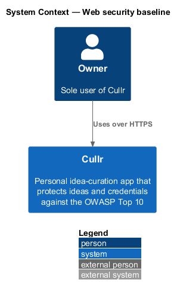
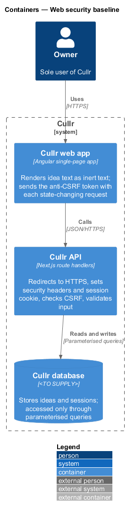
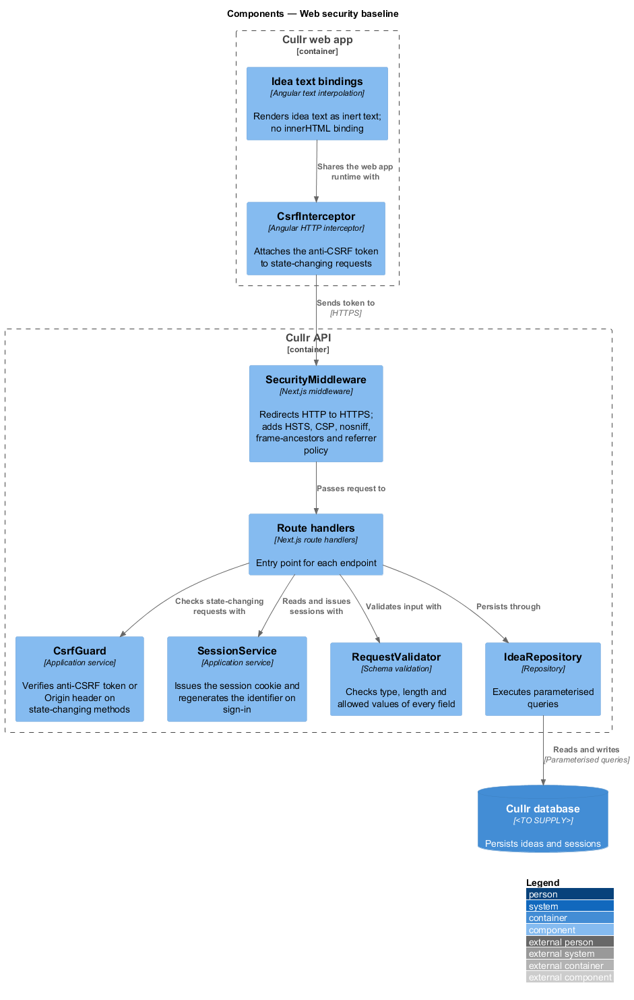
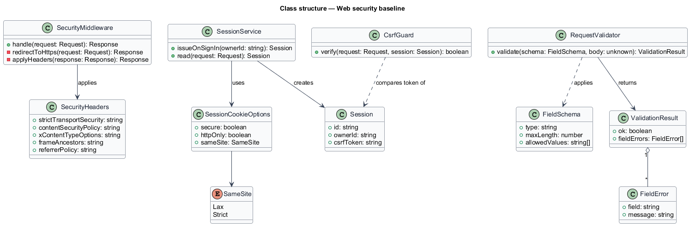
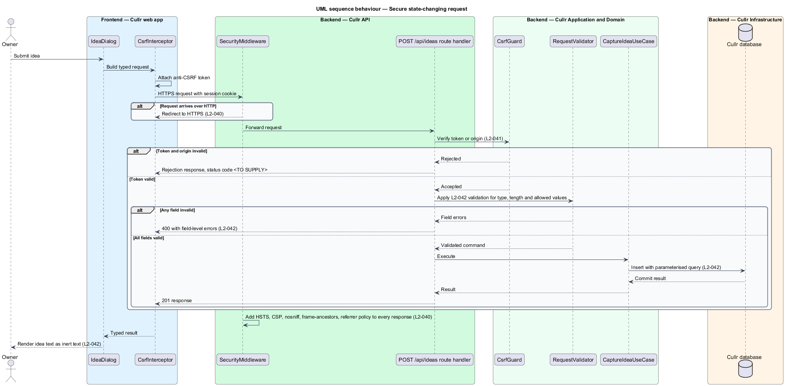
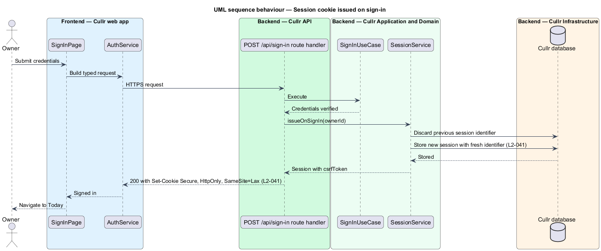

# Web security baseline

## Overview

Cullr is a personal idea-curation app used by one person, the owner. The *web security baseline* is the set of transport, header, session, input and output protections that every request and response passes through, whichever screen produced it. The baseline serves the security requirement to protect the owner's ideas and credentials against the OWASP Top 10 (`L1-015`).

The baseline covers three concerns. *Transport and headers* (`L2-040`) force HTTPS and constrain what the browser may load or embed. *Session security* (`L2-041`) protects the session cookie and rejects forged state-changing requests. *Input validation and output encoding* (`L2-042`) keep untrusted text from changing the behaviour of the server, the database or the browser.

Authorization and rate limiting are separate features, described in `access-control-and-rate-limits`. Password and secret handling is described in `credential-protection`.

## Description

The baseline sits in the Cullr API as middleware and shared services, with two small obligations in the Cullr web app.

- **`SecurityMiddleware`** — Next.js middleware that runs first on every request. It redirects HTTP requests to HTTPS and adds the response headers to every response: `Strict-Transport-Security`, a `Content-Security-Policy` that forbids inline script and third-party script, `X-Content-Type-Options: nosniff`, a `frame-ancestors` restriction and a strict referrer policy (`L2-040`, criteria 1 and 2). The exact policy strings are `<TO SUPPLY>`. Because the policy forbids inline script, the Angular build shall not emit inline script.
- **`SessionService`** — issues the session cookie with the `Secure`, `HttpOnly` and `SameSite=Lax` (or stricter) attributes, and regenerates the session identifier on sign-in (`L2-041`, criterion 1). The session carries a `csrfToken`.
- **`CsrfGuard`** — checks every state-changing request (non-`GET`) for a valid anti-CSRF token or an acceptable `Origin` header, and rejects the request otherwise (`L2-041`, criterion 2). The rejection status code is `<TO SUPPLY>`.
- **`CsrfInterceptor`** — Angular HTTP interceptor that attaches the token to state-changing requests.
- **`RequestValidator`** — validates every field on the server for type, length and allowed values, independent of client validation. Invalid input yields `400` with field-level errors (`L2-042`, criterion 1). The limits come from the field specifications (for example title 120 characters, summary 1,000, reason 500).
- **Output encoding** — the Angular templates bind idea text with text interpolation only, so HTML or script in idea text renders as inert text everywhere it is displayed, including toasts and dialogs (`L2-042`, criterion 2). Templates shall not use `innerHTML` bindings for idea text.
- **Parameterised queries** — every repository executes parameterised queries; string concatenation of input into queries is not used (`L2-042`, criterion 3).

The database engine is `<TO SUPPLY>`; the protections hold for any engine that supports parameterised queries.

## Requirements

The feature realizes the following level-2 (L2) requirements. The specification gives each only a title and acceptance criteria; the criteria are summarised in the Description above.

| L2 ID | Refines (L1) | Requirement |
|-------|--------------|-------------|
| `L2-040` | `L1-015` | Transport and headers |
| `L2-041` | `L1-015` | Session security |
| `L2-042` | `L1-015` | Input validation and output encoding |

## Diagrams

### System context

The owner reaches Cullr only over HTTPS. The context is near-identical to the container level for this slice, so the container and component views carry the detail.

### Containers

The Cullr API enforces the baseline; the Cullr web app sends the anti-CSRF token and renders idea text as inert text; the Cullr database receives only parameterised queries.

### Components

Every request passes `SecurityMiddleware`, then a route handler that calls `CsrfGuard`, `SessionService` and `RequestValidator` before reaching a repository.

### Class structure

`SecurityMiddleware` applies `SecurityHeaders`. `SessionService` uses `SessionCookieOptions` and creates a `Session`. `RequestValidator` returns a `ValidationResult` of `FieldError` items.

### Behaviour — secure state-changing request

A request is redirected to HTTPS when needed, checked for CSRF, validated field by field, and persisted through a parameterised query. Every response carries the security headers.

### Behaviour — session cookie on sign-in

Sign-in discards the previous session identifier, stores a fresh one and returns it in a `Secure`, `HttpOnly`, `SameSite=Lax` cookie.

