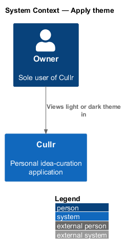
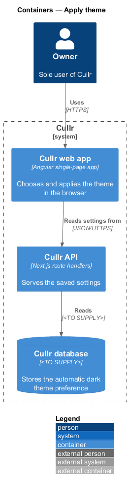
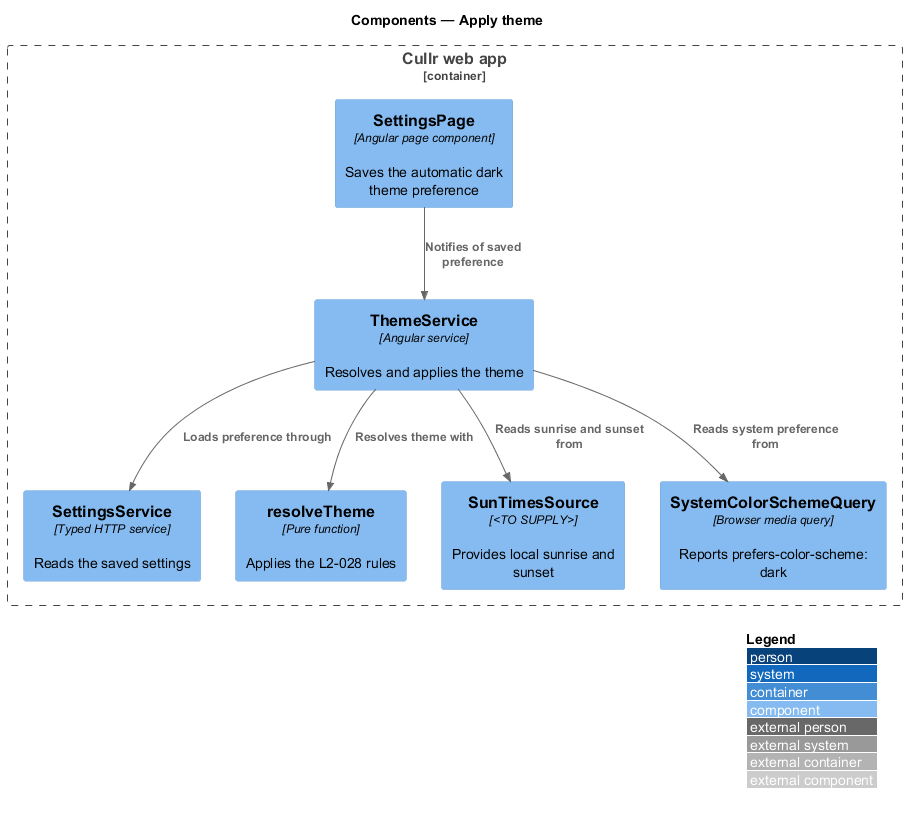
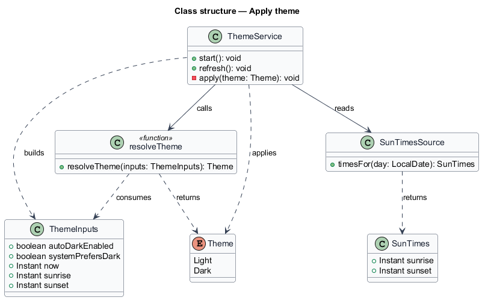
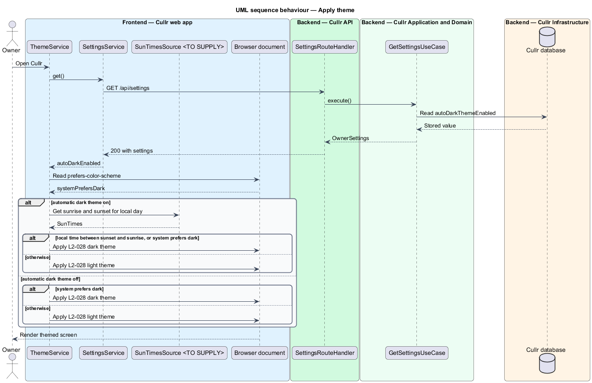

# Apply theme

## Overview

Cullr is a personal idea-curation application used by a single owner. The interface has a light theme and a dark theme, and the owner may prefer dark in the evening.

*theme* — set of colour values that gives the interface its light or dark appearance

*automatic dark theme* — preference ("Use dark theme automatically at night") that selects the dark theme between sunset and sunrise

*system preference* — operating-system or browser setting, exposed as the `prefers-color-scheme` media query, that states whether the owner favours dark

This feature decides which theme the interface shows and applies it. The decision runs in the browser only. The feature adds no endpoint and no stored data; it reads the preference that the `manage-settings` feature saves.

## Description

- **`ThemeService`** — Angular service in the Cullr web app. It loads the automatic dark theme preference through `SettingsApi`, gathers the inputs, calls `resolveTheme`, and applies the result to the document root. It re-evaluates when the saved preference changes, when the system preference changes, and when local time crosses sunrise or sunset.
- **`resolveTheme`** — pure function. It returns `Dark` or `Light` from a `ThemeInputs` value.
- **`ThemeInputs`** — value holding `autoDarkEnabled`, `systemPrefersDark`, the current time, and the sunrise and sunset times.
- **`SunTimesSource`** — provider of local sunrise and sunset times. The source (a location input, a browser capability, or a calculation library) is `<TO SUPPLY>`, as is the location it uses.
- **`SettingsApi`** — typed API client from `manage-settings`; it supplies `autoDarkThemeEnabled`.

Rules, by criterion of L2-028:

1. With the automatic dark theme on, the result is `Dark` when local time is between sunset and sunrise or the system prefers dark, and `Light` otherwise (criterion 1).
2. With the automatic dark theme off, the result is `Light` unless the system prefers dark (criterion 2).

The saved preference applies immediately after a save, as L2-026 criterion 2 states. When the settings load fails, the service falls back to the system preference alone. That fallback is a design choice and is `<TO SUPPLY>` for confirmation.

The mocks in `docs/mocks` preview the dark theme by adding `?theme=dark` to a page address, and the Settings mocks show the control. That parameter belongs to the mocks and is not a production behaviour.

## Requirements

The feature realizes the following level-2 (L2) requirement, which refines a level-1 (L1) requirement.

| L2 ID | Refines (L1) | Requirement |
|-------|--------------|-------------|
| `L2-028` | `L1-010` | Theme |

## Diagrams

### C4 context

The owner sees the theme in Cullr; no external system takes part.

### C4 container

Only the web app decides the theme. The API supplies the saved preference. The context and container views differ little for this slice; the component view carries the detail.

### C4 component

`ThemeService` combines the saved preference, the sun times and the system preference through the `resolveTheme` function.

### Class structure

The class diagram shows the theme enumeration, the input value and the services that produce it.

### Sequence — apply theme

On start, the service reads the preference and the system preference, then applies the theme for each branch of L2-028.

