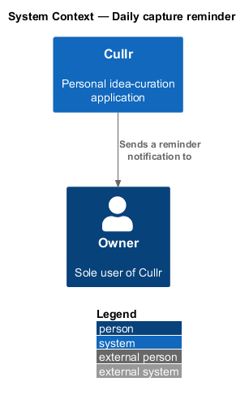
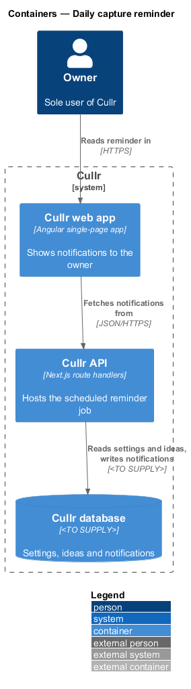
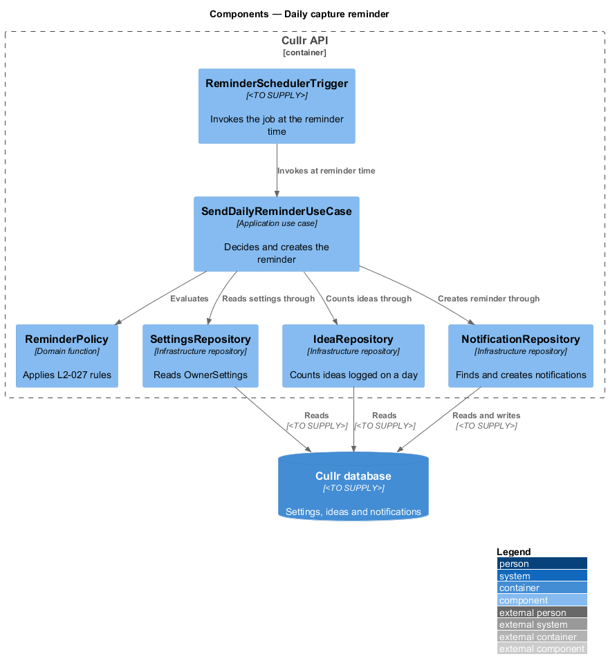
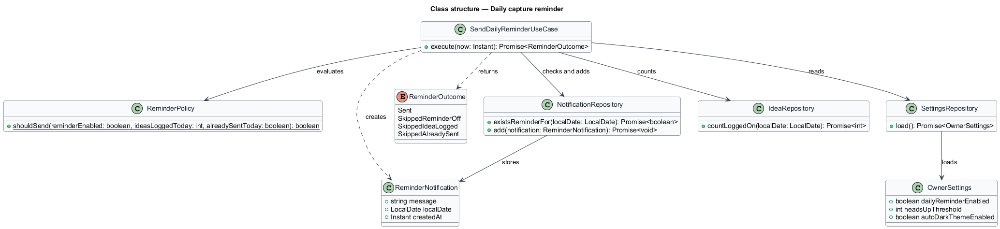
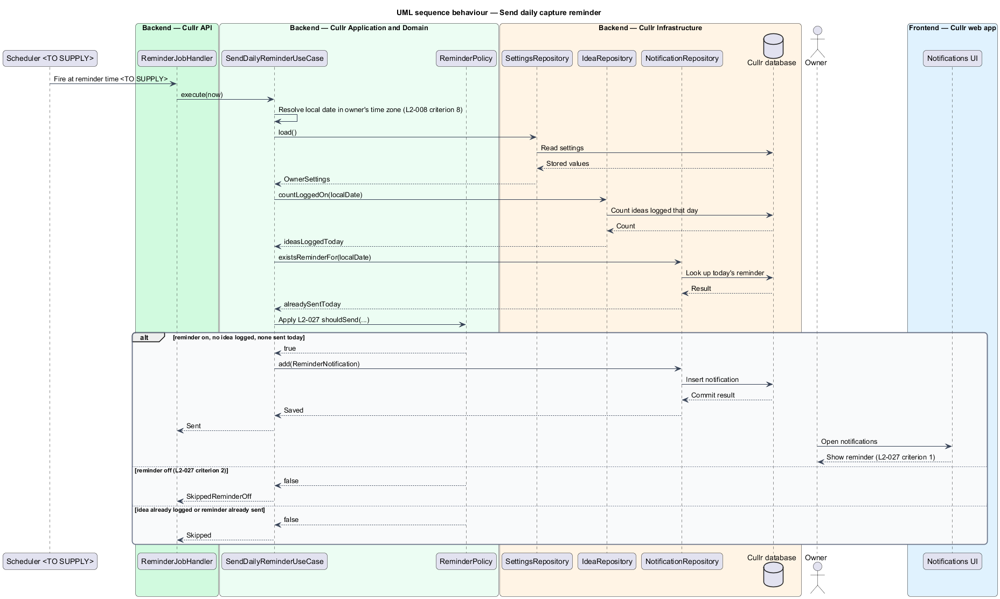

# Daily capture reminder

## Overview

Cullr is a personal idea-curation application used by a single owner who logs roughly 100 ideas a day. A habit of daily capture keeps the ideas flowing, so the owner may switch on a reminder.

*daily capture reminder* — notification that tells the owner no idea has been logged yet that day

*reminder time* — time of day, in the owner's time zone, at which Cullr checks whether the owner has logged an idea

*owner's time zone* — time zone that decides where one day ends and the next begins, with a default of `America/Toronto`

The preference is stored by the `manage-settings` feature as `dailyReminderEnabled`. This feature turns that preference into a notification. The specifications do not define the reminder time. The value is `<TO SUPPLY>` and shall be recorded before implementation.

## Description

The feature is a backend-only scheduled job; its only visible output is a notification in the existing notification list of the web app.

- **`ReminderSchedulerTrigger`** — mechanism that invokes the job at the reminder time. The mechanism (for example a hosted cron service, a platform scheduler, or an in-process timer) is `<TO SUPPLY>`.
- **`ReminderJobHandler`** — Next.js route handler in the Cullr API that receives the trigger and calls the use case. Whether the trigger is an HTTP call or an in-process call is `<TO SUPPLY>`.
- **`SendDailyReminderUseCase`** — application use case. It resolves the current local date in the owner's time zone (the rule of L2-008 criterion 8), loads the settings, counts the ideas logged that local date, checks for an existing reminder for that date, asks the policy for a decision, and creates the notification when the decision is positive.
- **`ReminderPolicy`** — domain function `shouldSend`. It returns true only when the reminder is on, no idea has been logged, and no reminder exists for that local date.
- **`ReminderNotification`** — record of the reminder, carrying its message, its local date and its creation time. The message wording is `<TO SUPPLY>`.
- **`SettingsRepository`**, **`IdeaRepository`**, **`NotificationRepository`** — infrastructure repositories over the Cullr database.

Key behaviours, by criterion of L2-027:

1. With the reminder on and no idea logged by the reminder time, one reminder notification is created that day (criterion 1). The once-per-day guarantee comes from the lookup `existsReminderFor(localDate)`, which makes a repeated trigger idempotent.
2. With the reminder off, the use case ends with `SkippedReminderOff` and creates nothing (criterion 2).

The reminder reuses the notification store of L2-024. L2-024 does not list a reminder event, so the notification text and its placement in the notification list are `<TO SUPPLY>`. No email is sent.

## Requirements

The feature realizes the following level-2 (L2) requirement, which refines a level-1 (L1) requirement.

| L2 ID | Refines (L1) | Requirement |
|-------|--------------|-------------|
| `L2-027` | `L1-010` | Daily capture reminder |

## Diagrams

### C4 context

Cullr sends the reminder to the owner; no external system is involved.

### C4 container

The job runs inside the Cullr API, which writes the notification that the web app later displays. The container view and the context view differ little for this slice; the component view carries the detail.

### C4 component

The trigger invokes one use case, which reads settings and ideas and writes the notification through three repositories.

### Class structure

The class diagram shows the use case, the policy function, the notification record and the outcomes the use case returns.

### Sequence — send reminder

A trigger leads to either one reminder or a skip. The alternates cover the reminder-off case (L2-027 criterion 2) and the already-logged or already-sent cases.

