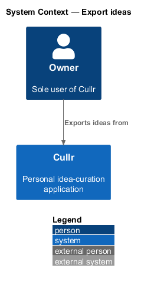
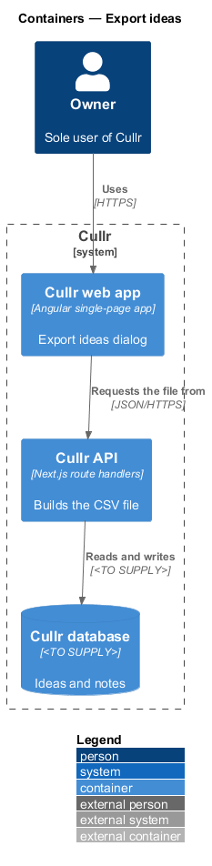
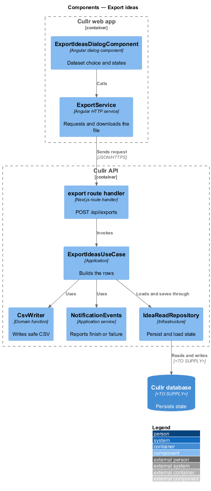
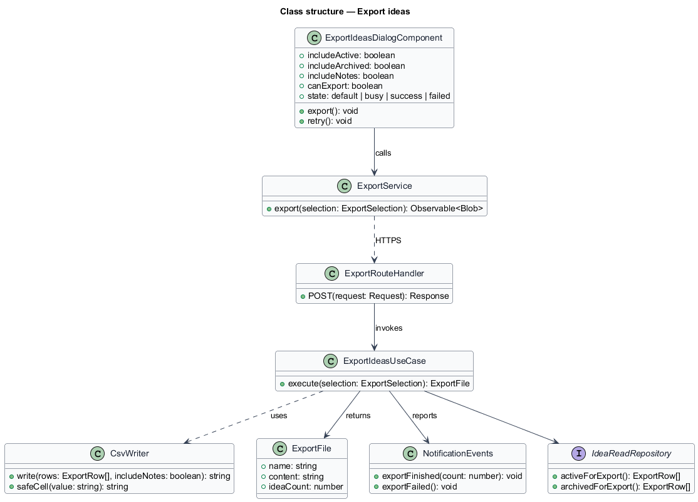
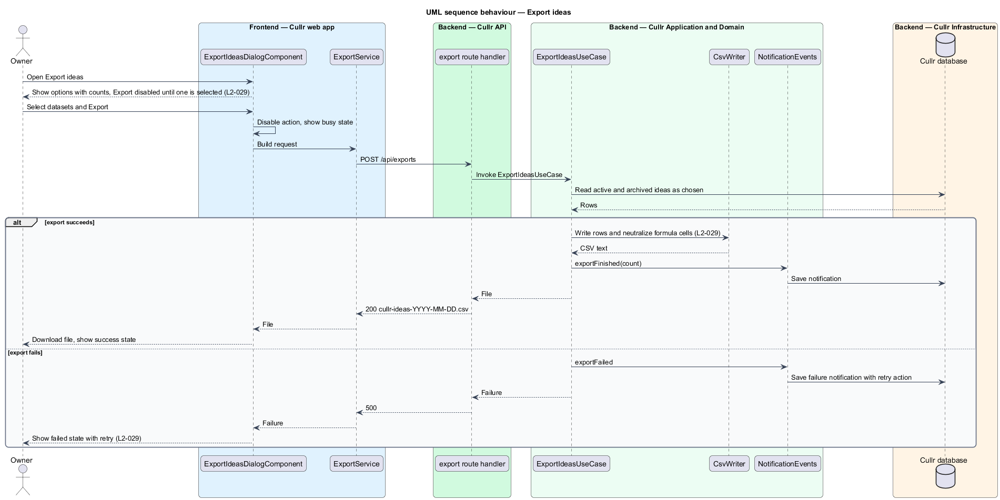

# Export ideas

## Overview

Cullr is a personal idea-curation application for a single owner. *Export ideas* is the capability that downloads the owner's ideas as a spreadsheet file. It lets the owner keep a copy outside Cullr.

The Export ideas dialog opens from Settings and from Ideas. The owner chooses one or more *datasets*: active ideas, archived ideas and critique notes. The file is a *CSV*, a plain-text table that spreadsheet programs open. A *formula injection* is a cell that starts with `=`, `+`, `-` or `@` and that a spreadsheet would run as a formula. The export neutralizes such cells.

## Description

The feature is a vertical slice from the dialog to the Cullr database.

- **`ExportIdeasDialogComponent`** — Angular dialog component. It shows the three options with their counts, disables Export while no dataset is selected, and shows the busy, success and failed states.
- **`ExportService`** — Angular HTTP service for `POST /api/exports`. It receives the CSV as a download named `cullr-ideas-<YYYY-MM-DD>.csv`.
- **export route handler** — Next.js route handler. It validates the selection and streams the file.
- **`ExportIdeasUseCase`** — application-layer use case. It reads the chosen datasets, builds one row per idea and reports the result to `NotificationEvents` (see `notification-events`).
- **`CsvWriter`** — domain function that writes the header and rows. Its `safeCell` function prefixes a cell that begins with `=`, `+`, `-` or `@` so that no spreadsheet evaluates it, and quotes cells that contain separators.
- **`IdeaReadRepository`** — query interface that returns the active and archived ideas and their counts. The database technology is `<TO SUPPLY>`.

Columns: title, summary, category, status, score, logged time, archive reason (archived ideas only) and, when selected, critique notes.

Key behaviours, by acceptance criterion:

- The dialog offers Active ideas with count, Archived ideas with count and Critique notes (`L2-029`, criterion 1).
- A selected dataset produces `cullr-ideas-<YYYY-MM-DD>.csv` with one row per idea (`L2-029`, criterion 2).
- With no dataset selected the Export action is disabled (`L2-029`, criterion 3).
- Cells that start with `=`, `+`, `-` or `@` are prefixed (`L2-029`, criterion 4).
- Export is busy and disabled in flight and shows the success state on completion. A failure shows the failed state with a retry action (`L2-029`, criteria 5 and 6).
- The file is produced within 10 seconds at 10,000 ideas (`L2-049`, criterion 3).

### Screen composition

The Export ideas dialog entry of `docs/screen-composition.md` lists the following components. The implementation shall use them and shall build locally only the UI marked local.

- **Library:** `dialog`, `checkbox` (`.choice`, `.choice__text`), `button`, `alert` (failed).
- **Local:** none.

## Requirements

The feature realizes the following level-2 (L2) requirements. Each L2 requirement refines a level-1 (L1) requirement, cited by identifier.

| L2 ID | Refines (L1) | Requirement |
|-------|--------------|-------------|
| `L2-029` | `L1-010` | Export ideas. The Export ideas dialog must download a spreadsheet. It opens from Settings and Ideas. |

## Diagrams

### System context

The owner works with Cullr directly. No external system takes part.

### Containers

The Cullr web app calls the Cullr API, which stores state in the Cullr database.

### Components

The dialog and service run in the browser. The route handler, use case, CSV writer, notification service and repository run in the Cullr API.

### Class structure

The use case reads ideas through the repository, writes them with `CsvWriter` and reports the outcome to `NotificationEvents`.

### Export sequence

The sequence shows a successful export and the failure path.

