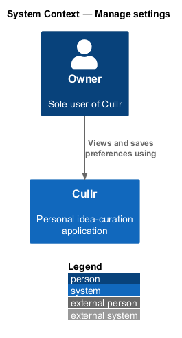
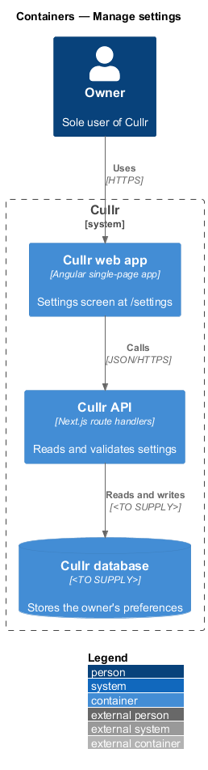
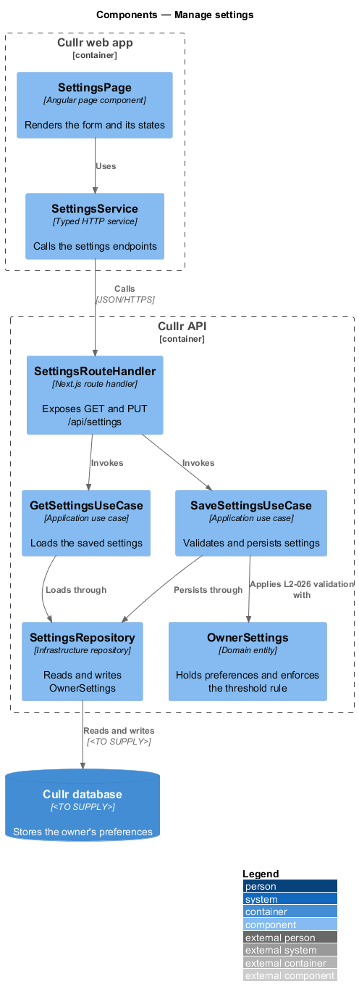
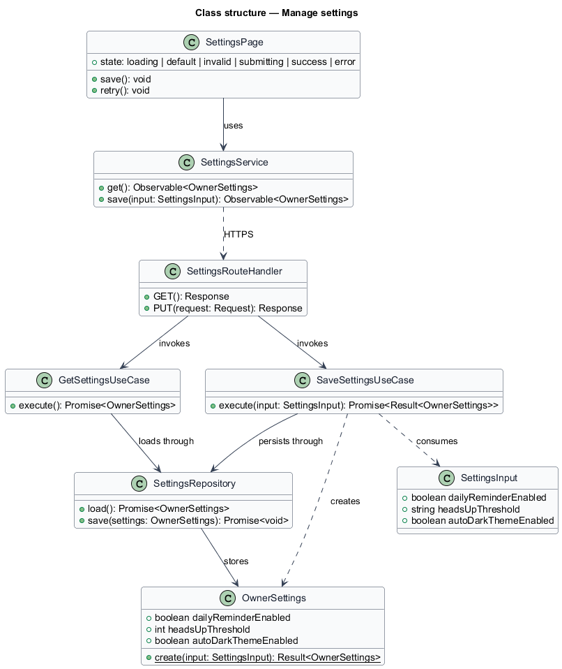
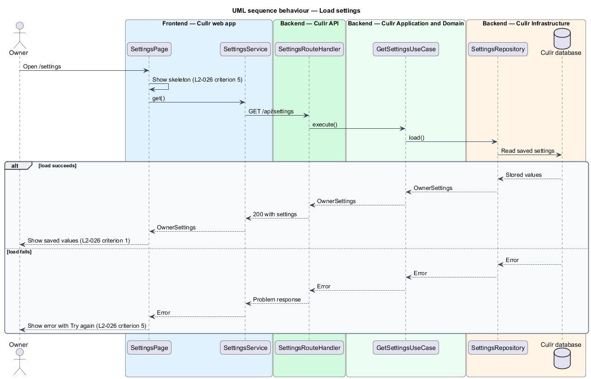
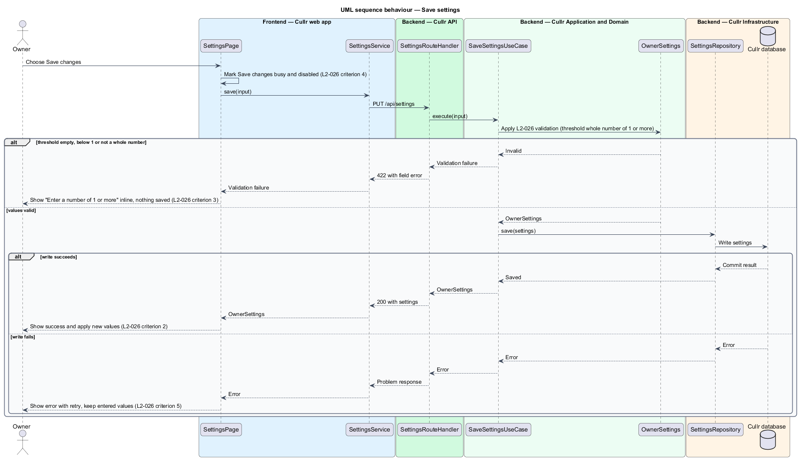

# Manage settings

## Overview

Cullr is a personal idea-curation application used by a single owner. The owner logs roughly 100 ideas a day, then critiques, curates and archives them. A few behaviours of the application depend on personal preferences, and this feature lets the owner view and change them.

*settings* — set of the owner's saved preferences that govern reminders, warnings and appearance

The Settings screen (`/settings`) exposes three preferences:

- *daily capture reminder* — switch that enables a notification when no idea has been logged by the owner's reminder time
- *heads-up threshold* — whole number of 1 or more at which Cullr warns the owner about the count of ideas logged in one day
- *automatic dark theme* — switch that selects the dark theme at night ("Use dark theme automatically at night")

The screen also hosts the entry point for the Export ideas dialog, which the `export-ideas` feature describes. The preferences are consumed by the `daily-reminder` and `apply-theme` features and by the heads-up notification of L2-024.

## Description

The feature is a vertical slice from the Settings screen to the database. Cullr has one owner, so the slice carries no user identifier.

- **`SettingsPage`** — Angular page component at `/settings`. It renders the states shown in the mocks (`loading`, `default`, `invalid`, `submitting`, `success`, `error`), keeps entered values on failure, and offers the Try again action.
- **`SettingsApi`** — typed Angular API client service. It calls `GET /api/settings` and `PUT /api/settings` and returns typed results or typed errors to the page.
- **`SettingsRouteHandler`** — Next.js route handler in the Cullr API. It maps HTTP requests to the two use cases and maps results to responses.
- **`GetSettingsUseCase`** — application use case that loads the saved `OwnerSettings`.
- **`SaveSettingsUseCase`** — application use case that builds `OwnerSettings` from a `SettingsInput`, rejects invalid input, and persists valid settings.
- **`OwnerSettings`** — domain entity holding `dailyReminderEnabled`, `headsUpThreshold` and `autoDarkThemeEnabled`. Its `create` function enforces that `headsUpThreshold` is a whole number of 1 or more.
- **`SettingsRepository`** — infrastructure repository that loads and saves `OwnerSettings` in the Cullr database.

Key behaviours, by criterion of L2-026:

1. On open, the page shows the three preferences with their saved values (criterion 1). A skeleton shows while loading.
2. A valid save is persisted, the success state ("Saved just now") shows, and the new values apply immediately (criterion 2). Applying immediately means the page updates the theme setting in memory without a reload.
3. An empty, sub-1 or non-integer threshold yields "Enter a number of 1 or more" inline, the summary "Fix 1 error to continue", and no write (criterion 3). The check runs in the domain entity so the server enforces it regardless of the client.
4. While the request is in flight, "Save changes" is busy and disabled (criterion 4).
5. A failed load shows an error with Try again; a failed save shows an error with retry; entered values are kept (criterion 5).

The default threshold value, the persistence engine and the transport of the stored record are `<TO SUPPLY>`.

## Requirements

The feature realizes the following level-2 (L2) requirement, which refines a level-1 (L1) requirement.

| L2 ID | Refines (L1) | Requirement |
|-------|--------------|-------------|
| `L2-026` | `L1-010` | Settings. The Settings screen (`/settings`) must save the owner's preferences. |

## Diagrams

### C4 context

The owner is the only person who interacts with Cullr for this feature, and no external system is involved.

### C4 container

The web app calls the API, and the API persists the preferences in the database. The database technology is `<TO SUPPLY>`.

### C4 component

The component view shows the page, the client, the route handler, the two use cases, the entity and the repository. The route handler never reaches the repository directly.

### Class structure

The class diagram shows the fields of `OwnerSettings` and the dependencies from the page down to the repository.

### Sequence — load settings

Opening the screen reads the saved values; a read failure ends in the error state with retry (L2-026 criteria 1 and 5).

### Sequence — save settings

Saving validates the threshold in the domain, then persists. The alternates cover validation failure (criterion 3) and write failure (criterion 5).

